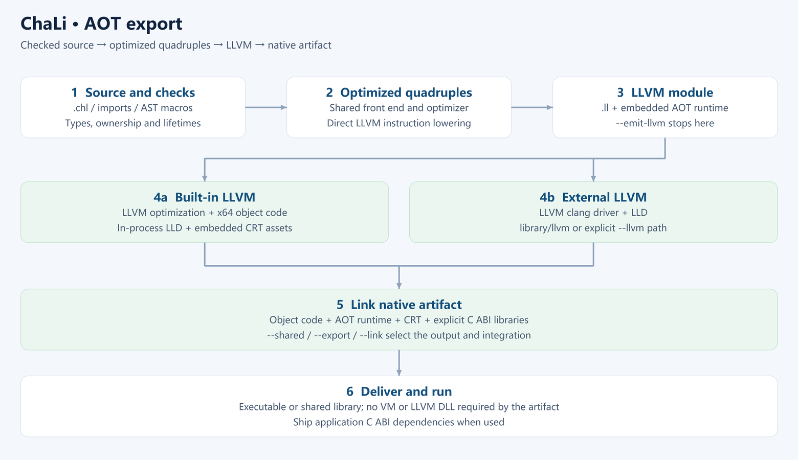

# The ChaLi Language

<!-- LANGUAGE NAVIGATION -->
**English** · [简体中文](README.cn.md)
<!-- END LANGUAGE NAVIGATION -->

ChaLi is a statically typed language with observable value semantics, explicit borrowing and moves, and scope-based resource cleanup. Its type, ownership and runtime rules are defined by the language. Supported hosts, export targets and external-library requirements are documented separately.

The ChaLi compiler's front end is generated from this repository's `source/chali.gram` by
[ParseEngine](https://github.com/rabbitc999/ParseEngine). It generates LLVM IR directly from the semantically checked AST and compiles native code through LLVM AOT. run uses checked compilation and execution; aot defaults to unchecked export. .svmb has been removed.

> This is the English edition. The Chinese edition is the default and is the one maintained first —
> see [中文 README](README.cn.md). Where the two disagree, the Chinese one wins.

See [current capabilities](doc/en/17-capabilities.md) for implemented features, defaults and platform limits; read the current version from [`VERSION`](VERSION).

## Name and capability references

| Area | Current behavior |
| --- | --- |
| Values | Independent observable values, explicit references and moves; copies may be removed when behavior is preserved |
| Macros | Hygienic names and parameter categories with defined evaluation rules |
| Type erasure | Any retains concrete type information and follows ownership and provenance restrictions |
| References | Static source and lifetime checks; unsafe and foreign-code preconditions remain separate |
| Interfaces | Generic behavior, inheritance and concrete-type matching; known calls may be devirtualized or inlined |

See [naming and related capabilities](doc/en/37-name-freeze.md) for references and verification entry points.

## Compilation

Conditional preprocessing precedes the generated parser. Hygienic AST macros expand during semantic analysis alongside type inference. After name, type, generic and borrow checks, the C++ backend generates LLVM IR directly from the checked AST; LLVM optimizes it and generates native code. Normal run and AOT paths skip quadruple generation, serialization and assembly. The .svmb format has been removed.


## AOT export

Run `./ChaLi.exe aot input.chl --out build/program --checked` to lower the semantically checked AST directly to LLVM code, generate machine code and link a native artifact. The static variant embeds LLVM and LLD; the external variant uses `library/llvm/` or the clang path passed through `--llvm`. Use `--emit-llvm` to export only the LLVM module.



The generated application needs no VM or LLVM DLL. Ship application-specific C ABI dynamic libraries when required. See [LLVM AOT compilation](doc/en/38-aot.md) and the Chinese book's [AOT export chapter](doc/book/en/24-aot-export.md) for the supported scope and steps.

## Execution

`run` compiles and executes checked AOT machine code. `aot` exports unchecked native products by default. The compiler and embedded generator assets omit the VM interpreter; shared memory, ownership, host callbacks and thread services remain. `.svmb` export has been removed.

## Documentation

[Current capabilities and limits](doc/en/17-capabilities.md) describe implementation, defaults and platform contracts.

The [library API reference](doc/library/README.md) (Chinese) covers the module list with signatures, overloads, parameters, return values, error contracts and runnable examples.

| Document | Audience | What it covers |
| --- | --- | --- |
| [Documentation index](doc/en/README.md) | Everyone | Jump to any of the documents below by "what do you want to do" |
| [00 Vision](doc/en/00-vision.md) | Decision makers, prospective users | The three dilemmas of software delivery and ChaLi's answers, including "who should not use it" |
| [01 Quickstart](doc/en/01-quickstart.md) | First-time users | Install, first program, command cheat-sheet |
| [02 Language tour](doc/en/02-language-tour.md) | Experienced developers | 14 runnable snippets walking through what ChaLi looks like |
| [03 Core concepts](doc/en/03-core-concepts.md) | Users going deeper | Value semantics, non-null references, resource management without a GC |
| [04 Language reference](doc/en/04-language-reference.md) | Day-to-day writers | Syntax, semantics and common errors by topic |
| [05 Delivery security](doc/en/05-delivery-security.md) | Teams shipping outward | Four delivery forms, the four steps, reverse-engineering cost, boundary statement |
| [06 Cross-platform deployment](doc/en/06-deployment.md) | People doing deployment | Source execution and bytecode deployment, desktop / embedded Linux, resources and limits |
| [07 Standard library overview](doc/en/07-stdlib-overview.md) | Anyone asking "what can it do" | standard-library modules by capability |
| [08 Host integration and C ABI](doc/en/08-host-integration.md) | Integrators | `abi` blocks, host glue bindings, type mapping, nullable references |
| [09 Toolchain](doc/en/09-toolchain.md) | Daily `chali` users | Scenario commands, options, `chali.toml`, diagnostics, debugging |
| [10 Roadmap](doc/en/10-roadmap.md) | Contributors, long-term users | Short/mid/long-term goals and "things we explicitly will not do" |

Companion resources:

- [`example/samples/`](example/samples/) — runnable formal samples; expected stdout in [`example/expected/`](example/expected/).
- [`example/samples-error/`](example/samples-error/) — samples expected to fail; diagnostics in [`example/expected-error/`](example/expected-error/).
- [`doc/examples/`](doc/examples/) — examples that need a companion project layout (ABI, SQLite).
- [Full grammar reference (EBNF)](doc/14-grammar-ebnf.md) — the authoritative form of the grammar.

The 36 old developer-facing chapters have been removed; the 7 that are standalone specs
([14 EBNF](doc/14-grammar-ebnf.md)–[20 memory allocator](doc/20-memory-allocator.md)) moved into `doc/`
and were rewritten in the current voice. The rest remain in Git history.

The Chinese and English technical text keep corresponding code examples, including comments. The book and selected guides have executable verification scripts; reports identify the compiler, commands and checks actually run. The [English book](doc/book/en/README.md) contains technical chapters and appendices without the Chinese literary extras.

## Build

From the repository root:

```sh
sh gen.sh          # generate the parser first; requires ParseEngine
make               # build chali and build/chali-frontend/libparser.a
./chali example/samples/hello.chl
sh check.sh        # run the passing and the failing samples
```

After cloning, run `sh gen.sh` with ParseEngine available, then `make`. Parser sources
(`chali_parser.cpp` / `chali_parser.hpp` / `chali_parser_user.h` / `chali_main.cpp`) are
generated locally and are not committed to the repository.

Regenerate for the initial build and after changing these source files; commit the sources,
not the generated parser files:

```sh
sh gen.sh          # regenerate the front end from chali.gram with IELR (needs the [ParseEngine](https://github.com/rabbitc999/ParseEngine) grammar generator)
```

- `source/chali.gram` / `source/chali_token.gram` (the grammar)
- `source/chali_semantics.cpp` / `source/semantics/*.cpp` (expanded into `chali_parser.cpp` by `%epilogue include`)
- `source/chali_driver.cpp` (expanded into `chali_main.cpp` by `%main include`)

> Forgetting `gen.sh` is the easiest trap to fall into: `chali_main.cpp` is a **generated copy** of
> `source/chali_driver.cpp`, and `make` alone does not regenerate it — you will see "I changed it but
> nothing happened".

`gen.sh` needs a ParseEngine grammar generator. The simplest option is to drop it into the
repository root as `./ParseEngine[.exe]`; it also works if it stays in a neighboring ParseEngine
checkout (`gen.sh` looks for `../ParseEngine/build/bin/` automatically).

### Building with annotations and reflection

The default toolchain build includes annotation and reflection support in both the front end
and the VM runtime:

```sh
make                # defaults to CHALI_WITH_REFLECTION=1 STACKVM_WITH_REFLECTION=1
make reflection     # retained as an explicit enable target
```

Reflection is a fixed part of the language and is **not trimmable**: `CHALI_WITH_REFLECTION` and
`STACKVM_WITH_REFLECTION` are pinned to `1` (unlike the `NO_CHALI_*` trim options these are not
switches), so the reflection front end and runtime are always built in and compilation always runs
the full reflection pass.

Source compilation emits reflection metadata and its artifact feature flag by default;
`--no-reflection` omits that metadata and rejects annotations/reflection use in the program. It
decides this artifact only and reduces no compiler workload (metadata and query-source generation
still run). Use `--no-reflection` when targeting a board VM without reflection support.
`make` pins both macros to 1; only a hand-written `-D` build can turn reflection off, and that path
exists solely to validate the compiler itself — it is not a supported trim configuration.

## Quick usage

```sh
./chali run  example/samples/hello.chl        # checked AOT (default)
./chali new  hello-chali                       # create a new application project
```

`chali` is the single toolchain entry point: front end, both C/C++ export tiers, project generation
and cleanup all live in the same program. See [Toolchain](doc/en/09-toolchain.md) for the remaining
subcommands and `--mode`.

### Debugging

VS Code uses GDB/MI to debug an AOT program with DWARF source locations and variables. Source breakpoints, continue, step in/over/out, stack frames, parameters, locals and expressions are supported. Debug builds retain symbols at O0; normal release builds retain highest optimization. See [Native AOT debugging](doc/en/43-native-debugging.md).

### Diagnostics

Syntax errors carry **file, line and column**, echo the offending line, and underline it at the
error position with a caret run sized to the token:

```text
syntax error: example/samples-error/syntax_extern_impl_removed.chl line 2 col 8: expected one of identifier / constant(const) / mutable(mut) / new(new) (17 candidates), found impl(impl)
   |
 2 | extern impl Value : Some = binding;
   |        ~~~~
```

- The width of the underline is the length of the offending token; tabs are padded to 4-column tab
  stops and CJK characters count as 2 columns, so the column never drifts.
- When the error sits in a module loaded by `import`, it points at **the file that actually
  contains the mistake**, not at the expanded main file.
- Internal token names are no longer shown: `SEMI` → `semicolon(;)`, `IMPL` → `impl(impl)`,
  `VARIABLE` → `identifier`.
- Diagnostic text follows the display language (`CHALI_LANG=zh|en` or `--lang`); the same error
  reads:

  ```text
  期望 标识符 / 常量(const) / 可变(mut) / 新建(new) 等 17 个之一，实际是 实现(impl)
  expected one of identifier / constant(const) / mutable(mut) / new(new) (17 candidates), found impl(impl)
  ```

  Semantic errors (type mismatch, undefined symbol, …) are still Chinese for now — those messages
  live in the compiler core, not in the diagnostic presentation layer.

## Language tour

```c
struct Item { int64 value; };

void main() {
    List<Item> items;
    Item item;
    item.value = 7;
    items.push(item);
    println("{}", items.len());

}
```

Value semantics is the default: assignment, argument passing and return all copy; share explicitly
by taking a reference (`T const&` read-only, `T mut&` writable), and there are no pointers and no
address arithmetic. There is no GC, so resources are released deterministically when they leave
scope. The standard library ships containers, iterators, JSON/TOML, regex, paths and processes,
networking, SQL, linear algebra, concurrency and more — see
[Standard library overview](doc/en/07-stdlib-overview.md).

## Configuration

A project can set the run mode, compiler path and search directories in `chali.toml`; command-line
arguments win. Example:

```toml
[chali]
run = "run"
opt_level = 2
main = "src/main.chl"
```

`[chali] main` names the project's entry file: when you run **without** a source file it is used as
the entry point (i.e. build the project); when you pass a file explicitly it is a single-file
compilation and the main file is ignored. Projects generated by `chali new` carry this line by
default.

## Linux deployment

Desktop and embedded Linux use ordinary operating-system hosts and the same VM core. Build the host
and native dependencies for the target architecture; deploy bytecode, data and layout files together.
Use `--memory-size` for the memory budget. Modules depend on the native glue registered by the host.
See [deployment](doc/en/06-deployment.md).

## Repository layout

```text
chali/
├── chali.gram / chali_token.gram   grammar: token declarations and productions
├── gen.sh / Makefile               build and self-checks
├── source/                         compiler front end, exporter and glue
│   ├── std/                        standard library modules (.chl)
│   ├── glue/                       host-side C++ glue
│   ├── allocator/                  desktop allocator
│   ├── lsp/ dap/                   editor integration
│   └── generator/            entry point that generates standalone compiler projects
├── library/                        reusable C++ libraries and the board host
│   ├── ircode/                     Quad IR and AOT shared runtime
│   ├── bignum/ json/ toml/ console/ lztext/ …
│   └── …
├── doc/                            user-facing documentation (00–20, 99)
│   ├── en/                         English edition (index + 00–11, 13, 99; 15 files)
│   └── library/                    library API reference (one page per module)
├── example/                        examples (samples, error samples, calculator, …)
├── tests/                          Python acceptance scripts
├── tools/                          helper scripts (icon, overview figure, …)
└── sql-chali/                      minimal SQL usage example
```

Full details live in the README of each directory and in the [documentation](#documentation)
section above.

## License

Apache License 2.0, see [LICENSE](LICENSE) and [NOTICE](NOTICE).

Generated parser sources, headers and reports live in `source/`. Object files and the parser archive live in `build/chali-frontend/`, keeping the repository root clear.

SQLite and miniz are downloaded as pinned build dependencies instead of being vendored; see [build dependencies](doc/en/42-build-dependencies.md).
