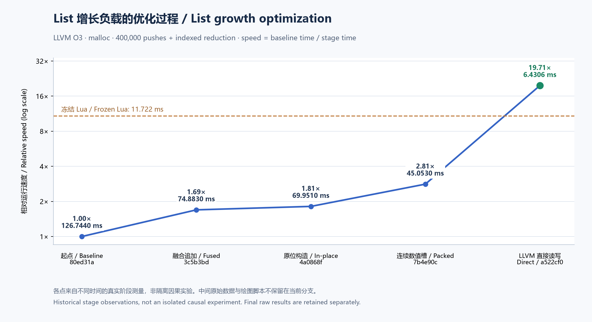

# ChaLi 1.0.11 性能对比：版本基线与其他语言

<!-- LANGUAGE NAVIGATION -->
[English](en/12-performance.md) · **简体中文**
<!-- END LANGUAGE NAVIGATION -->

本文比较真实的 **ChaLi 1.0.10 发行版与 1.0.11 本轮实现**，同时列出冻结的 C++、Rust、Lua 和 Java JIT 基线，并补充 C、Go、Node 与 Python 的较早可核对参考。当前结果中，List 与字符串读取快于 Lua；Map、Set、字符串拼接、切片和查找仍慢于 Lua。接口在内存池配置下满足当前 40／400 ms 门限，默认 malloc 配置的多态接口本轮未满足 400 ms。

本轮优化在 List 的 LLVM 直接读写完成后收束。文章记录实际结果，不把未完成的性能目标改写为通过，也不将跨语言参考重新标成当前版本的新测量。

以下数据冻结于性能阶段的 a522cf0；随后补充的 1.0.11 接口值、联合匹配、传播转换和卫生宏功能另做功能验收，未重新计时，不将这些数据重标为后续编译器的实测结果。

## 测量身份与环境

正式测量日期为 **2026-10-29**，宿主为 Windows 10 x64、AMD Ryzen 5 5600X（6 核、12 逻辑处理器）。两版 ChaLi 均为外置 LLVM 变体，使用相同的 clang **23.1.4**；计算内核采用 LLVM O3／LTO，C 计时壳为 `-O3 -DNDEBUG`。两版均按默认 512 MiB 堆预算构建。

| 被测编译器 | 实际源码身份 | SHA-256 |
| --- | --- | --- |
| 1.0.10 原发行产物 | `001cdd6`，原始字节未修改 | `35e6d2602054e757452ce570bf7fd6051a2b46d196e1e8ab2da3fa69b974ce6b` |
| 1.0.11 本轮实现 | `a522cf0` | `7f781f0ad808c2bfc5414302907b12fbb9e493d437b30a6695a1ceb87a6f736c` |

基准驱动快照为 `0bb28ec`。具体命令、编译器及内核摘要、输入源码摘要、校验值、每个进程的原始输出和样本保存在[最终数据](../benchmarks/results/1.0.11-final/results.json)。文档定稿会重新生成内嵌资产并构建编译器；本文数据保持上述被测字节的身份，最终文档构建的功能门禁单独记录，避免给旧测量重标二进制摘要。

1.0.10 默认使用内存池，没有 malloc 切换选项。因此同时测量三个统一配置：**1.0.10 pool、1.0.11 pool、1.0.11 malloc**。前两列观察相同分配器下的版本变化，malloc 列保留系统分配器基准。各列覆盖完整负载集合，没有按用例拼接不同配置的最优成绩。

1.0.10 的隔离 ABI 构建需补充同版本 AST 头搜索路径，并显式指定 clang。驱动从其 Git 快照提取头文件；发行编译器、标准库、运行时和生产 LLVM 生成代码均未修改。两个版本本身都从语义检查后的 AST 生成 LLVM，表中的提速包含后端、存储与运行时的组合变化。

## 计时和校验方法

每个负载、每个配置运行 **5 个独立进程，每进程 5 个样本**，对 25 个纳秒观测取中位数；三配置共 51 个组合、**1275 个正式样本**。每进程先用种子 0 预热一次，再依次测量种子 0～4。三个配置按轮次轮换先后顺序。

编译、链接、模块初始化和全局 `setup` 不计时。`work` 内的局部对象创建、增长、复制、返回前清理均计时。基础数组在 `work` 内初始化；枚举、嵌套结构、多维数组、接口 receiver 和字符串输入在计时前构造。接口视图与分派、拼接结果、切片及其清理仍位于 `work` 内。

每项计时前读取 CPU 占用，达到 40% 则暂缓。本轮启动记录为 **1%～27%**，这只描述启动检查；CPU 未固定频率、未绑核，也没有声称全程完全空闲。其他语言参考来自较早的冻结测量，不能把跨日差异当作严格的隔离因果实验。

所有组合先做结果核对。特征与字符串按五个种子逐项验证独立模型；基础负载核对冻结的 `sink`，Map／Set 的参考还包含独立算术模型。浮点链沿原 C 壳使用 `sink = sink * 0.5 + work(seed)`，其他整数计时壳归并预热和各轮结果。计时进程退出码或 stderr 异常均拒绝接纳。

比较采用相同规模、种子、操作序列和结果。各语言的库内部算法与优化策略可以不同；短函数允许内联，LLVM 也可以消除等价的冗余计算。字符串拼接额外采用 Lua 的 `table.concat` 作为较快参考，比较完成同一拼接任务的不同实现策略。

## 测试代码和规模

| 负载及完整源码 | 规模与操作 |
| --- | --- |
| [int_chain](../benchmarks/perf/int_chain.chl) | 4,000,000 轮整数依赖链，`(acc * 48271 + i) & 2147483647` |
| [float_chain](../benchmarks/perf/float_chain.chl) | 1,000,000 轮 double 乘加依赖链 |
| [call](../benchmarks/perf/call.chl) | 1,000,000 轮短函数 `mix(x)=x*17+3`，允许内联 |
| [array](../benchmarks/perf/array.chl) | 4,000,000 轮访问 16 元素数组；数组初始化在 work 内 |
| [list_growth](../benchmarks/perf/list_growth.chl) | 空 List 追加 400,000 个 int64，再按下标归并全部元素 |
| [map_growth](../benchmarks/perf/map_growth.chl) | 20,000 个离散整数键，插入、覆盖、命中／未命中、每三项删除并重插 |
| [set_growth](../benchmarks/perf/set_growth.chl) | 20,000 个离散整数键，含重复插入、命中／未命中与删除重插 |
| [enum_payload](../benchmarks/features/enum_payload.chl) | 256 个值，四类载荷，262,144 次依赖索引与借用匹配 |
| [interface_mono](../benchmarks/features/interface_mono.chl) | 262,144 次派生接口调用，单一具体实现类型 |
| [interface_poly](../benchmarks/features/interface_poly.chl) | 262,144 次调用，四种选择模式落到三个具体实现类型 |
| [struct_nested](../benchmarks/features/struct_nested.chl) | 256 个嵌套结构，262,144 次跨层字段及定长数组访问 |
| [array_2d](../benchmarks/features/array_2d.chl) | 64×64 数组，262,144 次依赖下标访问 |
| [array_3d](../benchmarks/features/array_3d.chl) | 16×16×16 数组，262,144 次跨层访问 |
| [string_read](../benchmarks/strings/cases.chl) | 8,448 字节 UTF-8 输入，131,072 次 byteAt/unwrap 与归并 |
| [string_concat](../benchmarks/strings/cases.chl) | 2,048 个 33 字节块，结果 67,584 字节；校验全部结果字节 |
| [string_slice](../benchmarks/strings/cases.chl) | 1,024 对切片，宽度 33／66／99／132 字节，包含比较与清理 |
| [string_find](../benchmarks/strings/cases.chl) | 256 次有起点的字节查找，包含中文、emoji、ASCII 与未命中 |

完整的 C++／Rust／Lua 实现位于 [benchmarks/perf](../benchmarks/perf)；特征对应实现及 Java 计时壳位于 [benchmarks/features](../benchmarks/features)；字符串各语言实现位于 [benchmarks/strings](../benchmarks/strings)。[版本驱动](../benchmarks/versions/run.py)只包装计算函数、构建和调度，不生成生产 LLVM IR。

例如，List 测量的完整计算内核如下。它从空容器开始，保留实际增长、下标访问与作用域清理；没有为某一语言提前 reserve。

```chali
#export("f_work")
int64 work(int64 seed) {
    List<int64> xs;
    int64 i = 0;
    while (i < 400000) {
        xs.push(i * 3 + seed);
        i = i + 1;
    }
    int64 total = seed;
    i = 0;
    while (i < 400000) {
        total = (total * 31 + xs[i]) & 2147483647;
        i = i + 1;
    }
    return total;
}
```

计时壳的完整实现见 [timing.c](../benchmarks/features/timing.c) 和[基础负载包装](../benchmarks/perf/build_aot.py)。关键边界是每次只包住 `kernel(seed)`：

```c
const int64_t start = now_ns();
const int64_t value = kernel(seed);
const int64_t elapsed = now_ns() - start;
sink += value;
printf("rep %lld\n", (long long)elapsed);
```

## 其他语言基线的配置与来源

其他语言本轮**没有重新测量**。保留其原版本、工具、时间、25 个样本及原始来源摘要：

| 参考 | 配置及说明 | 最终保留数据 |
| --- | --- | --- |
| C++ | MinGW g++ 11.2.0、C++17、`-O2`；作为附加参考，ChaLi 使用 O3 | [C++ O2](../benchmarks/results/1.0.11-final/references/cpp-o2.json)、[字符串](../benchmarks/results/1.0.11-final/references/strings.json) |
| Rust | rustc 1.98.1、`-O`；载荷枚举、结构和数组保留对应原生实现 | [基础](../benchmarks/results/1.0.11-final/references/basic.json)、[特征](../benchmarks/results/1.0.11-final/references/features.json)、[字符串](../benchmarks/results/1.0.11-final/references/strings.json) |
| Lua | Lua 5.5.1 官方 VM、默认 GC；拼接同时保留逐次拼接和 table.concat，验收取后者 | [基础](../benchmarks/results/1.0.11-final/references/basic.json)、[字符串](../benchmarks/results/1.0.11-final/references/strings.json) |
| Java | HotSpot 22.0.1、`-Xbatch`；接口为 JIT 热身后稳态测量 | [特征与热身记录](../benchmarks/results/1.0.11-final/references/features.json) |

Java 每个 JVM 至少预热 256 次计算函数且不少于 1 秒，并核对 `work` 的 C2 level 4 编译发生在采样前；5 个 JVM 分别保留证据。[JIT 日志](../benchmarks/results/1.0.11-final/references/java-jit)对应这两项接口参考。该表不混入 Java 解释模式或启动耗时。

基础 Lua／Rust、特征及字符串参考主要记录于 2026-10-28。C++ O2 的前四项复用 2026-10-27 的旧参考；原报告明确说明当时未记录源码摘要，只能按初始入库源码、工具主版本、宿主及校验值核对，本文保留这一证据限制。其余 C++ O2 项目记录于 2026-10-28。Lua 的 `table.concat` 参考为 **4.1247 ms**，逐次拼接为 **25.6472 ms**；后者不用于更快目标的判定。

## 结果：基础计算与容器

下表及后续各表单位均为 **ms，中位数越低越快**。“—”表示没有冻结的对应参考，不代表零成本。

| 负载 | 1.0.10 pool | 1.0.11 pool | 1.0.11 malloc | C++ O2 | Rust -O | Lua 5.5.1 |
| --- | ---: | ---: | ---: | ---: | ---: | ---: |
| `int_chain` | 0.8655 | 0.8634 | 0.8633 | 4.33 | 0.864 | 27.762 |
| `float_chain` | 1.2956 | 1.2955 | 1.3017 | 1.303 | 1.295 | 6.106 |
| `call` | 0.2156 | 0.2156 | 0.2156 | 0.903 | 1.083 | 16.955 |
| `array` | 76.4546 | 9.8599 | 9.878 | 6.998 | 6.22 | 41.553 |
| `list_growth` | 374.1419 | 3.4057 | 6.4306 | 2.137 | 1.624 | 11.722 |
| `map_growth` | 345.0664 | 179.256 | 169.6778 | 1.836 | 2.021 | 4.676 |
| `set_growth` | 291.6311 | 123.9572 | 148.9858 | 1.8816 | 1.554 | 4.563 |

整数、浮点和短函数与 1.0.10 基本持平，不将末位微小差异解释为明确进步。固定数组从 76.4546 降到 pool 下 9.8599 ms。List 在相同 pool 配置下由 374.1419 降到 3.4057 ms，观察到约 **109.86 倍**的速度比；默认 malloc 的 6.4306 ms 也低于 Lua 的 11.722 ms。

Map／Set 相对 1.0.10 有改善，但与 Lua 仍有明显距离：pool 的 Map 为 179.256 ms，对应 Lua 4.676 ms；Set 为 123.9572 ms，对应 Lua 4.563 ms。它们不能因为 List 通过而计为通过。

### C、Go、Node 和 Python 的补充冻结基线

下表沿用 2026-10-27 的记录：C 为 GCC 11.2.0 `-O2`，Go 为 1.27.1 默认优化，Node 为 26.5.0 的默认 V8，Python 为 CPython 3.12.3。只采用四项可核对的基础负载，源码与归档快照 `06478a5` 一致，校验值也与本轮一致；未重新运行这些语言。

| 负载 | 1.0.11 pool | 1.0.11 malloc | C O2 | Go | Node / V8 | CPython |
| --- | ---: | ---: | ---: | ---: | ---: | ---: |
| `int_chain` | 0.8634 | 0.8633 | 4.322 | 4.657 | 72.138 | 341.159 |
| `float_chain` | 1.2955 | 1.3017 | 1.302 | 1.546 | 1.301 | 31.328 |
| `call` | 0.2156 | 0.2156 | 0.869 | 1.047 | 16.097 | 126.102 |
| `array` | 9.8599 | 9.878 | 7.145 | 7.252 | 60.173 | 212.077 |

这些较早记录没有当时的源码摘要，当前保留的摘要明确标为“归档快照源码”，不能当作采样时摘要。Node 沿原记录的一次预热，不具有本篇 Java 接口那样的 C2 稳态证据。它们作为补充参考，不参与当前 Lua／接口门限；完整样本、工具版本和证据限制见[补充基线](../benchmarks/results/1.0.11-final/references/supplementary-basic.json)。没有给缺失的容器或特征负载填入推测值。

## 结果：载荷枚举、接口、复杂结构与多维数组

| 负载 | 1.0.10 pool | 1.0.11 pool | 1.0.11 malloc | C++ O2 | Rust -O | Java JIT |
| --- | ---: | ---: | ---: | ---: | ---: | ---: |
| `enum_payload` | 338.9185 | 0.8353 | 0.8329 | 1.6884 | 1.214 | — |
| `interface_mono` | 1205.4122 | 33.1437 | 33.9196 | 0.2825 | — | 0.2845 |
| `interface_poly` | 2350.4833 | 314.9402 | 437.8846 | 0.5095 | — | 1.0682 |
| `struct_nested` | 2164.7936 | 1.7447 | 1.7991 | 1.1711 | 1.0543 | — |
| `array_2d` | 3.0841 | 0.6521 | 0.6445 | 0.5668 | 0.5433 | — |
| `array_3d` | 3.1952 | 0.7649 | 0.7802 | 0.6806 | 0.6277 | — |

载荷枚举及嵌套结构的降幅来自版本间多项工作，包括减少重复物化、精化标量存储、地址视图及可证明纯访问的数据区快照；这些数据未将每项机制分别隔离计时。借用匹配、复杂字段访问与原生多维数组仍按原负载校验。

单态接口在两种分配器下均低于 40 ms。多态接口 pool 为 314.9402 ms，满足 400 ms；malloc 为 437.8846 ms，本轮未满足。两者都仍明显慢于已热身的 Java JIT。表中没有 Lua 接口参考，不能据此声称快于 Lua。

## 结果：String

| 负载 | 1.0.10 pool | 1.0.11 pool | 1.0.11 malloc | C++ O2 | Rust -O | Lua 5.5.1 |
| --- | ---: | ---: | ---: | ---: | ---: | ---: |
| `string_read` | 3610.6336 | 2.5745 | 2.5599 | 0.5427 | 0.5437 | 6.0014 |
| `string_concat` | 1865.9993 | 6.662 | 14.2666 | 0.1012 | 0.0699 | 4.1247 |
| `string_slice` | 2068.8784 | 9.6465 | 9.7462 | 0.1329 | 0.1323 | 0.3515 |
| `string_find` | 12212.2159 | 14.1769 | 11.7448 | 0.1123 | 0.0451 | 0.1703 |

String 输入包含中文和 emoji，操作按 UTF-8 字节定义。读取从 1.0.10 pool 的 3610.6336 ms 降到 1.0.11 pool 的 2.5745 ms；malloc 为 2.5599 ms，两者均低于冻结 Lua 的 6.0014 ms。此处覆盖了多个已实现优化的组合，包括立即消费 `byteAt().unwrap()` 的标量路径及字符串／地址快速路径。

拼接、切片和查找仍未达到较快 Lua 参考。尤其切片 1024 对结果与查找 256 次任务中，拥有型结果、复制、临时值、存储寻址及查找实现的成本仍显著；本文没有把这些差距归结为单一原因，也没有用读取成绩抵消它们。

## 分配器对照与逐项判定

同一 1.0.11 编译器的 pool 在 17 项中有 10 项中位数更低；按各项等权的耗时几何比计算，`pool / malloc = 0.9028`，约低 **9.72%**。Map、String 读取和查找等负载也有 malloc 更快的结果，所以保留两列完整结果，缺省 malloc 策略没有因本次报告修改。这个汇总只描述分配器对照，验收仍逐项判断。

当前保存数据判定为：

| 统一配置 | 有条件的项目 | 通过 | 未通过 | 未设门限 |
| --- | ---: | ---: | ---: | ---: |
| 1.0.11 pool | 13 | 8 | 5 | 4 |
| 1.0.11 malloc | 13 | 7 | 6 | 4 |

条件为有 Lua 参考的项目耗时严格更低，以及单态接口 ≤40 ms、多态接口 ≤400 ms；C++ O2 是参考。四项未设门限为载荷枚举、嵌套结构、二维和三维数组。判定直接重算原始样本，结果见 [pool](../benchmarks/results/1.0.11-final/gate-pool/results.json) 与 [malloc](../benchmarks/results/1.0.11-final/gate-malloc/results.json)，两组整体判定均为未全部通过。

## List 优化过程



图中保持 **LLVM O3、malloc 和同一 List 负载**，纵轴为本轮起点耗时除以各阶段耗时。阶段包括追加融合、原位构造、连续数值槽及 LLVM 直接读写；末点为本轮正式版本对照的 6.4306 ms。各点来自不同时间的真实阶段测量，图不构成隔离因果实验。

纯数值宿主槽在本机由 104 字节降至 16 字节；总占用还包括头部、容量及分配器元数据。LLVM 命中路径直接读取槽或在已有容量内追加，完整句柄、对象表失效代次、下标及容量检查继续保留。扩容、元素借用、复杂值和不适用布局使用兼容路径。功能矩阵覆盖 bool、char、各宽度整数和 float32／64，性能表中的容器数据专门测量 int64。

按本轮数据保留要求，当前分支只保留这张静态图、最终版本数据及最终冻结参考；阶段性测量、可编辑绘图数据与临时脚本不保留。源提交及此前测量仍可从保留的 Git 历史追溯。

## 复现和证据边界

在 Windows x64 仓库根使用已核对的两个编译器：

```powershell
python benchmarks/versions/run.py --build-only --new build/perf-baselines/a522cf0/chali-1.0.11-llvm-external-windows-x64.exe --new-source a522cf0 --out tmp/reproduce-performance
python benchmarks/versions/run.py --measure-only --out tmp/reproduce-performance
python benchmarks/evaluate_saved.py --reports benchmarks/results/1.0.11-final/results.json --configuration 1.0.11-pool --out tmp/recheck-pool
```

构建与验证完成后检查 CPU 再计时。最终报告里的临时程序路径用于记录当时实际命令；相应中间产物在归档后清理，复现应重新构建。`evaluate_saved.py` 只检查保存数据，不重新跑其他语言，也不会让性能未通过的报告变成通过。

本轮是 17 个固定微负载，不包含应用启动、编译速度、RSS、完整业务程序、迭代器专门负载或闭包专门负载；也不把 Windows x64 数据外推到其他系统与架构。源码 a522cf0 的布局、16 种视图／回退组合、完整 AOT 专项、同步回调及容量验证见[专项记录](../tools/history/20261029/chali-1.0.11-numeric-list-llvm/README.md)。本次性能与文档快照只重新生成内嵌资产与编译器，未运行全量门禁；同版本后续修订不能据此重标测量。后续功能与验证安排保留在 TASK.md。
