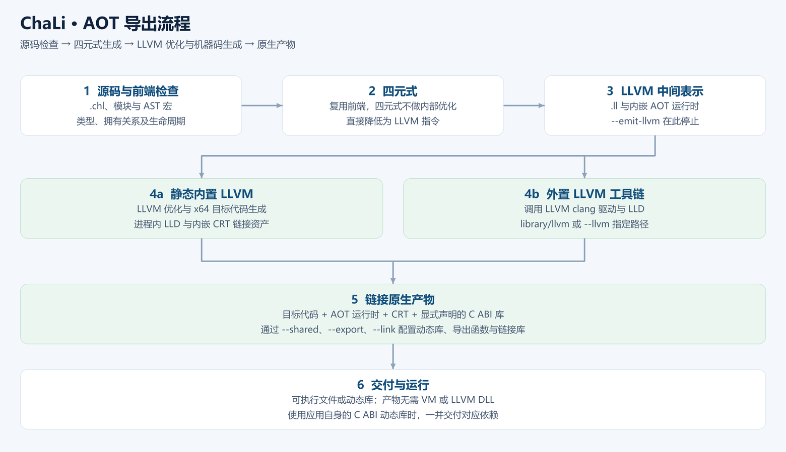

# 第 25 章 AOT 导出：把程序交付为原生产物

<!-- LANGUAGE NAVIGATION -->
[English](en/25-aot-export.md) · **简体中文**
<!-- END LANGUAGE NAVIGATION -->

从 1.0.8 起，run 使用 checked AOT，aot 默认 unchecked 导出。--debug 保留原生源码行和变量信息；VS Code 断点、单步和变量查看通过 GDB 实现，见[原生调试](../43-native-debugging.md)。.svmb 导出已删除。

写完程序以后，你可以把它导出为目标平台的可执行文件，也可以导出动态库供 C 程序调用。AOT 是提前编译：编译器在交付前完成 LLVM 优化、机器码生成和链接，使用者直接运行生成的程序。

本章先导出一个带列表的小程序，再说明工具链选择、运行期检查和动态库接口。完整选项见 [LLVM AOT 编译](../38-aot.md)。

## 25.1 从源码到原生产物



前端完成类型、借用和生命周期检查后，生成四元式（内部优化缺省关闭，交给 LLVM）。AOT 后端将这些四元式直接转换为 LLVM 中间表示，再由 LLVM 生成目标代码，由链接器将目标代码、AOT 运行时和所需库组合成原生产物。

这里的“四元式”是 ChaLi 的中间表示；图中的“LLVM 中间表示”是后端使用的另一种表示。输出的 `.ll` 文件可以保留，用于检查 LLVM 指令或接入其他 LLVM 工具。

## 25.2 导出第一个程序

把下面的代码保存为 `aot_demo.chl`：

```chali
int64 total(List<int64> const& values) {
    int64 result = 0;
    for (int64 value in values) {
        result = result + value;
    }
    return result;
}

void main() {
    List<int64> values;
    values.push(10);
    values.push(20);
    values.push(30);
    println("total={}", total(&values));
}
```

在 Windows PowerShell 中执行：

```sh
chali aot aot_demo.chl --out build/aot_demo --checked
./build/aot_demo.exe
```

输出为：

```text
total=60
```

`--out` 后面是输出前缀。Windows 下会得到可执行文件 `.exe`、LLVM 模块 `.ll` 和 C ABI 头文件；Linux 下可执行文件通常没有扩展名。输出针对编译时选择的目标平台，交付时需要匹配操作系统与处理器架构。

只想导出 LLVM 模块时使用：

```sh
chali aot aot_demo.chl --out build/aot_demo --emit-llvm
```

这个命令不运行机器码生成和链接工具。

## 25.3 选择内置或外置 LLVM

两种编译器都接受前面的 `aot` 命令，区别在于生成机器码和链接时从哪里取得 LLVM。

| 编译器变体 | 使用前的准备 | 适合的使用方式 |
| --- | --- | --- |
| 内置 LLVM | LLVM、LLD 与 CRT 链接资产已编入编译器 | 希望编译器单个 exe 就能导出 Windows x64 原生产物 |
| 外置 LLVM | 准备 `library/llvm/` 工具链或通过 `--llvm` 指定 clang | 希望编译器体积较小，单独管理工具链 |

在仓库根目录准备外置工具链：

```sh
python library/llvm/setup.py
chali aot aot_demo.chl --out build/aot_demo --checked
```

准备脚本会在线下载固定版本的工具链并核对 SHA-256，缓存位于 `build/`，源码仓库不保存 SDK。静态构建通过 `python tools/fetch_llvm_sdk.py` 下载预编译 LLVM/LLD 与匹配 GCC，并隔离全部构建对象。使用其他工具链时，可传入 `--llvm 路径`，也可设置 `CHALI_LLVM_CLANG`。静态变体默认使用内置后端，显式传入 `--llvm` 时使用指定的外置工具。

自己构建静态变体时执行 `make llvm-static`。构建程序会自动下载固定版本的预编译 LLVM/LLD 静态开发库和匹配 GCC，核验 SHA-256，并安装到 `build/dependencies/llvm/static-sdk/`。首次准备需要网络和磁盘空间，不编译 LLVM 源码；具体依赖见 [LLVM 工具链说明](../../library/llvm/README.md)。当前静态分发验收目标为 Windows x64。

编译器的 LLVM 链接方式不会让导出的应用依赖 LLVM DLL。应用使用的外部 C ABI 动态库仍须按应用的链接约定交付。

## 25.4 检查与支持范围

AOT 默认启用四元式中的数组边界和空指针检查，与 VM 的默认检查配置一致；`--checked` 可以显式声明这一选择。仅在调试或性能对照时使用 `--unchecked` 关闭这些检查。列表的下标、对象存活与实际内存访问验证始终执行，活跃元素引用期间也不能进行会改变列表结构的操作。

AOT 当前支持基本数值运算、分支、循环、直接调用、递归和固定数组，以及列表的创建、长度、追加、插入、下标读写、删除、弹出、清空、查找、复制与 `for-in` 引用。列表元素支持整数、浮点、字符串、嵌套列表和支持叶子布局的结构体；复制后各自拥有独立存储。

自定义语言 `opcode` 可以将创建、复制和销毁绑定到可达的 ChaLi 函数或显式声明的 C ABI 函数，`move` 沿用前端的移动语义。标准库宿主调用复用 VM 的堆、对象表和胶水注册，语言函数体继续运行 LLVM 生成的机器码。捕获闭包、函数值与同步回调保留原有参数、返回值和清理协议；隔离线程使用同源的消息、通道、事件和任务控制服务。JSON/TOML、反射序列化、图像、网络与数据结构等组合调用由 VM/AOT 差分样例核对。

学生信息管理系统使用反射、网络和数据库等服务，其 AOT 构建与原生启动步骤见第 26 章 26.1。数据库和前端页面仍按应用的实际宿主环境准备；平台能力见[当前能力](../17-capabilities.md)。

## 25.5 导出动态库与 C ABI

`export` 放在普通函数定义前，标记供 AOT 原生调用方使用的公开入口。例如：

```chali
#export("f_add")
int64 add(int64 left, int64 right)
{
    return left + right;
}
```

执行 `ChaLi aot library.chl --shared --out build/library` 生成动态库和 C ABI 头文件，
导出函数名以生成的头文件为准（上例为 `f_add`）。动态库源码可以没有 `main`；
可执行程序仍需要 `main`。调用方先调用 `chali_init()`，再使用导出函数，最后调用
`chali_finish()`；全局初始化与清理分别在这两个入口执行。`--export` 可以额外指定导出函数。
模块限定名和重载使用各自的实际标签；应以生成头文件核对完整签名。

程序调用外部 C 函数时，使用第 21 章介绍的 `abi` 声明；声明中的库按实际调用路径链接或由宿主加载，也可以重复使用 `--link 库路径` 添加库。标量参数与返回值按对应的 C ABI 类型传递。结构体、引用、数组、可选引用和同步回调等复杂形状通过类型化宿主适配器封送，导出时需要兼容的 GNU C++17 编译器；语言函数体仍直接降低到 LLVM。拥有资源的句柄须遵循创建和销毁协议，不可把运行时句柄当作机器函数指针。

## 25.6 在 VS Code 中构建

打开并保存 `.chl` 文件，使用编辑器标题栏的构建按钮，选择“可执行文件（LLVM AOT）”。也可以从命令面板或资源管理器右键菜单构建原生可执行文件。默认输出到工程的 `build` 目录；输出目录、外置 LLVM 路径和检查选项可在 ChaLi 设置中调整。

插件提供内置 LLVM 与外置 LLVM 两个安装变体，二者是同一扩展的替代版本。构建结束后查看“ChaLi 构建”输出中的诊断和产物路径，再运行生成的应用。`.svmb` 已删除，不再作为构建或交付格式。

## 25.7 小结

导出前先确认程序使用的库已适配 AOT，再选择内置或外置 LLVM 编译器。`aot` 生成原生产物，`--emit-llvm` 保留 LLVM 模块，`--checked` 控制四元式运行期检查；动态库通过生成的 C ABI 头文件与宿主对接。

## 25.8 习题

1. 将列表中的 `30` 改为 `70`，导出后应得到什么结果？
2. 只导出 LLVM 模块时应加哪个选项？
3. 静态 LLVM 编译器会自动消除应用自身的 C ABI 动态库依赖吗？
4. `--checked` 会关闭或开启列表的存活验证吗？

### 参考解答与验收要点

1. 将例子中的 `30` 改为 `70`，重新导出并运行。参考结果为 `total=100`，需要重新编译才能改变已导出的程序。
2. 只导出 LLVM 模块时应加哪个选项？参考答案：`--emit-llvm`，该路径不执行目标代码生成和链接。
3. 使用静态 LLVM 编译器后，应用自己依赖的 C ABI 动态库是否也会自动消失？参考答案：不会；这些依赖仍按应用的链接方式交付。
4. 列表下标与对象存活验证始终执行；`--checked` 控制的是四元式中的运行期检查。

## 下一步

下一章先介绍[不安全代码](24-不安全代码.md)，理解原始存储与裸指针的边界，再进入[第 26 章 学生信息管理系统](26-学生信息管理系统.md)，将前面学过的结构体、反射和标准库组织成完整项目。

## 25.9 番外：行囊里的工具

改写自欧阳修《卖油翁》。

陈康肃公善导出，当世无双，公亦以此自矜。尝于家圃编译，有卖油翁释担而立，睨之，久而不去。见其原生产物十发十中，但微颔之。

康肃问曰：“汝亦知 AOT 乎？吾静态 LLVM，不亦精乎？”翁曰：“无他，但工具装得熟尔。”康肃忿然曰：“尔安敢轻吾后端！”

翁曰：“以我酌油知之。”乃取一葫芦，置于地，以钱覆口，徐以杓酌油沥之，自钱孔入，而钱不湿。因曰：“工具在我担中，亦可借隔壁工坊；油入葫芦之后，买油人岂须背着我的油杓回家？”

康肃悟，谓内置 LLVM 是将编译所需工具纳入编译器，外置 LLVM 是借工具链完成同样工序；导出应用不因此平白多带一个 LLVM DLL。

翁将行，又折回道：“不过，若你葫芦上还接着别人家的水管，莫因油杓已收，就说水管也不必交付。”公视之，果有一条自己声明的 C ABI 动态库依赖。

康肃笑而遣之，归来便将发布说明分成工具链依赖与应用依赖两栏。门客称赞文档更长了，公曰：“我宁愿多写两行，也不愿用户半夜来问，油有了，葫芦为什么打不开。”

### 技术对照

内置 LLVM 编译器把优化器、代码生成器、链接器和链接资产装进行囊；外置变体借助独立工具链完成这些步骤。交付的原生产物包含所需的 AOT 运行时，应用额外使用的 C ABI 库则按各自的链接约定准备。工具放在哪里与应用依赖哪些库，是两个需要分别核对的问题。
