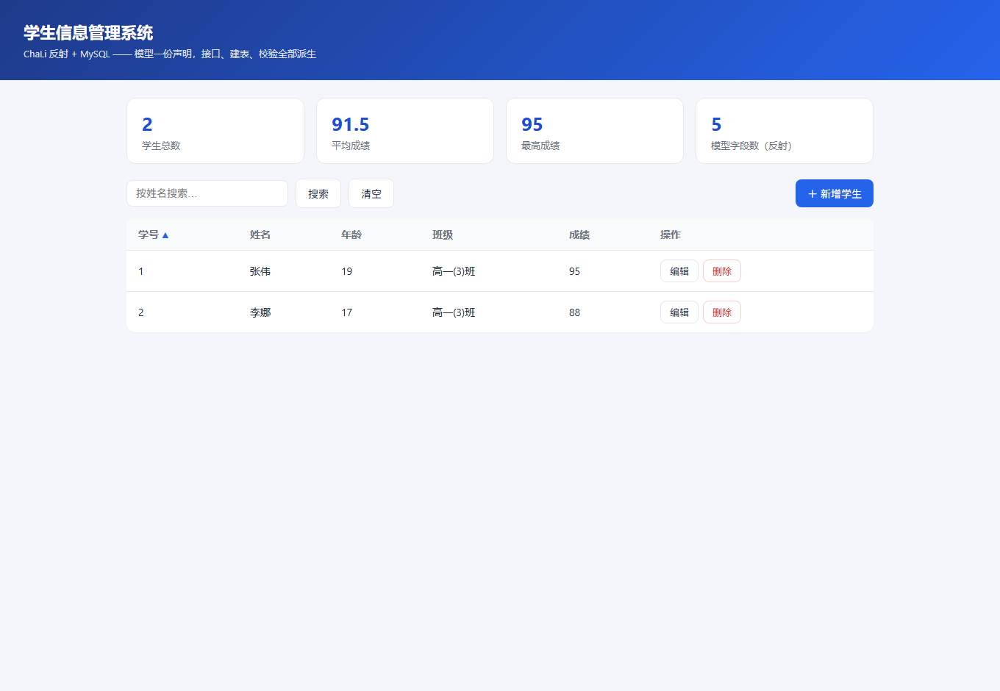
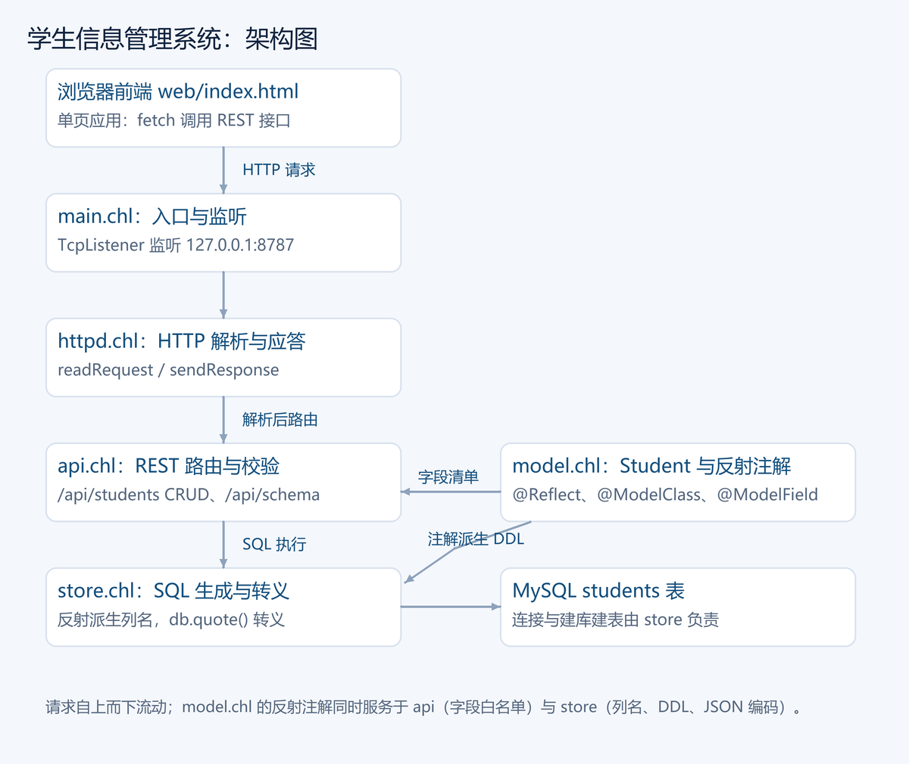
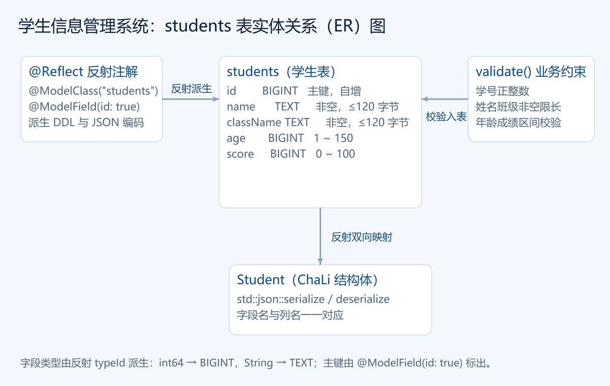

# 第 25 章 学生信息管理系统：让程序认识自己的结构

<!-- LANGUAGE NAVIGATION -->
[English](en/25-student-system.md) · **简体中文**
<!-- END LANGUAGE NAVIGATION -->

前面 25 章把语言讲完了。这一章反过来做一件「用」的事：把结构体、注解、反射、
JSON、SQL、TCP 和 `Result` / `?` 拼成一个**带前后端**的系统——浏览器里点一下
「新增学生」，请求走进 ChaLi 写的 HTTP 服务，落到 MySQL，再以 JSON 回到页面。

它覆盖了日常业务程序最核心的那几件事：

- 一份**模型**（学生有学号、姓名、年龄、班级、成绩）；
- 一张**表**（模型直接变成 MySQL 的表）；
- 一组**接口**（增删查改、搜索、排序，JSON 通信）；
- 一个**前端**（单页 HTML，只依赖浏览器原生能力，没有任何框架）；
- 一条**校验规则**（学号必须是正整数、年龄在 1 到 150、成绩在 0 到 100）；
- 一条**出错的路**（所有失败都变成可读的诊断，而不是崩溃）。

工程还按职责拆成**五个模块**——模型、存取、HTTP、路由、入口各自一个文件，
`import` 把它们接成一棵模块树（第 18 章）。

最关键的那一句话是：**这个系统从来没有手写过「学生有哪些字段」的清单。**
字段列表是它运行期从自己身上读出来的——这就是第 20 章的反射真正派上用场的地方。

示例就在仓库里：[`example/students-server/`](../../example/students-server/)。
命令行 + SQLite 的最小版本（同样的模型，两百行以内）见
[`example/reflection-students/`](../../example/reflection-students/README.md)，本章不再重复它的细节。

---

## 25.1 先看看它能做什么

```sh
cd example/students-server
chali src/main.chl            # 默认 127.0.0.1:8787
chali src/main.chl 9000       # 指定端口
```

### 导出为原生服务

本工程也可以通过第 24 章的 LLVM AOT 路径导出。在工程目录执行：

```sh
chali aot src/main.chl --out build/students-server
```

Windows 下启动生成的程序，并传入端口和前端目录：

```powershell
.\build\students-server.exe 9000 web
```

在支持的 Linux x64 构建环境中，生成的可执行文件通常没有 `.exe` 后缀，使用 `./build/students-server 9000 web`。程序仍需要 MySQL 服务、相应数据库客户端库以及 `web/index.html`；AOT 不会把数据库或应用页面自动打进可执行文件。端口和前端目录的参数与源码运行一致。

Windows x64 的实际验收已覆盖原始工程构建、服务启动及 18 项 HTTP 业务检查，包括中文和非 BMP 字符、增删查改、搜索排序、业务校验、错误状态码与注入文本。验收副本只把数据库名改为独立测试库，结束后删除该库；不要直接用现有业务库做破坏性验证。

```text
学生信息管理系统已启动：http://127.0.0.1:8787
数据库 students_db@127.0.0.1:3306/root（Ctrl+C 退出）
```

浏览器打开这个地址：



上面是统计卡（总数、平均分、最高分、模型字段数），
中间是表格和搜索栏，右上角「新增学生」。页面只依赖 fetch 和 DOM，
没有任何外部资源。

页面背后是同一套 REST 接口，用 `curl` 也能走通：

| 方法 | 路径 | 作用 |
| --- | --- | --- |
| `GET` | `/api/students?search=&order=&desc=1` | 列表，可选姓名模糊搜索与排序 |
| `GET` | `/api/students/<学号>` | 按学号查 |
| `POST` | `/api/students` | 新增（JSON，学号可省，自动分配） |
| `PUT` | `/api/students/<学号>` | 更新 |
| `DELETE` | `/api/students/<学号>` | 删除 |
| `GET` | `/api/schema` | 模型字段清单（反射读出） |

错误统一为 `{"error":"…"}`，配 400 / 404 / 405 状态码。

数据库是本机 MySQL：连接参数在 `src/main.chl` 的 `defaultServerConfig` 里改
（默认 `root/123456@127.0.0.1:3306`，与 `Database::local` 同一套默认值）。
库和表不存在时启动过程自动创建。

---

## 25.2 五个模块：一棵目录树就是一张职责表

```text
example/students-server/
├── chali.toml
├── web/
│   └── index.html        前端单页
└── src/
    ├── main.chl          module studentsServer;  入口：连库建表、accept 循环
    ├── api.chl           module api;             REST 路由
    ├── store.chl         module store;           MySQL 存取
    ├── httpd.chl         module httpd;           HTTP 读请求 / 发响应
    └── model.chl         module model;           学生模型 + 校验 + 反射派生
```

模块名就是文件路径（`::` 换成目录分隔符，见 18.2 节），所以谁在哪个文件、
谁依赖谁，看 `import` 就知道：`api` 依赖 `store` 和 `model`，
`store` 依赖 `model`，`main` 把四样都接起来。**依赖是单向的**：
`model` 不认识任何别的业务模块，所以它最稳、最容易测；
把「字段有哪些」这件事只放在 `model` 里，上层全都从反射拿。



---

## 25.3 模型：一份声明，多处复用

<!-- reflection -->
```chali
import std::sql;
import std::reflect;
import std::json;

@Reflect
@std::sql::ModelClass("students")
struct Student
{
    @std::sql::ModelField(id: true)
    int64 id;
    String name;
    int64 age;
    String className;
    int64 score;
};
```

三个注解各管一件事：

| 注解 | 谁在读它 | 读了做什么 |
| --- | --- | --- |
| `@Reflect` | 反射运行期 | 让 `getStructInfo<Student>()` 能列出字段 |
| `@std::sql::ModelClass("students")` | `std::sql` | 声明表名 |
| `@std::sql::ModelField(id: true)` | `std::sql` | 标出主键 |

这份声明与数据库表、业务约束的对应关系如下图：



**这就是本章最省力的地方**：加一个字段只要在这一处加一行，
建表列、结果集解码、JSON 的键、排序字段的合法性检查，**全都跟着变**。
如果在四个地方各写一遍字段清单，那四处迟早会对不上。

> 反射是语言的固定组成、不可裁剪：工具链始终编入，编译流程也始终跑完整反射处理。
> 要控制**产物**写不写反射元数据，用 `--reflection` / `--no-reflection`；
> `--hard-realtime` 会禁止整个编译单元使用反射。

---

## 25.4 校验单独写一个函数

业务规则不要散落在各个分支里，收成 `model::validate`，返回**空字符串表示通过**：

<!-- no-run -->
```chali
String validate(Student const& student)
{
    if (student.id <= 0)
    {
        return "学号必须是正整数";
    }
    if (student.name.trim().isEmpty() || len(student.name) > 120)
    {
        return "姓名必须为 1 到 120 字节的非空文本";
    }
    if (student.age < 1 || student.age > 150)
    {
        return "年龄必须在 1 到 150 之间";
    }
    if (student.score < 0 || student.score > 100)
    {
        return "成绩必须在 0 到 100 之间";
    }
    return "";
}
```

参数是 `Student const&`：**引用，不复制**（第 7 章），而且只读。
注意字节长度：`len()` 数的是**字节**不是字符（第 12 章），
「120」是 120 个字节，中文姓名大约 40 个字。

存入前校验一次，**从数据库读出来还要再校验一次**（25.6 的 `encodeRows`）——
「库里存了脏东西」也要在这一关被拦住，而不是一路带进接口响应。

---

## 25.5 反射派生：建表列、结果集解码、字段白名单

`model.chl` 里三个函数，全部从 `getStructInfo<Student>()` 出发。

**建表列**：字段类型映射成 MySQL 类型，主键加 `PRIMARY KEY`。
列名是编译期的模型字段名，不是用户输入，拼进 SQL 文本是安全的：

<!-- no-run -->
```chali
Result<String, MessageError> mysqlColumns()
{
    let reflected = std::reflect::getStructInfo<Student>();
    if (reflected.isNone())
    {
        return Result<String, MessageError>::Err(MessageError::from("Student 模型需要 @Reflect"));
    }
    let info = reflected.unwrap();
    String output = "";
    for (std::reflect::FieldInfo field in info.fields)
    {
        /* ……读 @ModelField 注解判断主键…… */
        if (!output.isEmpty()) { output = output + ", "; }
        output = output + "`" + field.name + "` " + columnDefinition(field.typeId, primary);
        if (primary) { output = output + " PRIMARY KEY"; }
    }
    return Result<String, MessageError>::Ok(output);
}
```

`store::ensureSchema` 拿它拼一句
``CREATE TABLE IF NOT EXISTS `students` (…) ENGINE=InnoDB DEFAULT CHARSET=utf8mb4``。

**结果集解码**：数据库返回「行 × 列」的文本网格，我们要 JSON。
字段清单从反射里拿，不在代码里再抄一遍：

<!-- no-run -->
```chali
Result<String, MessageError> encodeRows(std::sql::ResultSet const& rows)
{
    let fields = std::reflect::getStructInfo<Student>().unwrap().fields;
    List<String> records;
    for (int64 row in range(0, rows.rowCount()))
    {
        List<String> values;
        for (std::reflect::FieldInfo field in fields)
        {
            int64 column = rows.columnIndex(field.name);
            if (column < 0)
            {
                return Result<String, MessageError>::Err(MessageError::from("数据库缺少字段：" + field.name));
            }
            String value = rows.textAt(row, column);
            if (field.typeId == std::reflect::getTypeId<String>())
            {
                value = std::reflect::__serdeQuote(value);
            }
            values.push(std::reflect::__serdeQuote(field.name) + ":" + value);
        }
        /* 反序列化再序列化：解析器和模型对一遍，脏数据在这里被拦住 */
        /* ……校验通过后 std::json::serialize<Student>(&student)? …… */
    }
    String separator = ",";
    return Result<String, MessageError>::Ok("[" + separator.join(records) + "]");
}
```

两个值得单独看的点：

1. **`field.typeId == std::reflect::getTypeId<String>()`** —— 运行期判断字段是不是字符串，
   是才加引号。数字字段加了引号就不是合法 JSON 数字了。
2. **反序列化再序列化 + 再校验** —— 先 `deserialize<Student>` 让解析器和模型对一遍，
   再 `serialize<Student>` 输出，同一段文本走 `validate` 再走一遍。

**字段白名单**：`list` 接口允许按任意字段排序，但排序字段来自 URL 查询串——
用户输入绝不能直接拼进 `ORDER BY`。`model::isField(name)` 拿反射字段表当白名单，
不是模型字段直接拒绝：

```text
{"error":"模型 Student 没有字段 badfield"}
```

---

## 25.6 MySQL 存取：值必须过转义，列名只来自模型

`store.chl` 负责所有 SQL。这里有一条要**说实话**的边界：
`std::sql` 的参数化绑定（`db.exec(SqlStatement)`，值走驱动绑定）目前由 SQLite
后端实现；MySQL 后端按文档口径使用 `db.quote()`——它始终转义单引号，
MySQL 方言下同时转义反斜杠。所以本工程的规矩是：

- **文本值一律过 `db.quote()`**，不许手拼引号；
- **列名、表名只来自反射元数据**（编译期字段名），不拼任何用户输入；
- **排序字段先过 `isField` 白名单**。

新增学生把这条链走全：自动分配学号 → 校验 → 查重 → 拼参数化形状的
`INSERT` → 检查影响行数：

<!-- no-run -->
```chali
Result<String, MessageError> add(Database mut& database, Student const& student)
{
    Student record = student;
    if (record.id <= 0)
    {
        record.id = nextId(database);
    }
    String problem = model::validate(&record);
    if (problem != "")
    {
        return Result<String, MessageError>::Err(MessageError::from(problem));
    }
    ResultSet exists = database.exec("SELECT `id` FROM `students` WHERE `id` = "
        + record.id.toString() + " LIMIT 1");
    if (!exists.isEmpty()) { return Result<String, MessageError>::Err(MessageError::from("学号已存在：" + record.id.toString())); }
    /* ……toLiterals 从序列化 JSON 里取每个字段的值：文本过 db.quote，整数直写…… */
    String sql = "INSERT INTO `students` (" + separator.join(columns) + ") VALUES ("
        + separator.join(literals) + ")";
    ResultSet result = database.exec(sql);
    if (result.affected != 1) { return Result<String, MessageError>::Err(MessageError::from("写入失败：影响 0 行")); }
    return std::json::serialize<Student>(&record);
}
```

`toLiterals` 是「反射取列名、JSON 取值」的合流点：先把学生序列化成 JSON，
再按反射字段清单逐个 `parsed.find(field.name)`，文本字段交给 `db.quote`，
整数字段 `toString()`。**值永远不进列名，列名永远不来自用户。**

转义是不是真的有用？把注入Payload当姓名存进去试试：

```sh
curl -X POST http://127.0.0.1:8787/api/students \
  -d '{"id":0,"name":"a\x27); DROP TABLE students; --","age":18,"className":"1班","score":66}'
```

```text
{"id":3,"name":"a'); DROP TABLE students; --","age":18,"className":"1班","score":66}
```

它成了**一条普通记录**——单引号被翻倍、反斜杠被转义，SQL 里它就是文本。
表还在，随后的查询照常工作。这就是转义和「拼接」的区别：
**注入死在字面量边界上，而不是靠运气。**

模糊搜索的 `%` / `_` 通配符也要先转义再交给 `quote`（`store::list` 里的
`escaped` 循环），否则用户搜 `%%` 会变成全表匹配。

---

## 25.7 HTTP 层：四个套路写一个极简服务

`httpd.chl` 建立在 `std::net` 的 TCP 套接字上（第 21 章的宿主绑定），
全部就四个函数：`readRequest`、`sendResponse`，加两个小工具。

**读请求有个真实的坑**：浏览器会开「预连接」空套接字——连上来但什么都不发。
如果服务阻塞在 `receive` 上，一个空连接就能卡住整个服务。所以首行用
**带超时的阻塞读**（`receiveLine(idleMs)`，空连接到点即断），请求体用
**非阻塞接收 + 有界自旋**（`receiveAsync`，头通常和体在同一段到达，
自旋几轮就收完）。这样既不依赖线程运行期，也不会被空连接拖死：

<!-- no-run -->
```chali
Result<Request, MessageError> readRequest(TcpSocket mut& socket, int64 idleMs)
{
    String head = "";
    while (true)
    {
        String line = socket.receiveLine((int32)idleMs);
        if (socket.status() == std::net::NET_TIMEOUT)
        {
            if (head.isEmpty()) { return Result<Request, MessageError>::Err(MessageError::from("空连接")); }
            return Result<Request, MessageError>::Err(MessageError::from("等待请求超时"));
        }
        /* ……NET_CLOSED / NET_ERROR 各给诊断…… */
        if (line.isEmpty()) { break; }   /* 头部以空行结束 */
        head = head + line + "\r\n";
    }
    /* ……Content-Length 决定还要读多少字节进 body…… */
}
```

`status()` 是 `std::net` 的约定：`NET_CLOSED` 对端关闭、`NET_TIMEOUT` 超时、
`NET_ERROR` 出错——每种情况都有话说，没有「静默什么都没做」。

**发响应**只要认真数字节：`Content-Length` 用 `len(body)` 算，
`Connection: close` 让每条连接干完一件事就收工，服务端不用管保活。

**请求体上限 1 MiB**：防异常客户端拖垮内存。超限直接给诊断。

---

## 25.8 REST 路由：HTTP 语义进，业务语义出

`api.chl` 只做翻译：方法 + 路径 → 存取调用 → `Reply`（状态码 + JSON）。
每个分支三行结构——解析输入、调 `store`、包错误：

<!-- no-run -->
```chali
Reply handle(std::sql::Database mut& database, String method, String path, String query, String body)
{
    if (path == "/api/students" && method == "GET")
    {
        let rows = store::list(&database, queryValue(query, "search"), queryValue(query, "order"),
                               queryValue(query, "desc") == "1");
        if (rows.isErr()) { return errorReply(400, rows.error().toString()); }
        return jsonReply(200, rows.unwrap());
    }
    /* ……POST / PUT / DELETE / GET /api/students/<学号> / /api/schema…… */
    return errorReply(404, "未知接口：" + path);
}
```

URL 查询串的解码（`%E6%9D%8E` → 李、`+` → 空格）也在这层做完，
**业务层拿到的永远是解码后的文本**。`/api/schema` 直接吐 `model::schemaJson()`——
前端统计卡上的「模型字段数」就是它，反射一路通到浏览器。

---

## 25.9 入口：连库、建表、起服务、循环

<!-- no-run -->
```chali
void main(List<String> args)
{
    ServerConfig config = defaultServerConfig();
    /* ……命令行参数覆盖端口与前端目录…… */
    std::sql::Database database = store::connect(&config.database);
    if (!database.isOpen())
    {
        println("错误：连接 MySQL 失败：{}", database.lastError());
        return;
    }
    let schema = store::ensureSchema(&database);
    /* ……建表失败也要先关库再退出…… */
    std::net::TcpListener listener = std::net::TcpListener::listen(config.host, config.port, (int32)16);
    println("学生信息管理系统已启动：http://{}:{}", config.host, listener.localPort());
    while (true)
    {
        std::net::TcpSocket peer = listener.accept((int32)500);
        if (!peer.isOpen()) { continue; }   /* 超时轮询，给 Ctrl+C 留反应机会 */
        serve(&database, &peer, page);
        peer.close();
    }
}
```

连接是不可复制的值（`#NonCopyable`），所以它**不走 `Result` 包装**——
`store::connect` 直接返回连接，未打开时用 `lastError()` 看诊断，
和 `Database::mysql` 同一口径。每条失败路径都记得 `close()`：
「出错的那条路最容易忘掉清理」。

`accept` 给 500 毫秒超时：没有连接就回到循环顶上再等，
主循环始终保持「能被打断」的状态。

---

## 25.10 跑一遍

启动之后，浏览器里新增「张伟」、再新增「李娜」（学号留空自动分配），
表格立刻出现两行。用 `curl` 复现一遍：

```sh
curl -X POST http://127.0.0.1:8787/api/students \
  -d '{"id":0,"name":"张伟","age":18,"className":"高一(3)班","score":92}'
curl -X POST http://127.0.0.1:8787/api/students \
  -d '{"id":0,"name":"李娜","age":17,"className":"高一(3)班","score":88}'
curl "http://127.0.0.1:8787/api/students?order=score&desc=1"
```

```text
{"id":1,"name":"张伟","age":18,"className":"高一(3)班","score":92}
{"id":2,"name":"李娜","age":17,"className":"高一(3)班","score":88}
[{"id":1,…92},{"id":2,…88}]
```

改成绩、按姓名搜、删掉、再查：

```sh
curl -X PUT http://127.0.0.1:8787/api/students/1 \
  -d '{"id":1,"name":"张伟","age":19,"className":"高一(3)班","score":95}'
curl "http://127.0.0.1:8787/api/students?search=%E6%9D%8E"
curl -X DELETE http://127.0.0.1:8787/api/students/2
curl http://127.0.0.1:8787/api/students/2
```

```text
{"id":1,"name":"张伟","age":19,"className":"高一(3)班","score":95}
[{"id":2,"name":"李娜","age":17,"className":"高一(3)班","score":88}]
{"ok":true}
{"error":"学生不存在"}
```

搜索串里的「李」是百分号编码（`%E6%9D%8E`）——**URL 里没有裸中文**，
解码是接口层的事，业务层拿到的已经是原文。

**关掉服务再启动，数据还在**——它存在 MySQL 里，不在内存里。

---

## 25.11 出错时它说什么

这一章最值得模仿的不是「成功路径」，而是**每一条失败都有话说**：

| 输入 | 响应 |
| --- | --- |
| `GET /api/students/999` | `{"error":"学生不存在"}` |
| `DELETE /api/students/999` | `{"error":"学生不存在"}` |
| `POST` 学号 0（库里已有 1） | `{"error":"学号已存在：1"}`（0 会自动分配） |
| `POST` `age:200` | `{"error":"年龄必须在 1 到 150 之间"}` |
| `POST` 成绩 101 | `{"error":"成绩必须在 0 到 100 之间"}` |
| `POST` 空 / 非法 JSON | `{"error":"1:1: …[unexpected-token]"}` |
| `order=badfield` | `{"error":"模型 Student 没有字段 badfield"}` |
| `DELETE /api/other` | `{"error":"未知接口：/api/other"}` |
| `PUT` 用 `GET` 以外的方法访问不存在的路由 | `{"error":"方法不支持"}` |

五类错误分得清清楚楚：JSON 解析错误来自 `std::json`（带行列位置）、
业务校验错误来自 `validate`（人话）、模型 / SQL 错误来自 `store`（说明哪个字段不对）、
路由错误在 `api` 兜底、连接层错误在 `httpd` 有诊断。没有一种是「崩了」或者「静默」。

---

## 25.12 小结

- **一份模型声明，多处复用**：建表列、结果集解码、JSON 键、排序白名单都由它派生；
- **五个模块一棵树**：model / store / httpd / api / main 各管一段，依赖单向；
- **MySQL 的值过 `db.quote`，列名只来自反射元数据**，排序字段先过白名单；
- **读出库的数据也再校验一遍**，脏数据进不了响应；
- **HTTP 服务要防住空连接**：首行阻塞读 + 超时，请求体非阻塞收 + 上限；
- **每条失败路径都要有诊断**，并且都要记得关连接。

---

## 25.13 下一步

要把它部署出去，翻回[第 24 章 AOT 导出](24-AOT导出.md)；
要看命令行 + SQLite 的最小同款，翻到
[`example/reflection-students`](../../example/reflection-students/README.md)；
SQL 模型与反射序列化的完整说明在
[动态 SQL 说明](../33-reflection-serialization-sql.md)。

语言的全部细节在[语言参考](../04-language-reference.md)，
反射的 API 全貌在[第 20 章 注解与反射](20-注解与反射.md)。

---

## 25.14 边界与验证

反射元数据取决于编译期的注解与产物开关；换用 `--no-reflection` 或 `--hard-realtime`
构建时，`getStructInfo` 一族不可用，本示例需要写入反射元数据的产物。

`std::sql` 的参数化执行（值走驱动绑定）当前由 SQLite 后端实现；MySQL 后端按
文档口径使用 `db.quote` 转义字面量。列名与表名来自编译期模型字段名，
不拼接任何用户输入；排序字段经过反射白名单。

HTTP 服务是单线程顺序处理：够课堂演示与课内实验，吞吐不是目标。
请求体上限 1 MiB；`Connection: close`，每条连接只处理一个请求。
浏览器预连接空套接字按空闲超时关闭，不占用服务逻辑。

模型字段变化会影响既有数据库：新增字段后旧表缺少该列，`encodeRows` 会报
「数据库缺少字段」，需要迁移或重建。文本长度按字节计，与数据库列类型要对齐。

`like` 搜索与排序的稳定性由 MySQL 决定，不要把当前排列当成业务上可靠的次序。

---

## 25.15 习题

前两题用于理解和基本实现，第三题检查边界，最后一题为综合挑战。先独立完成，再核对参考解答。

1. 给模型新增一个 `String phone` 字段，需要改几处代码？
2. 用 `POST` 连续存两名学生（学号都留空），再用 `order=score&desc=1` 核对顺序。
3. `PUT` 一个不存在的学号会发生什么？为什么必须检查 `rows.affected`？
4. 挑战：给 `store::list` 加上「按班级精确过滤」的查询参数，并保持值不进 SQL 文本。

### 参考解答与验收要点

1. 只改 `model.chl` 的 `struct Student` 一处；建表列、结果集解码、JSON 键、
   `/api/schema` 都由反射派生。旧表会缺列并被「数据库缺少字段」拦下，需要迁移。
2. 以列表 JSON 数组为准核对顺序，不看插入先后；两次学号应连续自动分配。
3. SQL 不报错但影响 0 行；不检查 `rows.affected` 会把「没改到」误报成成功。
4. 在 `list` 里加一个 `className` 精确条件：值必须走 `database.quote()` 转义
   （或扩展反射条件构造），同时覆盖空结果和命中两种情况。

---

## 25.16 番外：目无全牛

改写自《庄子·养生主》庖丁解牛。

庖丁为文惠君解学生表。手之所触，肩之所倚，足之所履，膝之所踦，字段霍然向然，奏刀騞然，莫不中反射之会。

文惠君曰：“嘻，善哉！技盖至此乎？寡人不过加了一个班级字段，何以你的建表列、JSON 键、界面清单都跟着变了？”

庖丁释刀对曰：“臣之所好者，结构也，进乎手抄矣。始臣之解表之时，所见无非整段字符串者。三年之后，未尝见整表也。方今之时，臣以元数据遇而不以眼抄，依乎模型，批大隙，导大窾，因其固然。”

“良程序员岁更字段表，抄也；族程序员月更正则，猜也。今臣之模型十九次变更矣，所解接口数千矣，而列名清单若新发于声明。”

文惠君大悦，要把所有用户输入原样拼进 SQL，谓顺其自然。庖丁急拦：“虽然，每至于外部输入，吾见其为难，怵然为戒，视为止，行为迟。值须转义，排序列须核准，校验不容省。”

忽有连接未开，庖丁不下刀；又有影响零行，庖丁留诊断。君问何不假装成功，以免扫兴。庖丁揩刀而藏，答曰：“善哉！臣只会顺着结构解牛，不会顺着报表造牛。”

文惠君曰：“善哉！吾闻庖丁之言，得维护系统焉。”随即又补了一条需求：“顺便支持导出 Excel，应该不复杂吧？”

### 技术对照

本章的系统就是把「眼睛」换掉的那个过程：字段清单、建表列、JSON 键不靠手抄，从反射给出的结构里长出来（25.3、25.5），模型改了，派生处自动跟上，刀刃不钝。硬拼 SQL 就像砍骨头——值不过转义、排序字段不过白名单，短期看不出事，缺口都在暗处（25.6）。而「怵然为戒」对应的是失败路径：空连接、超时、脏数据、影响 0 行，每一处都认真对待、留下诊断，程序才经得起长久使用（25.7、25.11）。
