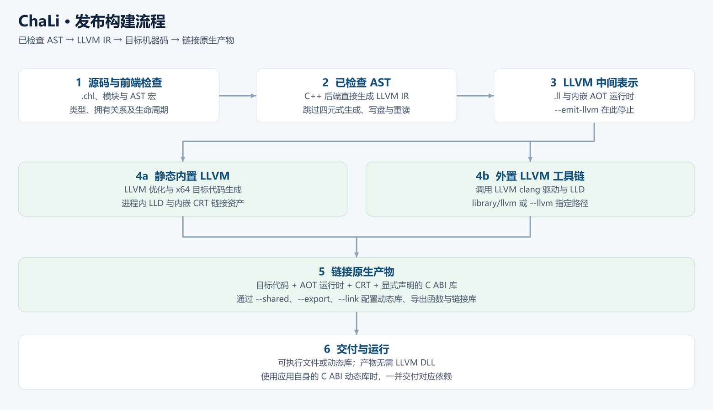

# 第 27 章 发布构建：把程序交付为原生产物

<!-- LANGUAGE NAVIGATION -->
[English](en/27-aot-export.md) · **简体中文**
<!-- END LANGUAGE NAVIGATION -->

运行一个开发例程与交付一个可部署程序，涉及不同层次的证据。LLVM 构建 生成目标机器代码，但目标库、系统加载器、动态依赖与资源目录仍要匹配，不能以“文件已经生成”作为全部验收。

本章从 run 与 build 的默认配置开始，串起前端、已检查 AST 与 LLVM 后端，再区分工具链和应用依赖，说明交叉编译、原生调试与分阶段部署。阅读配置时始终注明宿主、目标和实际执行到哪一步。

## 27.1 运行与导出的配置

先区分两个目的：开发时立即看到程序行为，交付时生成指定环境的原生产物。run 将编译与执行连在一起，默认 checked 原生构建；build 用于导出，默认 unchecked，LLVM 优化等级默认 O3。

unchecked 的相关默认开关主要影响运行期数组与指针检查，静态类型、所有权和借用检查仍然存在。比较两次执行时，把这些配置也写进记录，不只比较源码文件是否相同。

命令选项以 chali help 和 [LLVM 构建文档](../38-build.md) 为准。

默认 run／build 将最终产物发布到源码同级，中间文件放在源码旁的 `.chali`；Windows 将该目录设为隐藏。成功或失败后清理本次独占工作区，保留既有用户文件。编译成功并发布后在标准错误提示“编译完成”，run 随后启动原生程序；`--quiet` 或 `CHALI_QUIET=1` 只关闭完成提示。显式输出、保留和增量配置按[产物参考](../15-artifacts.md)使用。




### 用 TOML 保存构建配置

第 11 章的工程清单可以继续扩展 `[build]`。下面是 Windows x64 发布构建的配置片段；其他目标需要匹配的运行时、SDK 和链接输入。

```toml
[build]
target = "windows-x64"
output = "executable"
lto = "full"
allocator = "malloc"
subsystem = "console"
build_option = ["A", "B"]
assembly_sources = []
assembly_includes = []
objects = []
libraries = []
search_paths = ["src"]
```

| 配置项 | 含义与命令行关系 |
| --- | --- |
| target、cpu | 目标三元组或已支持别名、CPU 调优名称；显式 --target、--cpu 优先 |
| output | executable、llvm、object、assembly；显式 --emit-llvm、--emit-obj、--emit-asm 优先，run 仍编译并执行程序 |
| lto | true、false，或 full、thin、off；显式 LTO 选项优先 |
| allocator、subsystem | malloc／pool 和 Windows console／windows；显式同名选项优先 |
| sysroot、runtime_dir | 目标 SDK 根与目标运行时目录；显式对应选项优先 |
| assembly_sources、assembly_includes | 汇编源与汇编包含目录；命令行已给同类输入时使用命令行集合 |
| objects、libraries | 额外对象与链接库；命令行已给同类输入时使用命令行集合 |
| search_paths | 追加模块和导入搜索目录，以清单所在目录解析相对路径 |
| build_option | 布尔标志名称数组，与 -B 定义取并集；$build[name] 查询存在性 |

`libraries` 中没有路径分隔符和点的裸名称交给链接器解析；其他路径相对清单目录。`cpu` 选择指令调优，不改变 `$cpu` 表示的目标架构。`$system`、`$cpu` 与 `$build` 在宏展开阶段成为常量，具体写法见[第 22 章](22-预处理与宏.md)。

静态 LLVM 变体使用内置后端，拒绝 `--llvm` 和 `[build] llvm`。外置变体才允许配置外部工具链路径。不能通过修改 TOML 让静态版切换后端。完整选项见[LLVM 构建参考](../38-build.md)，项目入口和搜索规则见[第 11 章](11-模块与工程.md)。

### 从源码走到原生执行

正常的 run 和 build 从语义检查后的 AST 直接生成 LLVM IR。前端解析声明与表达式，展开宏，并进行名称、类型、所有权和借用检查；后端读取这棵已检查的树，生成 LLVM 指令和必要的运行时调用。LLVM 负责优化和目标代码生成，链接步骤把对象与所需运行时、系统库和应用依赖组合成原生产物。

本书不加限定的 IR 指 ChaLi 四元式；LLVM IR 则明确写全，两者不能互换。四元式导出及独立调用方的兼容路径仍存在，正常 LLVM 构建 不要求先生成四元式、写盘再读回。LLVM 通过 O3／LTO 执行优化；具体收益仍取决于程序及配置。

`run` 通过 checked 原生构建 编译并执行程序。开发时用 run 验证的程序，正式导出时仍应核对目标、检查开关和链接配置；两次命令的默认配置并不完全相同。

checked 有助于在运行时发现相应的非法访问，静态检查则在运行前拒绝不合法程序。两层检查各有覆盖范围，任何一种都不能证明业务输入必然有效。选择 unchecked 时应理解具体开关，并对发布配置做实际验收；不要只因开发配置通过就省略发布产物的运行检查。

## 27.2 工具链依赖与应用依赖

### 标准库算法、C 原语与 LLVM

导入标准模块后，其中能由语言表达的算法也参与编译。例如 `std::parse` 的整数解析由 ChaLi 扫描完整十进制文本，先检查范围再累加；布尔解析比较 `true` 和 `false`。这些函数与调用方一起进入 LLVM 后端，不需要运行期解释它们的源码。

<!-- verify-book -->
```chali
import std::parse;

void main() {
    match (Parse::parseInt64("-42")) {
        Ok(value) => { println("{}", value); }
        Fail(error) => { println("{}", error.toString()); }
    }
}
```

```text
-42
```

第一行导入解析模块，`parseInt64` 返回 `Result<int64, Error>`。成功分支取得数值并打印；错误分支通过 `Error` 接口取得原因。这个例子输入合法，所以输出 -42。空文本、非法文本和范围错误分别保存对应的 `ParseError`，调用方仍用同一种错误协议处理。

浮点文本转换保留薄 C 入口，使用原有 `strtod` 格式规则，再把状态组合成同样的语言结果。公开 C 调用边界使用槽、字节长度和不透明句柄；必要的实现文件可以是 C++，其内部类型不因此变成 C ABI。内存复制、填充和适合的标量操作则可直接降低到 LLVM 指令或 intrinsic。

文件、网络和数据库访问最终仍需实际宿主服务。LLVM 负责优化和生成机器码，目标操作系统及相关库负责 IO；把一个入口改为 LLVM 原语，也不能省略拥有值清理或交付所需的外部库。

### 按实际链接交付依赖

内置 LLVM 变体携带编译所需组件，外置变体使用已安装工具链。两者生成的应用按实际链接结果交付；编译器使用 LLVM 不等于应用必须携带 LLVM 动态库。

应用主动调用的 C ABI 动态库、数据库客户端和运行期资源仍按各自约定准备。对最终文件检查真实依赖，不从编译器变体名推断。

### 从源码模块构建应用

把模块保存到 `modules/example/counter.chl`。目录和文件名对应完整模块名。

```chali
module example::counter;
struct Counter {
    int64 value;
    static Counter create(int64 initial) {
        self.value = initial;
        return self;
    }
    void add(int64 step) { self.value += step; }
    int64 read() { return self.value; }
}
void write(int64 mut& target, int64 value) { *target = value; }
```

把调用方保存为与 `modules` 同级的 `main.chl`。模块的可写引用参数可以修改调用方的值。

```chali
import example::counter;
void main() {
    let counter = example::counter::Counter::create(40);
    counter.add(2);
    int64 result = 0;
    example::counter::write(&result, counter.read());
    println("{}", result);
}
```

```sh
mkdir -p build
chali run main.chl
chali build main.chl --lto-mode thin --checked --out build/counter
```

直接运行源码和启动导出的程序时，标准输出相同。

```text
42
```

Windows 的导出产物是 `build/counter.exe`，Linux 上是 `build/counter`。已有原生对象和归档的链接用法见[工具链参考](../09-toolchain.md)。需要封装或检查已有资产时，可使用[库包格式工具](../44-library-packages.md)。

## 27.3 交叉编译需要哪些信息

交叉编译至少要明确目标 triple、CPU／特性、目标 ABI、sysroot、链接器、目标运行库与启动资产。可将受支持配置写入 toml；具体键与命令行覆盖规则按 [LLVM 构建配置参考](../38-build.md) 使用，不把宿主库路径混入目标链接。

VS Code 的 **ChaLi：选择项目目标** 从编译器读取目标列表，并保存到项目的 `[build].target`。命令行可用别名或三元组选择同一个目标。下表中的目标均为小端。

| 别名 | LLVM 三元组 | 目标 ABI |
| --- | --- | --- |
| `windows-x64` | `x86_64-w64-windows-gnu` | Windows x64 |
| `linux-x64` | `x86_64-unknown-linux-gnu` | Linux x86-64 |
| `linux-x86` | `i686-unknown-linux-gnu` | Linux i686 |
| `linux-arm32` | `armv7-unknown-linux-gnueabihf` | ARMv7-A 硬浮点 |
| `linux-arm64` | `aarch64-unknown-linux-gnu` | AArch64 |
| `linux-riscv32` | `riscv32-unknown-linux-gnu` | RV32GC / ILP32D |
| `linux-riscv64` | `riscv64-unknown-linux-gnu` | RV64GC / LP64D |
| `linux-mipsel` | `mipsel-unknown-linux-gnu` | MIPS32r2 / O32 |
| `linux-mips64el` | `mips64el-unknown-linux-gnuabi64` | MIPS64r2 / N64 |

选择对象文件可以先核对架构。生成可执行文件时，用 `tools/build_cross_runtime.sh` 准备对应的 Linux GNU SDK，并配置 `sysroot`、`runtime_dir` 和支持目标后端的 clang/LLD。MIPS 可执行文件采用非 PIE 链接并关闭 LTO，MIPS32 和 RV32 的目标环境需要 `libatomic.so.1`。

```toml
[build]
target = "aarch64-unknown-linux-gnu"
cpu = "generic"
sysroot = "build/cross-sdk/linux-arm64/sysroot"
runtime_dir = "build/cross-sdk/linux-arm64/lib"
output = "executable"
```

[build] 将这些键归入导出配置。target 选择 ARM64 Linux GNU 目标，cpu=generic 不针对某一具体处理器调优；sysroot 指向目标系统头文件与库所在的根，runtime_dir 指向该目标所需运行时链接资产，不能用宿主 Windows 库代替。

output=executable 记录希望得到可执行产物，但这份配置不会下载 SDK，也不会凭空提供缺失库。两个路径相对于 chali.toml 解析，所以应把配置文件位置也纳入工程记录。后续命令若显式选择对象输出，会覆盖对应导出设置；配置意图与实际执行步骤应一起核对。


```sh
chali build app.chl --target linux-arm64 --emit-obj --out build/arm64/app
```

build 以 app.chl 为输入，--target 选择命名目标 linux-arm64，--out 指定输出位置。最关键的是 --emit-obj：该命令到对象文件生成就停止，尚未把目标运行库和启动资产链接为可执行程序。

因此这条命令适合单独验证目标代码生成，不能马上在 Windows 上执行得到的 ARM64 对象，也不能据它宣称目标设备已运行。下一步要用匹配的目标链接环境形成应用，再在目标系统验证启动与业务。输出路径应与其他架构隔离，避免混用同名对象。


路径相对 chali.toml 解析，命令行显式选项覆盖对应配置。上述 --emit-obj 只生成对象文件，不执行目标链接。

生成某架构对象文件不等于已经得到可部署应用。对象生成、目标链接和目标设备运行需要分别验收；构建出交叉架构编译器也不表示全部 LLVM 构建 目标自动可用。

### 从 Linux 交叉链接到 MCU 固件

Linux 目标通过目标 SDK 提供系统库和启动文件。MCU 固件则由板级工程提供启动代码、内存布局和链接脚本。`chali build --target mcu-cortex-m4` 或 `--target mcu-rv32` 使用外置 clang 和 LLD，将通过 `--link` 传入的板级对象与 ChaLi 代码链接成 ELF。完整命令和板级接口见 [MCU 固件参考](../38-build.md#mcu-固件)。

裸机端口可把打印接到串口，把分配和释放接到板级堆。使用 FreeRTOS 时，任务调用生成程序的入口，`RTOS_HAL_Chali_*` 将这三项操作转发给板级实现。Cortex-M4 的 QEMU 验证检查了任务唤醒后打印和归还堆内存，RV32 的模拟验证覆盖裸机打印。MCU 禁止导入 `std::reflect`，动态字符串和集合的完整运行依赖当前未提供的板级原语。

## 27.4 部署核对与诊断

在干净目录核对配置文件、网页、动态库、数据目录权限及工作目录。首次启动先验证一个无副作用操作，再测试真实业务。需要原生调试时使用 DWARF 与 GDB/MI 路径；保留符号和错误日志，使用户能定位失败阶段。

### 按失败阶段收集证据

解析或类型检查失败时，还没有可供调试的目标程序，应先根据源码诊断修正输入。对象生成成功但链接失败时，应检查目标 ABI、库的架构、符号和搜索路径。程序链接成功却无法启动时，再检查操作系统加载器、动态库、资源路径与权限。程序启动后业务结果错误，则需要结合输入、日志和原生调试定位。文件已经存在只能证明某个步骤写出了文件，不能替代后续阶段的证据。

原生调试使用 DWARF 调试信息与 GDB/MI。调试信息帮助把机器指令关联到源码，但优化可能内联函数、合并操作或使局部变量难以直接观察。排查时保留被测二进制与对应源码、构建配置和符号，避免拿另一次构建的行号解释当前文件。调试入口及平台要求见[构建调试](../43-native-debugging.md)。

交付前可把验收写成一条可复现的操作链：在目标环境准备依赖，进入约定工作目录，启动发布产物，完成一次读取，再完成一次有权限的写入并核对结果。涉及数据库时，同时验证连接失败和权限不足的诊断。验证记录写明宿主、目标、编译器变体与实际执行到的步骤；只在 Windows 上生成 Linux 对象文件，应报告对象生成成功，不能写成 Linux 部署验证通过。

运行时共享核心要求 C++17 与操作系统服务，面向桌面及受支持的嵌入式 Linux 宿主，不承诺裸机支持。目标 triple 只描述目标的一部分，不能替代目标系统的库、启动资产和真实设备验证。

### 用固定输入核对产物

使用输出稳定的程序核对原生编译和链接后的行为。

<!-- verify-book -->
```chali
int64 result() {
    return 6 * 7;
}
void main() {
    println("artifact={}", result());
}
```

```text
artifact=42
```

### 小结

开发时通过 run 观察 checked 原生执行，发布时按实际 build 配置验证产物。编译器自带哪些 LLVM 组件、应用依赖哪些库、目标上能否启动，是三个需要分别回答的问题。

交付记录保留命令、源码和二进制身份、目标环境及业务结果。对象生成、链接成功和目标运行都写明各自证据，不把前一步扩大成后一步。第 29 章将这些要求用于带网页与数据库的完整应用。

下一章：[第 28 章 HTTP文件服务器](28-HTTP文件服务器.md)。

## 27.6 番外：行囊里的工具

改写自欧阳修《卖油翁》。

陈康肃公善导出，当世无双，公亦以此自矜。尝于家圃编译，有卖油翁释担而立，睨之，久而不去。见其原生产物十发十中，但微颔之。

康肃问曰：“汝亦知 LLVM 构建 乎？吾静态 LLVM，不亦精乎？”翁曰：“无他，但工具装得熟尔。”康肃忿然曰：“尔安敢轻吾后端！”

翁曰：“以我酌油知之。”乃取一葫芦，置于地，以钱覆口，徐以杓酌油沥之，自钱孔入，而钱不湿。因曰：“工具在我担中，亦可借隔壁工坊；油入葫芦之后，买油人岂须背着我的油杓回家？”

康肃悟，谓内置 LLVM 是将编译所需工具纳入编译器，外置 LLVM 是借工具链完成同样工序；导出应用不因此平白多带一个 LLVM DLL。

翁将行，又折回道：“不过，若你葫芦上还接着别人家的水管，莫因油杓已收，就说水管也不必交付。”公视之，果有一条自己声明的 C ABI 动态库依赖。

康肃笑而遣之，归来便将发布说明分成工具链依赖与应用依赖两栏。门客称赞文档更长了，公曰：“我宁愿多写两行，也不愿用户半夜来问，油有了，葫芦为什么打不开。”

### 技术对照

内置 LLVM 编译器把优化器、代码生成器、链接器和链接资产装进行囊；外置变体借助独立工具链完成这些步骤。交付的原生产物包含所需的 原生运行时，应用额外使用的 C ABI 库则按各自的链接约定准备。工具放在哪里与应用依赖哪些库，是两个需要分别核对的问题。
