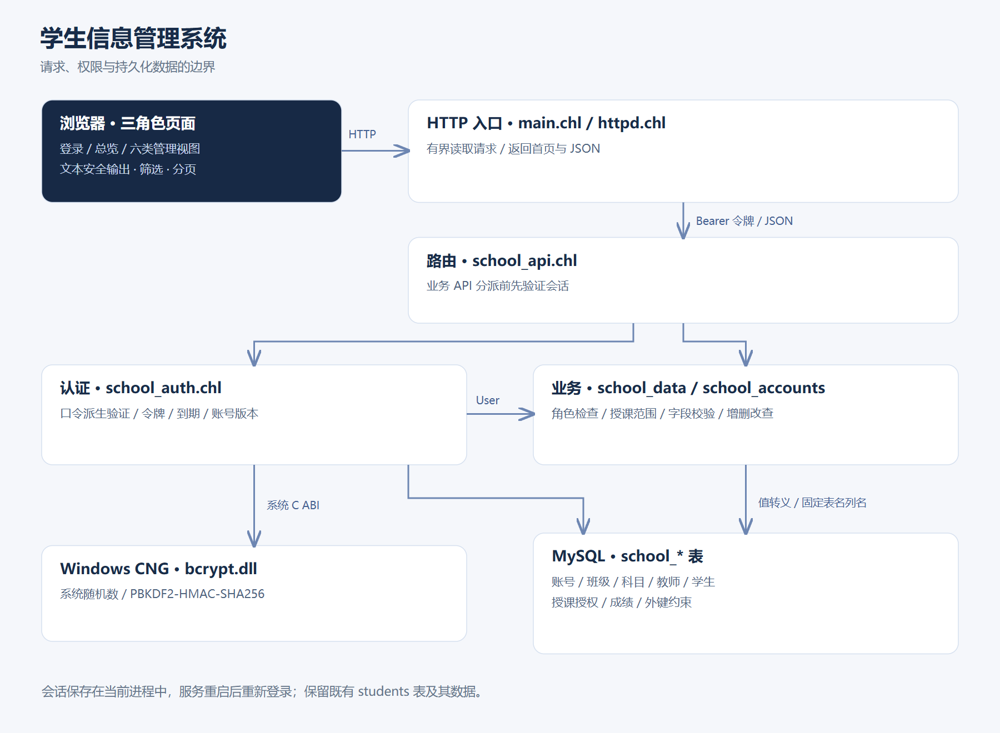
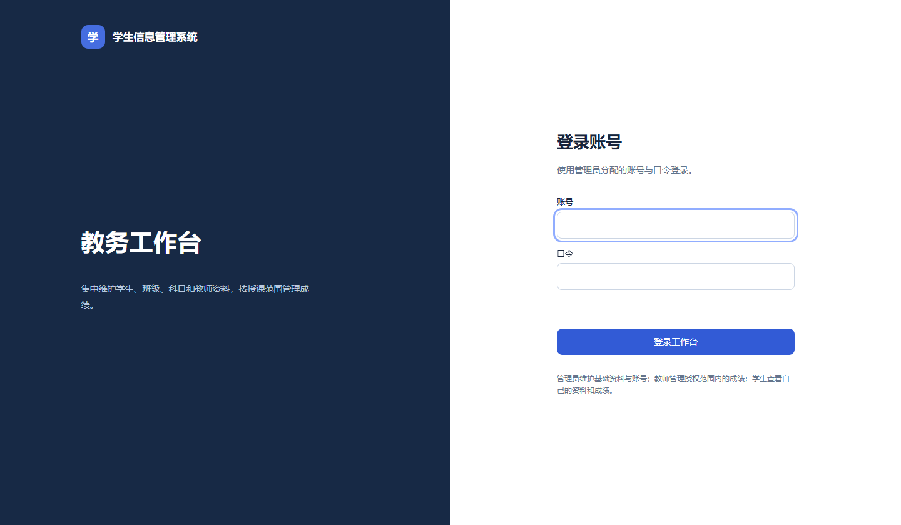
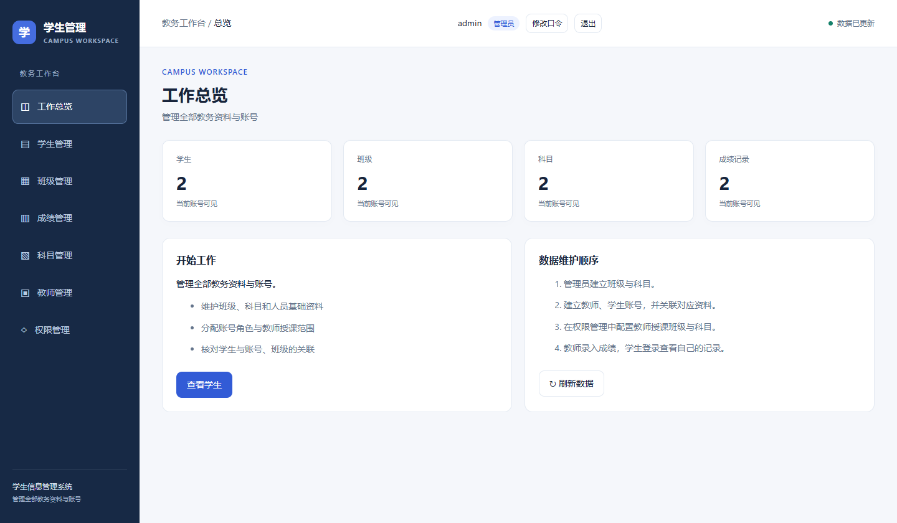
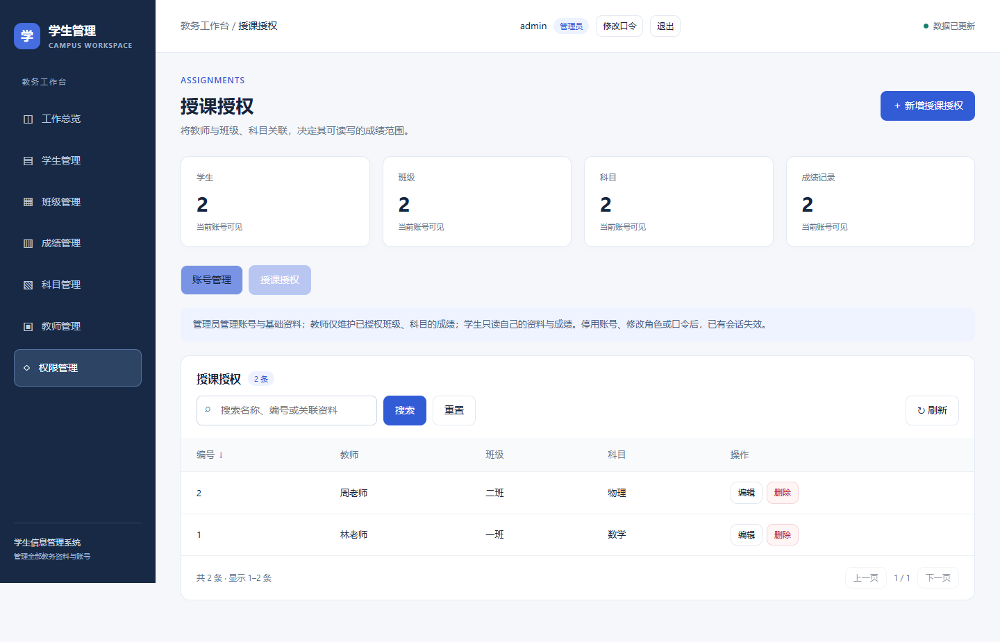
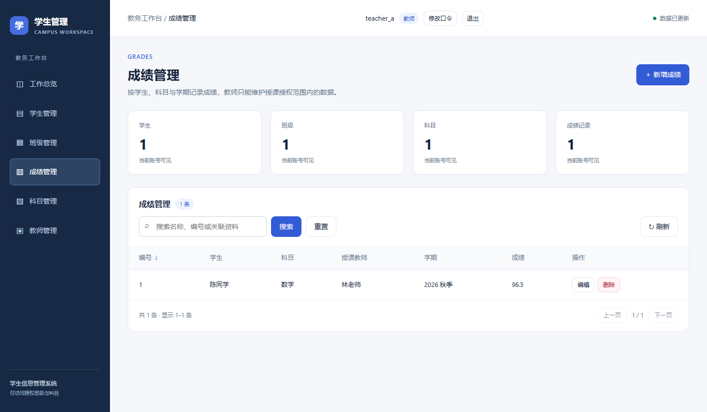
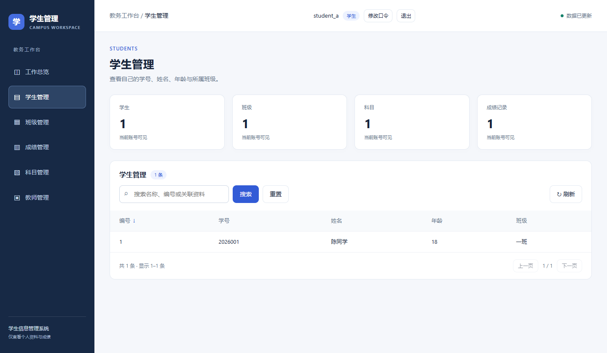
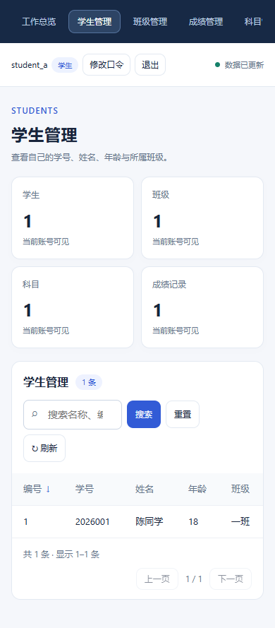

# 第 29 章 学生信息管理系统

<!-- LANGUAGE NAVIGATION -->
[English](en/29-student-management.md) · **简体中文**
<!-- END LANGUAGE NAVIGATION -->

前面各章分别讨论类型、引用、错误和模块，现在把它们放进同一条业务请求：用户登录，取得权限范围，读取或修改教务数据，再把结果显示到页面。功能正确还要求关系完整、失败可说明、服务可启动和数据范围不能越权。

本章对应仓库中真实的学生信息管理工程，包含登录、权限、学生、班级、成绩、科目、教师七个板块。以管理员、教师、学生三类角色串起配置、认证、数据关系、页面与交付；截图和历史验收说明实际环境，不代表所有平台都已运行。

## 29.1 从业务动作确定数据边界

先从一个可观察动作开始：教师登录后更正自己所教班级的一条成绩。要完成它，需要知道账号是谁、负责哪个班级和科目、学生属于哪里，以及分数是否有效。界面只是入口，这些关系最终都要由后端检查。

管理员负责账号、基础资料与授课授权；教师在授权范围内读写；学生读取本人信息。先确定这些规则，再安排七个板块的页面与路由，可以避免先做出按钮、最后才追补权限。

| 板块 | 主要动作 | 权限边界 |
| --- | --- | --- |
| 登录 | 登录、退出、修改口令 | 认证成功后才可访问业务 API |
| 权限 | 账号角色、启停、授课授权 | 仅管理员写入 |
| 学生 | 学号、姓名、年龄、班级和账号关联 | 管理员维护，教师按班级读取，学生只读本人 |
| 班级 | 编号与名称 | 管理员维护，其他角色读取关联班级 |
| 成绩 | 学生、科目、教师、学期与分数 | 教师只写授课范围，学生只读本人 |
| 科目 | 编号与名称 | 管理员维护，其他角色读取关联科目 |
| 教师 | 工号、姓名和账号关联 | 管理员维护，其他角色读取关联教师 |

前端只显示当前角色可用的按钮。真正的数据边界在后端：即使手工发送 HTTP 请求，仍要通过相同校验。

## 29.2 请求经过哪些模块



工程位于 [example/students-server](../../example/students-server/)。main.chl 建立数据库连接并接受 TCP 连接；httpd.chl 读取有大小与时间限制的请求，返回 HTML 或 JSON。school_api.chl 分派路由，school_auth.chl 验证会话；school_data.chl 处理教务表与授课范围，school_accounts.chl 处理账号与口令。

store.chl 只负责数据库连接配置，api.chl 提供响应和编号解析。crypto.chl 通过系统 C ABI 获取随机数和派生密码摘要。前端保存在 web/index.html，样式和脚本随首页一起提供，不依赖外部 CDN。

## 29.3 配置并启动真实工程

本章实际验证环境为 Windows x64、外置 LLVM 编译器、MySQL 8 和 Edge。认证示例直接绑定 C:/Windows/System32/bcrypt.dll；其他 Windows 安装位置需要调整声明，其他操作系统需要替换对应系统认证实现，不能只改目标 triple 后声称应用已可部署。

把项目中的 config.example.json 复制为不入库的配置文件，填入有权使用测试库的数据库账号。不要把真实数据库口令写进源码或提交到 Git。

```json
{
  "host": "127.0.0.1",
  "user": "school_app",
  "password": "replace-with-local-secret",
  "database": "chali_school",
  "port": 3306
}
```

host 与 port 定位数据库服务器，和网页服务监听的 8787 端口不是同一用途。user、password 是程序连接 MySQL 的账号凭据，database 选择要使用的库；它们不是浏览器登录学生系统的用户名与口令。

示例中的 password 是占位文字，需替换为本机测试配置，且不能把真实秘密写回书稿或提交。JSON 的键和值都需要正确的引号，port 是数值而不是字符串。连接配置解析成功只证明格式可读，数据库是否存在、账号是否有权限还需启动时实际连接核对。


在仓库根目录运行，三个程序参数依次为端口、网页目录、数据库配置文件：

```sh
chali run example/students-server/src/main.chl -- 8787 example/students-server/web example/students-server/config.local.json
```

chali run 先编译并执行项目入口，双横线 -- 把编译器选项与程序自己的参数分开。其后三项按顺序交给应用：8787 是网页监听端口，web 路径定位静态页面，最后一个路径定位 MySQL 连接配置；顺序改变就会改变应用解释它们的方式。

这些路径以本命令约定的仓库根工作目录为基准，不能随意切到 src 后照抄。启动后还应观察数据库连接与初始化结果，再打开浏览器登录；只有编译成功并不能证明服务已监听、资源能读取或认证流程可用。不要把数据库的 3306 端口填成网页入口。


浏览器打开 http://127.0.0.1:8787。首次连接空库时建立 school_ 前缀的表，并在控制台显示随机生成的 admin 初始口令；已有账号时不重置口令。程序不插入业务演示记录。既有 students 表不做迁移或删除。

## 29.4 登录、会话与口令更新



登录提交账号与口令，服务端用 PBKDF2-HMAC-SHA256 和每个账号独立的随机盐验证摘要，迭代次数为 600000。会话令牌来自系统随机数，保存在服务端内存和当前页面内存中；页面刷新或服务重启后需要重新登录，不写 localStorage。

请求在 Authorization 头中发送 Bearer 令牌。会话有效期为 30 分钟，每次请求重新查询账号启用状态和版本；停用、角色更新或口令修改使旧会话失效。连续五次错误口令会暂时锁定账号 15 分钟，锁定时间用数据库挂钟，进程内会话到期使用单调时钟。

本例默认只监听本机 HTTP。跨机器部署需要在传输层配置 HTTPS，并结合实际并发、账号恢复和审计需求完善运维；本章没有实现密码找回、分布式会话或后台任务。算法说明见 [Windows CNG](https://learn.microsoft.com/en-us/windows/win32/api/bcrypt/) 与 [OWASP 密码存储说明](https://cheatsheetseries.owasp.org/cheatsheets/Password_Storage_Cheat_Sheet.html)。

## 29.5 按关系建立基础资料

先建立班级和科目，再建立账号、教师与学生资料，最后配置授课授权。账号角色不是姓名字段：教师资料的 user_id 必须关联教师账号，学生资料必须关联学生账号；未关联账号的人员记录仍可由管理员维护。



班级编号、科目编号、学号、工号和账号名称分别唯一。学生引用班级，授课授权引用教师、班级和科目，成绩引用学生、科目和教师。外键保护仍被使用的记录；重复编号、无效关联和越界成绩都返回失败结果，页面显示原因而不是宣称保存成功。

## 29.6 授课授权与成绩写入



一条授课授权由 teacher_id、class_id 和 subject_id 组成。教师写入成绩时，后端检查学生当前班级、科目和所选教师是否存在对应授权，并确认教师账号属于当前登录用户。仅知道另一条成绩的 id 不足以读取或修改它。



成绩按学生、科目和学期去重，分数限制在 0–100。PUT 更新即使值与原值相同也视为已存在记录的合法更新，不依赖 MySQL affected=0 推断记录不存在。授课范围变化后权限按当前授权重新计算，既有成绩保留；历史教师与科目仍供对应学生读取名称。

## 29.7 学生只读视图与窄屏布局



学生页面没有新增、编辑和删除操作，后端对同样的写请求也返回拒绝。概览统计按当前账号可见数据计算：学生看到的“学生 1”表示自己的可访问记录，不是全校人数。



页面采用统一侧栏、页头、统计卡片、筛选和分页。窄屏把侧栏改为横向导航；表格在容器内部滚动，页面本身不横向溢出。弹窗支持键盘焦点、Escape 和取消，提交期间阻止重复保存。

## 29.8 输入、SQL 和页面输出

后端只接受固定表名与列名，路径不能变成任意 SQL 标识符。JSON 字段分别检查文本、整数或分数类型，再验证长度、范围及关系。MySQL 接口当前使用 Database.quote 处理文本字面量；不能把 SQLite 的参数化能力当成当前 MySQL 接口已经提供的功能。

前端将用户数据赋给 textContent，而不是将姓名或班级名称拼入 innerHTML。筛选和分页在本次已加载数据中进行，每次列表查询上限为 10000 条；超过上限会返回错误，没有实现面向大数据量的游标分页。

| 路由 | 方法 | 含义 |
| --- | --- | --- |
| /api/auth/login | POST | 登录 |
| /api/auth/me | GET | 当前账号 |
| /api/auth/logout | POST | 撤销当前令牌 |
| /api/auth/password | POST | 校验旧口令后更换口令 |
| /api/accounts | GET／POST | 管理员读取或新建账号 |
| /api/accounts/id | PUT／DELETE | 更新或删除账号 |
| /api/students 等业务路径 | GET／POST | 按角色读取列表或创建记录 |
| /api/students/id 等业务路径 | PUT／DELETE | 先检查数据范围，再更新或删除 |

其余业务路径为 classes、grades、subjects、teachers 和 assignments。错误响应统一带 error 字段。

## 29.9 导出与业务验收

导出后仍需准备网页目录、数据库配置和 MySQL 客户端依赖。进程内会话不进入数据库备份；备份数据库时同时核对账号关联和业务外键。部署步骤与交叉编译边界见第 27 章。

项目验证使用独立临时数据库，包含有效增删改查、重复键和外键拒绝、三角色数据隔离、教师越权写拒绝、会话撤销及浏览器操作。验证结束关闭服务并删除该测试库，不连接或清空已有业务库。自动验证入口为 [students_server.py](../../tests/students_server.py) 和 [students_server_ui.py](../../tests/students_server_ui.py)。

本章截图来自 Windows x64 上运行的真实服务、MySQL 隔离库与 Edge 浏览器。姓名、班级和成绩均为验收数据；图中账号角色和统计范围与实际权限结果对应。

章末番外保留早期单模型反射示例的叙事与技术对照，旧小节编号沿用原文。当前七板块工程采用本章列出的关系表、认证与字段白名单。

### 小结

以教师更正成绩为例，把整条链重新走一遍：浏览器提交令牌与数据，服务端确认会话和账号，验证字段与授课范围，再写数据库并形成响应，页面根据真实结果更新。只验证页面按钮或只验证数据库写入，都不能覆盖整条链。

对照前文，结构体组织业务值，枚举与 Result 表达状态，模块组织责任，C ABI 连接系统能力，AOT 决定交付路径。继续扩展时保持这些边界，新增功能附上对应正反例，不把本章的本机验收直接推成任意部署承诺。

## 29.10 沿一条业务请求阅读路由代码

```chali
api::Reply handle(std::sql::Database mut& database, school_auth::State mut& state, httpd::Request const& request)
{
    if (request.path == "/api/auth/login")
    {
        if (request.method != "POST") { return api::errorReply(405, "登录需要 POST"); }
        return school_auth::login(&database, &state, request.body);
    }
    let identity = school_auth::authenticate(&database, &state, &request);
    if (identity.isNone()) { return api::errorReply(401, "请登录，会话已失效或账号已更新"); }
    let user = identity.unwrap();
    if (request.path == "/api/auth/me" && request.method == "GET") { return api::jsonReply(200, school_auth::userJson(user)); }
    if (request.path == "/api/auth/logout" && request.method == "POST")
    {
        school_auth::logout(&state, &request);
        return api::jsonReply(200, "{\"ok\":true}");
    }
    if (request.path == "/api/auth/password" && request.method == "POST") { return school_accounts::changePassword(&database, user, request.body); }
    if (!std::text::Text::startsWith(request.path, "/api/")) { return api::errorReply(404, "接口不存在"); }
    String entity = request.path[5:];
    int64 id = 0;
    int64 separator = std::text::Text::find(entity, "/");
    if (separator >= 0)
    {
        id = api::parseId(entity[(separator + 1):]);
        entity = entity[0:separator];
        if (id <= 0) { return api::errorReply(400, "记录编号无效"); }
    }
    if (entity == "accounts")
    {
        if (request.method == "GET" && id == 0) { return school_accounts::list(&database, user); }
        return school_accounts::write(&database, user, request.method, id, request.body);
    }
    if (request.method == "GET" && id == 0) { return school_data::list(&database, entity, user); }
    return school_data::write(&database, entity, user, request.method, id, request.body);
}
```

这段函数可以分成四段读，不必一次记住每条路径。

第一段只放行登录路由，并要求 POST；登录失败不建立身份。第二段 authenticate 为其余请求检查会话，None 立即返回 401。后面拿到的 user 来自服务端验证，不来自浏览器自己填写的角色。

第三段处理查看本人、退出与改口令，再把 /api/ 后的部分拆成 entity 和可选 id。无效编号返回 400，避免把错误路径误当作批量操作。

第四段按 accounts 与普通教务记录分派。GET 且无编号走列表接口，其余交给写入模块；列表与写入函数仍接收 user，继续检查角色及授课范围。路由层通过认证，并不意味着用户有权修改任意成绩。

可以拿教师更正成绩的请求做练习：先标出身份在哪里取得，再找编号在哪里解析，最后进入 school_data 的授权检查。浏览器隐藏按钮只影响界面，无法替代这里的后端判断。

## 29.11 从 HTTP 连接进入业务函数

```chali
void serve(std::sql::Database mut& database, school_auth::State mut& state, std::net::TcpSocket mut& peer, String page)
{
    let read = httpd::readRequest(peer, 10000);
    if (read.isErr())
    {
        /* 空连接 / 超时是常态（浏览器预连接），安静地关掉即可。 */
        return;
    }
    httpd::Request request = read.unwrap();
    if ((request.path == "/" || request.path == "/index.html") && request.method == "GET")
    {
        let sent = httpd::sendResponse(peer, 200, "OK", "text/html; charset=utf-8", page);
        if (sent.isErr()) { eprintln("发送首页失败：{}", sent.error().toString()); }
        return;
    }
    api::Reply reply = school_api::handle(&database, &state, &request);
    String reason = "OK";
    if (reply.status == 400) { reason = "Bad Request"; }
    elif (reply.status == 401) { reason = "Unauthorized"; }
    elif (reply.status == 403) { reason = "Forbidden"; }
    elif (reply.status == 429) { reason = "Too Many Requests"; }
    elif (reply.status == 503) { reason = "Service Unavailable"; }
    elif (reply.status == 404) { reason = "Not Found"; }
    elif (reply.status == 405) { reason = "Method Not Allowed"; }
    elif (reply.status == 500) { reason = "Internal Server Error"; }
    let sent = httpd::sendResponse(peer, reply.status, reason, reply.contentType, reply.body);
    if (sent.isErr()) { eprintln("发送响应失败：{}", sent.error().toString()); }
    eprintln("{} {} -> {}", request.method, request.path, reply.status);
}
```

先看参数。database 与 state 是服务持有的可变状态，peer 是本次连接的可变引用，page 是启动时读好的首页。这个函数不创建第二套数据库连接，也不把客户端套接字复制给后台线程。

函数的前半段调用 readRequest，处理读取失败与首页请求。首页命中后发送 HTML 并 return，不进入 API 分派。这里读取失败直接返回，由外层管理连接资源；它没有返回“业务成功”。

后半段调用上一节的 school_api::handle，得到包含 status、contentType、body 的 Reply。条件链把数字状态转为响应说明，再统一调用 sendResponse。最后的日志是方法、路径与结果状态，不打印口令或完整令牌。把一次 GET /api/grades 跟到这里，能看到请求与业务结果如何交接。

## 29.12 登录：从输入验证到建立会话

```chali
api::Reply login(std::sql::Database mut& database, State mut& state, String body)
{
    prune(&state);
    let parsed = std::json::parse(body);
    if (parsed.isErr()) { return api::errorReply(400, "登录数据必须是 JSON 对象"); }
    let value = parsed.unwrap();
    String username = stringField(&value, "username");
    String password = stringField(&value, "password");
    if (username.isEmpty() || len(username) > 64 || len(password) < 1 || len(password) > 1024)
    {
        return api::errorReply(400, "请填写有效账号与口令");
    }
    let rows = database.exec("SELECT id,username,role,version,enabled,salt,digest,failed_count,locked_until,CAST(UNIX_TIMESTAMP()*1000 AS SIGNED) AS now_ms FROM school_users WHERE username=" + database.quote(username));
    if (!rows.ok) { return api::errorReply(503, "账号服务暂不可用"); }
    if (rows.rowCount() != 1)
    {
        let ignored = crypto::derive(password, "school-unknown-account", (uint64)600000);
        return api::errorReply(401, "账号、口令无效或账号暂不可用");
    }
    int64 now = rows.intAt(0, 9);
    if (rows.intAt(0, 8) > now) { return api::errorReply(429, "登录尝试过多，请稍后再试"); }
    let digest = crypto::derive(password, rows.textAt(0, 5), (uint64)600000);
    if (digest.isErr()) { return api::errorReply(503, "认证服务暂不可用"); }
    int64 id = rows.intAt(0, 0);
    if (rows.intAt(0, 4) != 1 || !crypto::equalDigest(digest.unwrap(), rows.textAt(0, 6)))
    {
        int64 attempts = rows.intAt(0, 7) + 1;
        int64 until = 0;
        if (attempts >= 5) { until = now + 900000; attempts = 0; }
        let failed = database.exec("UPDATE school_users SET failed_count=" + attempts.toString() + ",locked_until=" + until.toString() + " WHERE id=" + id.toString());
        return api::errorReply(401, "账号、口令无效或账号暂不可用");
    }
    if (len(state.sessions) >= 4096) { return api::errorReply(503, "会话数量已达上限"); }
    let random = crypto::token();
    if (random.isErr()) { return api::errorReply(503, "无法创建会话"); }
    Session session;
    session.token = random.unwrap(); session.userId = id; session.version = rows.intAt(0, 3); session.expires = std::clock::nowMs() + 1800000;
    state.sessions.push(session);
    let reset = database.exec("UPDATE school_users SET failed_count=0,locked_until=0 WHERE id=" + id.toString());
    User user;
    user.id = id;
    user.username = rows.textAt(0, 1);
    user.role = rows.textAt(0, 2);
    user.version = session.version;
    return api::jsonReply(200,
        "{\"token\":" + std::reflect::__serdeQuote(session.token)
        + ",\"user\":" + userJson(user) + "}");
}
```

这段代码较长，可以按三段理解。第一段 prune 清理过期会话，JSON 解析与 stringField 读取账号、口令，再检查长度。不要把 JSON 中的任意数值自动当成字符串账号。

第二段按账号查询数据库。username 通过 database.quote 转为 SQL 字面量，不直接把浏览器字符串拼进引号。没有账号时仍进行一次派生计算后返回统一失败说明；有账号时检查锁定时间，再用该账号的 salt 派生摘要并比较。失败计数和锁定时间使用数据库中的账号状态。

第三段只在校验成功后创建随机 token，保存 userId、version 与单调时钟到期时间，再返回 token 和公开 user 信息。Session 不保存口令。前端拿到的是凭据，不是任意选择角色的许可；后续每个请求还会检查账号当前状态。

读这段时可以分别标出三个失败位置：输入无效返回 400，凭据无效返回 401，服务不可用返回 503。它们会影响用户接下来是修改输入、重新登录还是稍后重试。示例的 SQL 调用结果也需要核对，不能把数据库写入失败一概解释成成功；部署要求更高时应进一步收紧会话建立与失败计数更新的事务边界。

## 29.13 带着令牌返回：每次重新验证账号

```chali
Option<User> authenticate(std::sql::Database mut& database, State mut& state, httpd::Request const& request)
{
    prune(&state);
    String token = bearer(&request);
    if (token.isEmpty()) { return Option<User>::None; }
    for (Session session in state.sessions)
    {
        if (!crypto::equalDigest(session.token, token)) { continue; }
        let rows = database.exec("SELECT id,username,role,version FROM school_users WHERE enabled=1 AND id=" + session.userId.toString());
        if (!rows.ok || rows.rowCount() != 1 || rows.intAt(0, 3) != session.version) { return Option<User>::None; }
        User user;
        user.id = rows.intAt(0, 0);
        user.username = rows.textAt(0, 1);
        user.role = rows.textAt(0, 2);
        user.version = rows.intAt(0, 3);
        return Option<User>::Value(user);
    }
    return Option<User>::None;
}
```

第一段先清理到期会话，从 Authorization 读取 Bearer token。空或格式不符时返回 None，后面的路由将它转换为 401。

第二段遍历服务端会话，用 equalDigest 比较令牌。匹配以后仍查询 enabled=1 的账号，并检查数据库 version 与会话 version 一致。停用账号或更新版本，会使旧令牌无法继续使用；不能只在登录时检查一次角色。

最后构造 User，只带 id、username、role、version。返回 Value(user) 是认证成功，不是写入成绩的授权结论；业务模块还需要根据 role 和教务关联检查具体操作。None 也可能来自数据库查询失败，这个教学接口没有把认证失败细分为独立的基础设施错误。

## 29.14 教师为什么不能改任意成绩

```chali
bool relations(std::sql::Database mut& database, String entity, std::json::JsonValue const& body, school_auth::User user)
{
    if (entity == "students" || entity == "teachers")
    {
        int64 account = integer(&body, "user_id");
        if (account > 0)
        {
            String role = "student";
            if (entity == "teachers") { role = "teacher"; }
            let rows = database.exec("SELECT id FROM school_users WHERE id=" + account.toString() + " AND role=" + database.quote(role));
            if (!rows.ok || rows.rowCount() != 1) { return false; }
        }
    }
    if (entity == "grades")
    {
        String sql = "SELECT a.id FROM school_assignments a JOIN school_students s ON s.class_id=a.class_id JOIN school_teachers t ON t.id=a.teacher_id WHERE s.id=" + integer(&body,"student_id").toString()
            + " AND a.subject_id=" + integer(&body,"subject_id").toString() + " AND a.teacher_id=" + integer(&body,"teacher_id").toString();
        if (user.role == "teacher") { sql += " AND t.user_id=" + user.id.toString(); }
        let rows = database.exec(sql);
        if (!rows.ok || rows.rowCount() != 1) { return false; }
    }
    return true;
}
```

第一段处理学生、教师与账号的关联。提供 user_id 时，学生资料必须指向 student 账号，教师资料必须指向 teacher 账号。姓名相同不构成账号关联。

第二段处理 grades。SQL 从学生所在班级连接授课授权与教师，要求 student_id、subject_id、teacher_id 同时匹配。当前登录用户为教师时，再加 t.user_id=user.id，防止教师把别人的教师编号填进请求来扩大权限。

查询必须成功且唯一命中，才返回 true。它检查的是写入后的目标关联；修改已有成绩时，还要先确认原记录也在当前用户可访问范围内，这个检查在下一段 write 中。

## 29.15 把校验放在数据库写入之前

```chali
api::Reply write(std::sql::Database mut& database, String entity, school_auth::User user, String method, int64 id, String text)
{
    String source = table(entity);
    if (source.isEmpty()) { return api::errorReply(404, "板块不存在"); }
    if (user.role != "admin" && !(user.role == "teacher" && entity == "grades")) { return api::errorReply(403, "没有此操作权限"); }
    if (method != "POST" && method != "PUT" && method != "DELETE") { return api::errorReply(405, "请求方法不支持"); }
    if ((method == "POST" && id != 0) || (method != "POST" && id <= 0)) { return api::errorReply(400, "记录编号无效"); }
    String condition = "id=" + id.toString() + " AND (" + rowFilter(entity,user) + ")";
    if (id > 0)
    {
        let existing = database.exec("SELECT id FROM " + source + " WHERE " + condition);
        if (!existing.ok) { return api::errorReply(503, "读取记录失败"); }
        if (existing.rowCount() != 1) { return api::errorReply(404, "记录不存在或无权访问"); }
    }
    String sql = "DELETE FROM " + source + " WHERE " + condition;
    if (method != "DELETE")
    {
        let parsed = std::json::parse(text);
        if (parsed.isErr() || !parsed.unwrap().isObject()) { return api::errorReply(400, "记录必须是 JSON 对象"); }
        let body = parsed.unwrap();
        List<String> names = fields(entity);
        String columns = "";
        String values = "";
        String updates = "";
        for (String name in names)
        {
            let item = literal(&database, &body, name);
            if (item.isErr()) { return api::errorReply(400, item.error().toString()); }
            if (!columns.isEmpty()) { columns += ","; values += ","; updates += ","; }
            columns += name; values += item.unwrap(); updates += name + "=" + item.unwrap();
        }
        if (!relations(&database, entity, &body, user)) { return api::errorReply(403, "账号角色不匹配，或教师未获该班级与科目授权"); }
        sql = "INSERT INTO " + source + "(" + columns + ") VALUES (" + values + ")";
        if (method == "PUT") { sql = "UPDATE " + source + " SET " + updates + " WHERE " + condition; }
    }
    let result = database.exec(sql);
    if (!result.ok) { return api::errorReply(400, "保存失败：编号重复、关联不存在，或记录仍被其他数据使用"); }
    return api::jsonReply(200, "{\"ok\":true}");
}
```

第一段确认板块、角色、HTTP 方法与编号形状。学生不能进入写入路径，教师只能写 grades。涉及已有记录时，用 id 与 rowFilter 组合条件，查不到就拒绝，不因为知道编号就允许操作。

第二段处理 POST、PUT 的 JSON。fields(entity) 提供服务端允许的列名；循环只遍历这份列表，不接受客户端任意指定表名或列名。literal 检查每个字段，文本通过数据库转义，score 要是 0 到 100 的数值，失败立即形成 400。拼接列、值、更新表达式时使用相同顺序。

第三段调用上一节 relations，再选择 INSERT、UPDATE 或 DELETE。最后检查数据库执行结果，成功才返回 {"ok":true}。唯一编号冲突、外键关系或仍被引用的记录会导致失败，页面应显示失败原因，不提前宣称保存完成。

可以做一次反向阅读：从最后的 exec 往上找，列出到达它之前已经检查的身份、数据范围、字段与关联。再向另一个班级的学生提交成绩请求，应在授权检查中被拒绝，而不是等前端按钮阻止。

## 29.16 习题

1. 用管理员建立一名教师、一个班级和一门科目，再配置授权。
2. 尝试用教师令牌修改另一班级的成绩。
3. 停用学生账号后复用其旧令牌。
4. 说明清空浏览器内存、服务重启和数据库备份分别影响什么。

### 参考解答与验收要点

1. 按依赖顺序建立记录，教师账号登录后核对可见范围。
2. 后端返回拒绝，目标记录保持不变；不能只检查按钮隐藏。
3. 旧令牌应被拒绝，因为请求重新检查账号状态和版本。
4. 页面刷新丢失令牌，重启丢失内存会话，数据库备份保留账号和业务记录。

## 29.17 番外：目无全牛

改写自《庄子·养生主》庖丁解牛。

庖丁为文惠君解学生表。手之所触，肩之所倚，足之所履，膝之所踦，字段霍然向然，奏刀騞然，莫不中反射之会。

文惠君曰：“嘻，善哉！技盖至此乎？寡人不过加了一个班级字段，何以你的建表列、JSON 键、界面清单都跟着变了？”

庖丁释刀对曰：“臣之所好者，结构也，进乎手抄矣。始臣之解表之时，所见无非整段字符串者。三年之后，未尝见整表也。方今之时，臣以元数据遇而不以眼抄，依乎模型，批大隙，导大窾，因其固然。”

“良程序员岁更字段表，抄也；族程序员月更正则，猜也。今臣之模型十九次变更矣，所解接口数千矣，而列名清单若新发于声明。”

文惠君大悦，要把所有用户输入原样拼进 SQL，谓顺其自然。庖丁急拦：“虽然，每至于外部输入，吾见其为难，怵然为戒，视为止，行为迟。值须转义，排序列须核准，校验不容省。”

忽有连接未开，庖丁不下刀；又有影响零行，庖丁留诊断。君问何不假装成功，以免扫兴。庖丁揩刀而藏，答曰：“善哉！臣只会顺着结构解牛，不会顺着报表造牛。”

文惠君曰：“善哉！吾闻庖丁之言，得维护系统焉。”随即又补了一条需求：“顺便支持导出 Excel，应该不复杂吧？”

### 技术对照

本章的系统就是把「眼睛」换掉的那个过程：字段清单、建表列、JSON 键不靠手抄，从反射给出的结构里长出来（25.3、25.5），模型改了，派生处自动跟上，刀刃不钝。硬拼 SQL 就像砍骨头——值不过转义、排序字段不过白名单，短期看不出事，缺口都在暗处（25.6）。而「怵然为戒」对应的是失败路径：空连接、超时、脏数据、影响 0 行，每一处都认真对待、留下诊断，程序才经得起长久使用（25.7、25.11）。
