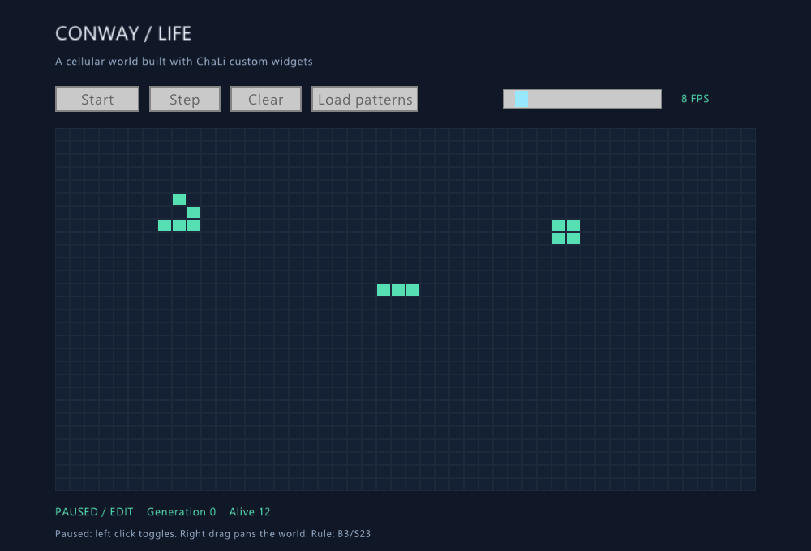
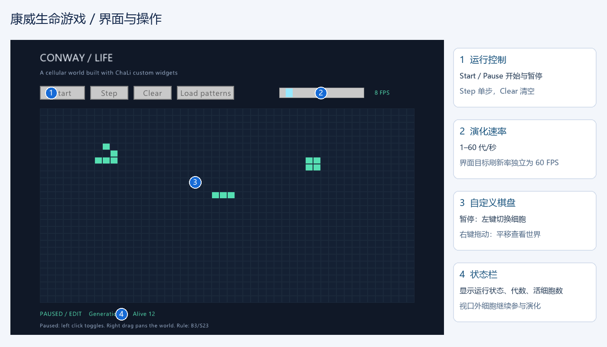
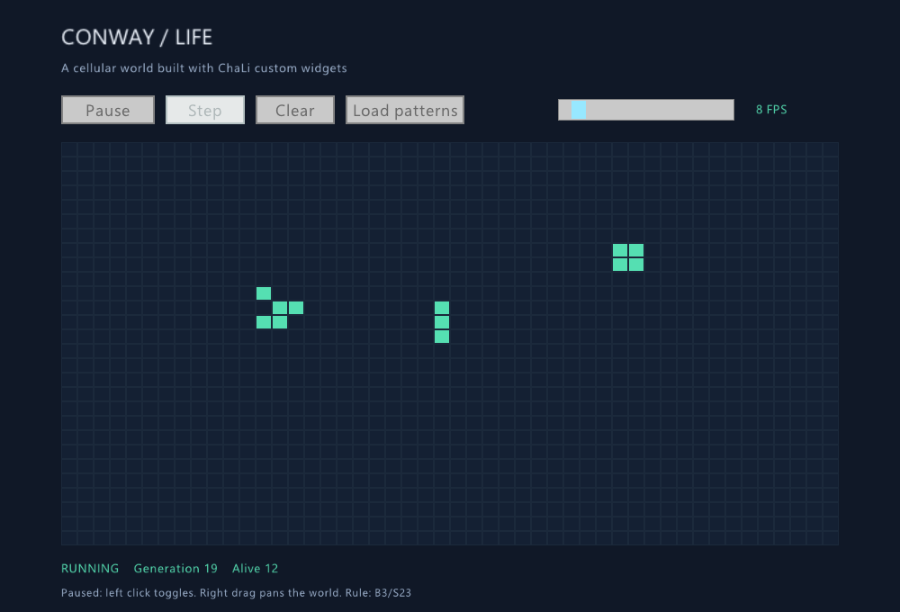
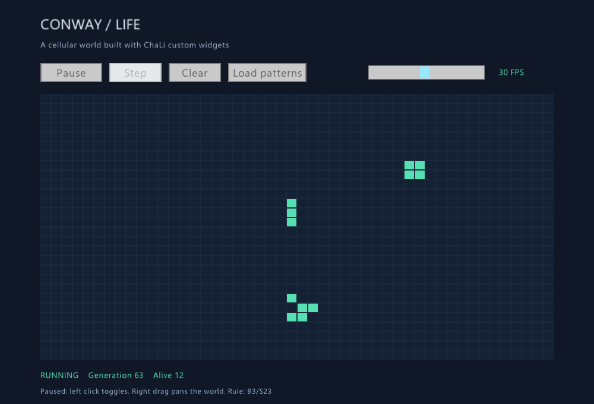
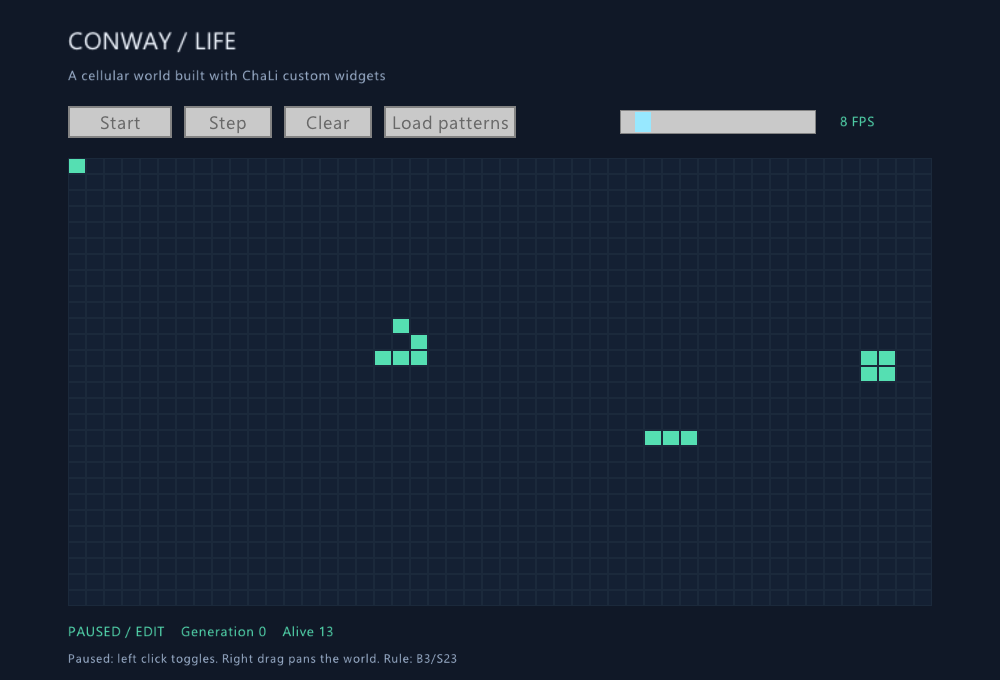

# 第 30 章 项目：康威生命游戏

<!-- LANGUAGE NAVIGATION -->
[English](en/30-standard-library-tour.md) · **简体中文**
<!-- END LANGUAGE NAVIGATION -->

这一章把集合、闭包和事件处理组合成一个桌面项目：康威生命游戏。我们用 `std::gui` 的基础按钮和滑块管理操作，用自定义控件绘制棋盘、处理点击和拖动。程序默认暂停，先布置细胞，再开始观察演化。

## 30.1 先看完成后的程序



上图来自实际程序的渲染帧。绿色方格代表活细胞。窗口只显示世界的一部分，移到窗口外的细胞仍保留并参与下一代计算。

| 操作 | 效果 |
| --- | --- |
| Start / Pause | 开始或暂停自动演化 |
| 暂停时左键单击 | 空格放置细胞；已有细胞则清除 |
| 按住右键拖动 | 平移棋盘；运行和暂停时都可使用 |
| Step | 暂停时只推进一代 |
| Clear | 暂停并清空全部细胞 |
| Load patterns | 暂停并重新装入示例图案 |
| FPS 滑块 | 设置每秒演化 1–60 代 |

FPS 在本项目中指模拟更新频率。窗口目标刷新率独立设为每秒 60 帧，因此即使选择每秒演化一代，也可以平滑拖动和及时点击暂停。低性能设备可能达不到目标频率。



## 30.2 准备并运行项目

使用带有 `std::gui` 原生归档的编译器；从源码构建时参照[可选宿主库](../45-optional-libraries.md)。项目源码是仓库中的 `example/desktop-gui/life.chl` 和 `life_model.chl`，放在同一目录。程序直接写 `import std::gui;`，无需配置库搜索路径。

```sh
chali run example/desktop-gui/life.chl
chali build example/desktop-gui/life.chl --out build/life
```

Windows 生成的 `build/life.exe` 含实际使用的 GUI 原生代码。把这个文件复制到另一目录即可运行；程序通过 Win32 创建窗口，不需要随附 GUI DLL。

## 30.3 规则与稀疏棋盘

每格有八个相邻格。死细胞恰有三个活邻居时出生；活细胞有两个或三个活邻居时存活，其余情况死亡，这就是 B3/S23。所有格子必须根据上一代同时更新，不能边读边写同一个棋盘。

棋盘使用 `int64` 世界坐标，允许负坐标，并不限于窗口显示的 48×28 个格子。`Map<String,int64>` 保存活细胞，用 `x:y` 作为无歧义键；两条坐标列表用于遍历。每一代只枚举活细胞的八个邻居，再创建下一代的列表和映射。孤立细胞没有候选邻居满足规则，自然消失。运行成本取决于活细胞及其邻域，而不是已拖动过的面积。坐标范围和可用内存仍是实际限制。

删除细胞时要同时更新映射和坐标列表，否则视觉上删除的细胞还可能在下一代产生邻居计数。下面是完整模型文件：

```chali
module life_model;
/**
 * @brief 稀疏棋盘，仅保存活细胞，视口外仍参与演化；坐标使用 int64。
 */
struct Board {
    int64 generation;
    List<int64> xs;
    List<int64> ys;
    Map<String, int64> live;
    /**
     * @brief 生成无歧义坐标键。
     * @param x 世界列。
     * @param y 世界行。
     * @return 坐标字符串。
     */
    String key(int64 x, int64 y) { return x.toString() + ":" + y.toString(); }
    /**
     * @brief 清空所有细胞并重置代数。
     */
    void reset() { self.xs.clear(); self.ys.clear(); self.live.clear(); self.generation = 0; }
    /**
     * @brief 查询世界坐标上的细胞。
     * @param x 世界列。
     * @param y 世界行。
     * @return 0 或 1。
     */
    int64 at(int64 x, int64 y) { return self.live.getOption(self.key(x, y)).unwrapOr(0); }
    /**
     * @brief 放置活细胞，已有细胞保持不变。
     * @param x 世界列。
     * @param y 世界行。
     */
    void place(int64 x, int64 y) {
        if (self.at(x, y) == 0) { self.live.put(self.key(x, y), 1); self.xs.push(x); self.ys.push(y); }
    }
    /**
     * @brief 切换指定细胞；删除时同步维护坐标表，避免幽灵邻居。
     * @param x 世界列。
     * @param y 世界行。
     */
    void toggle(int64 x, int64 y) {
        if (self.at(x, y) == 0) { self.place(x, y); return; }
        self.live.remove(self.key(x, y));
        List<int64> nx; List<int64> ny;
        for (int64 i in range(0, self.xs.len())) {
            if (self.xs[i] != x || self.ys[i] != y) { nx.push(self.xs[i]); ny.push(self.ys[i]); }
        }
        self.xs = nx; self.ys = ny;
    }
    /**
     * @brief 累计活细胞邻居，以双缓冲同时应用 B3/S23 规则。
     */
    void step() {
        Map<String, int64> counts; List<int64> cx; List<int64> cy;
        for (int64 i in range(0, self.xs.len())) {
            for (int64 dy in range(-1, 2)) {
                for (int64 dx in range(-1, 2)) {
                    if (dx != 0 || dy != 0) {
                        int64 x = self.xs[i] + dx; int64 y = self.ys[i] + dy;
                        String k = self.key(x, y); int64 n = counts.getOption(k).unwrapOr(0);
                        if (n == 0) { cx.push(x); cy.push(y); }
                        counts.put(k, n + 1);
                    }
                }
            }
        }
        List<int64> nx; List<int64> ny; Map<String, int64> next;
        for (int64 i in range(0, cx.len())) {
            String k = self.key(cx[i], cy[i]); int64 n = counts[k];
            if (n == 3 || (n == 2 && self.at(cx[i], cy[i]) == 1)) {
                nx.push(cx[i]); ny.push(cy[i]); next.put(k, 1);
            }
        }
        self.xs = nx; self.ys = ny; self.live = next; self.generation += 1;
    }
    /**
     * @brief 获取活细胞数量。
     * @return 当前活细胞数。
     */
    int64 population() { return self.xs.len(); }
    /**
     * @brief 装入滑翔机、闪烁器和静物。
     */
    void seed() {
        self.reset();
        self.place(8, 5); self.place(9, 6); self.place(7, 7); self.place(8, 7); self.place(9, 7);
        self.place(22, 12); self.place(23, 12); self.place(24, 12);
        self.place(34, 7); self.place(35, 7); self.place(34, 8); self.place(35, 8);
    }
};
```

## 30.4 自定义控件、坐标和鼠标捕获

棋盘由 `customWidget()` 创建。`onDraw` 接收屏幕上的矩形，绘制时加上平移量。`pointer.down`、`pointer.move` 和 `pointer.up` 事件携带的是控件局部坐标。点击位置先减去平移量，再除以格子宽高，得到世界坐标。

负数转换需要特别处理：浮点数强制转换为整数通常向零截断，世界坐标却需要向下取整。例如 -0.2 应命中 -1 列，代码在转换结果大于原值时再减一。

右键按下时记录指针位置，移动时累加差值，松开时结束拖动。自定义控件的鼠标捕获使指针移出绘制区域后仍能收到释放事件；失去焦点时也清除拖动状态，避免回来后棋盘继续跟随鼠标。窗口事件由 `run` 的事件回调转发给 `grid.handle(event)`。

## 30.5 完整窗口程序

按钮回调用 `fn mut` 修改运行状态和棋盘；普通绘制回调只读取状态。`frameTime()` 累计真实时间，达到一代的间隔后调用 `step()`。单帧最多追赶四代，超过时丢弃积压，避免窗口因追赶历史时间而失去响应。暂停和切换运行状态时不积累待补算时间。

```chali
import std::gui;
import life_model;

/**
 * @brief 康威生命游戏：暂停编辑，自定义棋盘绘制，独立演化速率。
 */
void main() {
    assert(openWindow(1000, 680, "ChaLi | Conway's Game of Life", 1));
    setTargetFps(60);
    setBackground((uint32)0x101827ff);
    bool font = loadFont("C:/Windows/Fonts/segoeui.ttf", (int32)24, "");
    if (!font) { loadFont("/usr/share/fonts/truetype/dejavu/DejaVuSans.ttf", (int32)24, ""); }
    Board board; board.seed();
    bool running = false; float64 elapsed = 0;
    float64 pan_x = 0; float64 pan_y = 0; bool dragging = false;
    float64 drag_x = 0; float64 drag_y = 0;
    let toggle = button("Start");
    let step = button("Step");
    let clear = button("Clear");
    let seed = button("Load patterns");
    let speed = slider(""); speed.setRange(1, 60); speed.setValue(8);
    let grid = customWidget();
    toggle.onClick(void fn mut(Event event) { running = !running; elapsed = 0; });
    step.onClick(void fn mut(Event event) { if (!running) { board.step(); } });
    clear.onClick(void fn mut(Event event) { running = false; elapsed = 0; board.reset(); });
    seed.onClick(void fn mut(Event event) { running = false; elapsed = 0; board.seed(); });
    grid.on("pointer.down", void fn mut(Event event) {
        if (event.code == 1) { dragging = true; drag_x = event.x; drag_y = event.y; }
        if (!running && event.code == 0) {
            float64 wx = (event.x - pan_x) / 18; float64 wy = (event.y - pan_y) / 16;
            int64 x = (int64)wx; int64 y = (int64)wy;
            if (wx < x) { x -= 1; } if (wy < y) { y -= 1; }
            board.toggle(x, y);
        }
    });
    grid.on("pointer.move", void fn mut(Event event) {
        if (dragging) { pan_x += event.x - drag_x; pan_y += event.y - drag_y; drag_x = event.x; drag_y = event.y; }
    });
    grid.on("pointer.up", void fn mut(Event event) { if (event.code == 1) { dragging = false; } });
    grid.on("focus.lost", void fn mut(Event event) { dragging = false; });
    grid.onDraw(void fn(Rect bounds) {
        drawRectangle(bounds, (uint32)0x1b293bff);
        int64 left = (int64)(-pan_x / 18) - 1; int64 top = (int64)(-pan_y / 16) - 1;
        for (int64 y in range(top, top + 31)) {
            for (int64 x in range(left, left + 51)) {
                uint32 color = (uint32)0x142033ff; if (board.at(x, y) == 1) { color = (uint32)0x55dfb2ff; }
                drawRectangle(Rect::at(bounds.x + pan_x + x * 18 + 1, bounds.y + pan_y + y * 16 + 1, 16, 14), color);
            }
        }
    });
    run(void fn mut() {
        int64 fps = (int64)speed.value();
        if (running) {
            elapsed += frameTime();
            int64 updates = 0;
            while (elapsed >= 1.0 / fps && updates < 4) { board.step(); elapsed -= 1.0 / fps; updates += 1; }
            if (updates == 4) { elapsed = 0; }
        }
        drawText("CONWAY / LIFE", Point::at(68, 24), 32, (uint32)0xf0f6ffff);
        drawText("A cellular world built with ChaLi custom widgets", Point::at(68, 66), 18, (uint32)0x9fb3cfff);
        if (running) { toggle.setText("Pause"); } else { toggle.setText("Start"); }
        toggle.draw(Rect::at(68, 106, 104, 32));
        step.setEnabled(!running); step.draw(Rect::at(184, 106, 88, 32));
        clear.draw(Rect::at(284, 106, 88, 32));
        seed.draw(Rect::at(384, 106, 132, 32));
        speed.draw(Rect::at(620, 110, 196, 24));
        drawText(fps.toString() + " FPS", Point::at(840, 112), 18, (uint32)0x55dfb2ff);
        grid.draw(Rect::at(68, 158, 864, 448));
        String state = "PAUSED / EDIT"; if (running) { state = "RUNNING"; }
        drawText(state + "    Generation " + board.generation.toString() + "    Alive " + board.population().toString(), Point::at(68, 622), 18, (uint32)0x55dfb2ff);
        drawText("Paused: left click toggles. Right drag pans the world. Rule: B3/S23", Point::at(68, 650), 16, (uint32)0x9fb3cfff);
    }, void fn mut(Event event) { grid.handle(event); });
    grid.close(); toggle.close(); step.close(); clear.close(); seed.close(); speed.close();
}
```

## 30.6 观察运行与调整速度



先点击 Start，观察状态栏从 PAUSED / EDIT 变为 RUNNING。闪烁器交替呈现横线和竖线，方块保持稳定，滑翔机每四代沿对角线移动一个格子。右键拖动只改变视角，不改变这些细胞的世界坐标。



暂停后可以再次布置或清除细胞。运行时左键不修改棋盘，避免一次绘制和下一代计算之间出现含混的编辑结果。也可以用 Step 对照每一代的变化。



## 30.7 验证项目

模型无需打开窗口即可测试。`tests/fixtures/desktop_life_model.chl` 检查负坐标、重复点击清除、孤立细胞死亡、方块稳定、闪烁器两代回到原状，以及滑翔机四代后的准确位置。GUI 验收脚本从本章真实示例生成隐藏窗口测试，注入本进程鼠标事件，检查放置、清除、右键平移和负坐标点击，并采集实际帧；测试钩子不进入常规 GUI 构建。

```sh
python tests/chali_desktop_life.py --compiler path/to/chali.exe --library path/to/testing/chali_desktop.dll
```

这里的 DLL 必须以 `CHALI_GUI_TESTING=ON` 构建。普通运行不需要测试构建。脚本分别验证 checked run 和 LLVM 构建，截图写入 `tmp/life-regression/`，书稿图片由验收后的截图更新。

下面的无窗口程序可单独核对闪烁器的周期：

<!-- verify-book -->
```chali
import life_model;

void main() {
    Board board; board.reset();
    board.place(-1, 0); board.place(0, 0); board.place(1, 0);
    board.step();
    assert(board.at(0, -1) == 1 && board.at(0, 1) == 1);
    board.step();
    assert(board.at(-1, 0) == 1 && board.at(1, 0) == 1);
    println("{} / {}", board.population(), board.generation);
}
```

```text
3 / 2
```

## 30.8 小结、习题与参考思路

这个项目把模型、视口和窗口事件分开。模型只关心世界坐标及 B3/S23；自定义控件负责显示和输入；基础按钮与滑块控制程序状态。

1. 增加一个回到原点的按钮，只重置平移量。它应该改变细胞坐标吗？
2. 暂停时支持拖动左键连续绘制，怎样避免同一格被反复切换？
3. 增加保存和载入功能，需要保存窗口外的细胞吗？
4. 增加缩放后，怎样让鼠标指向的世界位置保持不变？

参考思路：回到原点只修改视口；连续绘制记录本次拖动已访问的格子，或在按下时确定统一的绘制/清除模式；保存所有活细胞坐标及所需设置；缩放前后分别求鼠标对应的世界位置，再调整平移量补偿差值。
