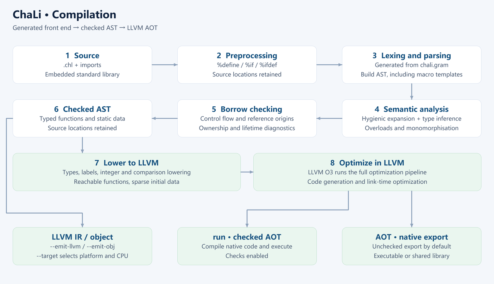

# Chapter 1 Your first program

<!-- LANGUAGE NAVIGATION -->
**English** · [简体中文](../01-第一个程序.md)
<!-- END LANGUAGE NAVIGATION -->

Start with one source file and distinguish checking, running locally and exporting an application. Later chapters develop score records, collection processing and text input into larger examples. Complete programs include output; fragments require their surrounding declarations.

## 1.1 Prepare the compiler and toolchain

Follow the [installation guide](../../en/39-installation-packages.md) for platform requirements. Commands use chali from PATH. A Windows source build has a versioned filename such as chali-1.0.11-llvm-external-windows-x64.exe; use its actual path. On Linux, an executable in the current directory is invoked as ./chali.

The external LLVM variant needs a configured toolchain. The embedded variant carries its corresponding compiler components. Compiler availability and supported export targets are separate checks.

## 1.2 A source file and its entry point

Save the program as hello.chl. An executable starts at void main. Braces delimit its body; println writes text and a newline. Punctuation inside a string is data, while the final semicolon terminates the statement.

<!-- verify-book -->
```chali
void main()
{
    println("Hello, ChaLi!");
}
```

```text
Hello, ChaLi!
```

## 1.3 Check and run

Run the commands below in the source directory. Check performs frontend analysis without executing the application. Run compiles checked native code and executes it on the host. Input, file access and application side effects occur during execution. When checking fails, address the first diagnostic before assessing later messages.

```sh
chali check hello.chl
chali run hello.chl
```

## 1.4 Compilation stages

The frontend parses declarations and expressions and checks types, borrowing, resources and control flow. Normal run/aot paths generate LLVM IR from the checked AST, then optimize, generate machine code and link. LLVM IR differs from ChaLi quadruples; neither needs manual editing for ordinary programs.

Chapter 24 covers export targets and application dependencies. VERSION identifies the compiler release. This book describes implemented behavior rather than planned syntax.



## 1.5 Reading and diagnosing

Complete examples execute from main, with supporting declarations before it. Interactive examples specify input. Rejection examples illustrate a diagnostic and are separate from successful programs. Use the [language reference](../../en/04-language-reference.md) for detailed syntax.

## 1.6 Exercises

1. Run hello.chl and inspect its newline.
2. Which command executes println?
3. Remove the semicolon and inspect the first diagnostic.
4. Distinguish compiler and application dependencies.

### Answers and checks

1. The output is one line: Hello, ChaLi!.
2. Run executes the program; check does not.
3. Restore it and check again; line numbers depend on the source.
4. LLVM supplies compilation tools; application libraries follow their linkage requirements.

Next: [Chapter 2](02-guessing-game.md).
