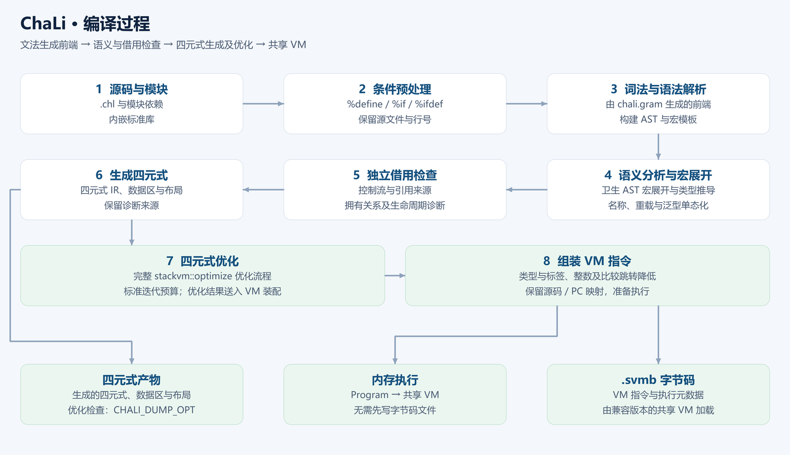
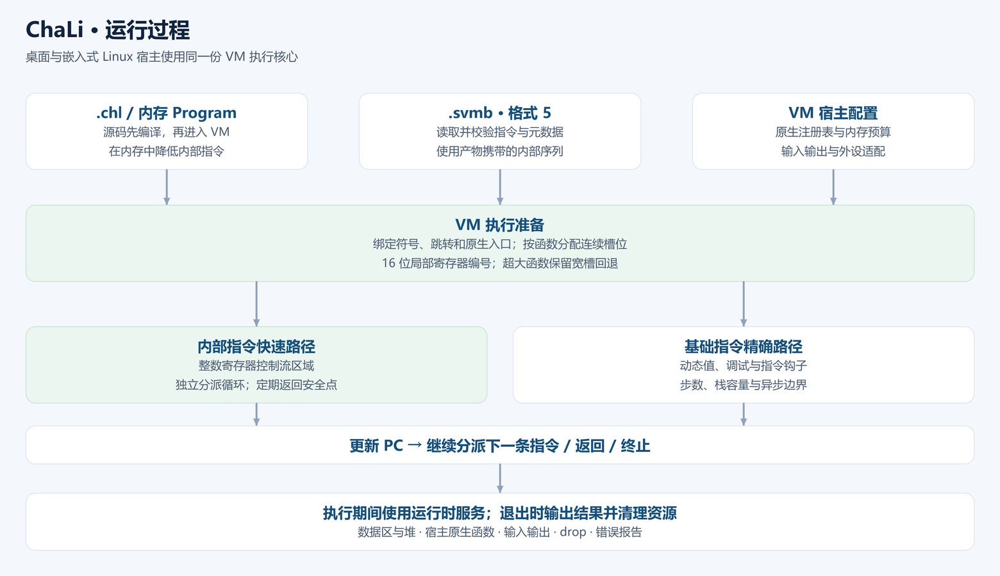

# Chapter 1 Your first program

<!-- LANGUAGE NAVIGATION -->
**English** · [简体中文](../01-第一个程序.md)
<!-- END LANGUAGE NAVIGATION -->

ChaLi compiles source into a quadruple intermediate representation and executes it through the shared VM. LLVM AOT can instead produce a native executable. Start with source execution so that diagnostics point directly to the program you are editing.

Install the MSI on Windows, DEB on Ubuntu/Debian or RPM on CentOS, then use the `chali` command on PATH. A Windows source build instead produces `chali-1.0.0-llvm-external-windows-x64.exe` (or `llvm-static`); invoke that actual path when using an uninstalled build. See [installation and architecture options](../../en/42-installation-packages.md).

Save this as `hello.chl`:

```chali
void main()
{
    println("Hello, ChaLi!");
}
```

Run `chali hello.chl`. `main` is the program entry point. Braces delimit its body, and a semicolon terminates the call. `println` writes a line. The format string stays part of the source; the compiler's display language only changes tool messages.





Use `chali --check hello.chl` to check a program without running it. A successful syntax check does not prove that every possible runtime input is valid: indexing, division and resource operations still have runtime checks.

Exercise: print two lines and then introduce a missing semicolon. Read the diagnostic location before correcting it. Continue with [a guessing game](02-guessing-game.md).
