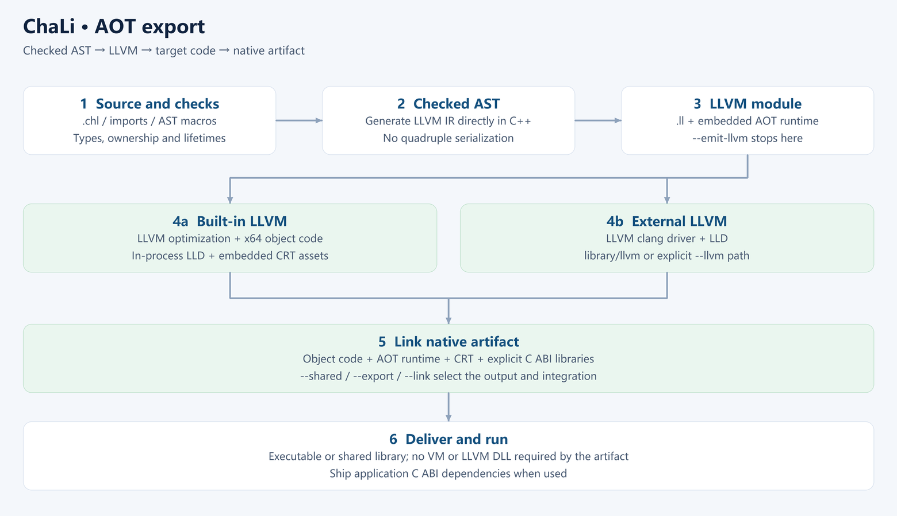

# Chapter 24 AOT export: delivering native artifacts

<!-- LANGUAGE NAVIGATION -->
**English** · [简体中文](../24-AOT导出.md)
<!-- END LANGUAGE NAVIGATION -->

AOT compiles a checked program into target machine code ahead of execution. Verify compilation tools, target link assets and application dependencies separately instead of checking only that a file exists.

## 24.1 Run and export settings

Run defaults to checked AOT for development; aot defaults to unchecked and LLVM O3. Unchecked defaults mainly affect runtime array and pointer checks and do not bypass static ownership or borrowing.

Use chali help and the [LLVM AOT reference](../../en/38-aot.md) for exact options. The emit and .svmb paths have been removed.



### From source to native execution

Separate the frontend, quadruple IR, LLVM IR and target artifacts. The frontend parses declarations and expressions and checks names, types, ownership and borrowing; macros expand during compilation. ChaLi quadruples express language operations, which the backend lowers to LLVM IR. LLVM performs optimization and target code generation. Linking combines objects with runtime components, system libraries and application dependencies.

Unqualified IR in this book means ChaLi quadruple IR; LLVM IR is named explicitly. Internal quadruple optimization passes and aggregate optimization have been removed, with optimization delegated to LLVM through O3/LTO. Historical descriptions of those passes do not describe current execution, and O3 does not promise equal gains for every program.

Run combines compilation and execution through checked AOT. It does not interpret quadruples in a VM. The current compiler and embedded assets contain no VM interpreter core, and .svmb export has been removed. A program validated with run still needs its export target, check settings and link configuration verified; the two commands have different defaults.

Checked execution helps detect the corresponding invalid accesses at runtime, while static checking rejects invalid programs before execution. Their coverage differs, and neither proves business inputs valid. Understand the actual switches before selecting unchecked and validate the release configuration itself rather than relying only on a development run.

## 24.2 Toolchain versus application dependencies

The embedded LLVM variant carries compilation components; the external variant uses an installed toolchain. Deliver applications according to their actual linkage. Compiler use of LLVM does not itself require an LLVM DLL beside the application.

C ABI libraries, database clients and runtime assets used by the application remain separate dependencies. Inspect the final artifact rather than inferring dependencies from the compiler variant.

## 24.3 Required cross-compilation information

Cross compilation needs a target triple, CPU/features, ABI, sysroot, linker, runtime libraries and startup assets. Store supported settings in toml using the exact keys and override rules in the [AOT reference](../../en/38-aot.md). Do not link host libraries into the target.

```toml
[aot]
target = "aarch64-unknown-linux-gnu"
cpu = "generic"
sysroot = "build/cross-sdk/linux-arm64/sysroot"
runtime_dir = "build/cross-sdk/linux-arm64/lib"
output = "executable"
```

```sh
chali aot app.chl --target linux-arm64 --emit-obj --out build/arm64/app
```

Paths are relative to chali.toml. Explicit command-line options override matching settings. The --emit-obj example generates an object without target linking.

An object file does not establish a deployable application. Validate object generation, target linking and device execution separately. Building a cross-architecture compiler does not automatically enable every AOT target.

## 24.4 Deployment checks and diagnostics

In a clean directory verify configuration, web assets, dynamic libraries, data-directory permissions and working directory. Begin with a harmless operation before real workflows. Native debugging uses DWARF and GDB/MI; retain symbols and diagnostics to identify the failing stage.

### Collect evidence by failure stage

Parsing or type-checking failures occur before a target program exists; follow source diagnostics first. If objects exist but linking fails, inspect ABI, library architecture, symbols and search paths. If linking succeeds but startup fails, inspect the operating-system loader, dynamic libraries, resource paths and permissions. Incorrect business results after startup require inputs, logs and native debugging. A file's existence only establishes that a step wrote it, not that later stages passed.

Native debugging uses DWARF information and GDB/MI. Source mappings help explain machine instructions, but optimization may inline functions, combine operations or make locals difficult to inspect. Keep the tested binary, matching source, build settings and symbols together. Do not apply another build's line mappings to the current artifact. See [native AOT debugging](../../en/43-native-debugging.md) for entry points and platform requirements.

Make acceptance reproducible: prepare dependencies on the target, enter the documented working directory, start the release artifact, perform a read, then an authorized write and verify its result. Database applications should also verify connection-failure and insufficient-permission diagnostics. Record host, target, compiler variant and completed steps. Generating a Linux object on Windows establishes object generation, not successful Linux deployment.

The shared runtime core requires C++17 and operating-system services. It targets desktop and supported embedded Linux hosts, without promising bare-metal support. A target triple does not replace system libraries, startup assets or real-device validation.

## 24.5 Exercises

1. Give one compiler dependency and one application dependency.
2. Does unchecked remove static borrow checking?
3. What remains after cross-target object generation?
4. Which resources accompany a deployed web service?

### Answers and checks

1. For example LLVM tools and a MySQL client library; inspect actual linkage.
2. No; runtime defaults and static rules are separate.
3. Target linking and execution in the target environment.
4. Web assets, configuration, external libraries and data setup, with paths checked against the working directory.

Next: [Chapter 25](25-student-system.md).
