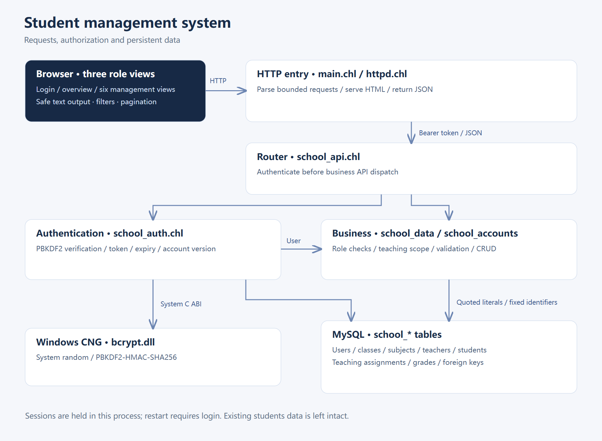

# Chapter 25 Student information management system

<!-- LANGUAGE NAVIGATION -->
**English** · [简体中文](../25-学生信息管理系统.md)
<!-- END LANGUAGE NAVIGATION -->

Bring types, borrows, errors and modules into one request: authenticate a user, determine access scope, read or change school data and display the outcome. Correct behavior also requires valid relations, explainable failures, successful startup and enforced authorization.

This chapter follows the repository's real student system: login, permissions, students, classes, grades, subjects and teachers. Administrator, teacher and student roles connect configuration, authentication, data relations, UI and delivery. Screenshots and historical acceptance describe their actual environment rather than universal platform validation.

## 25.1 Start with actions and data boundaries

Start with one observable action: a teacher signs in and corrects a grade for a class they teach. The application must identify the account, class/subject assignment, student relation and valid score. The page initiates the action while the backend checks those relationships.

Administrators manage accounts, reference data and assignments; teachers work within assigned scope; students read their own records. Establish these rules before arranging pages and routes instead of retrofitting authorization after building buttons.

| Area | Main actions | Boundary |
| --- | --- | --- |
| Login | Sign in, sign out, change password | Business APIs require authentication |
| Permissions | Roles, enabled status, teaching assignments | Administrator writes only |
| Students | ID, name, age, class and account link | Administrator writes; teachers read assigned classes; students read self |
| Classes | Code and name | Administrator writes; others read related classes |
| Grades | Student, subject, teacher, term and score | Teachers write assigned scope; students read self |
| Subjects | Code and name | Administrator writes; others read related subjects |
| Teachers | Staff number, name and account link | Administrator writes; others read related teachers |

The browser displays appropriate actions, but the backend enforces the boundary even for manually constructed HTTP requests.

## 25.2 Trace a request through the modules



The project lives in [example/students-server](../../../example/students-server/). main.chl connects the database and accepts TCP connections. httpd.chl reads bounded requests and returns HTML or JSON. school_api.chl dispatches routes; school_auth.chl verifies sessions; school_data.chl handles school records and teaching scope; school_accounts.chl handles accounts and passwords.

store.chl owns database connection configuration and api.chl provides responses and ID parsing. crypto.chl calls system C ABI for random bytes and password derivation. The frontend is web/index.html, with its styles and script served in the same page without an external CDN.

## 25.3 Configure and start the application

The verified environment is Windows x64, the external LLVM compiler, MySQL 8 and Edge. The authentication example binds C:/Windows/System32/bcrypt.dll directly. Adjust declarations for a different Windows installation; another operating system requires a corresponding authentication implementation. Changing a target triple alone does not establish application portability.

Copy config.example.json to an untracked local configuration and provide a database account permitted to use the test database. Keep real database passwords out of source control.

```json
{
  "host": "127.0.0.1",
  "user": "school_app",
  "password": "replace-with-local-secret",
  "database": "chali_school",
  "port": 3306
}
```

### Code walkthrough

Host and port identify the database server, serving a different purpose from the web listener's port 8787. User and password authenticate the application's MySQL connection; database selects its schema. These are not credentials for browser login to the student system.

The password is placeholder text for a local test configuration, not a secret to retain in the book or Git. JSON quotes delimit keys and string values, while port is numeric. Successful parsing only validates readable configuration; schema existence and account privileges still require a real connection.


Run from the repository root. The three application arguments are the port, web directory and database configuration:

```sh
chali run example/students-server/src/main.chl -- 8787 example/students-server/web example/students-server/config.local.json
```

### Code walkthrough

Chali run compiles and executes the project entry. The double dash separates compiler options from application arguments. The following three values specify the web port, static-page directory and MySQL configuration file in that order. Reordering them changes their interpretation.

These paths assume the documented repository-root working directory. Copying the command after changing into src would alter resolution. Observe database connection and initialization before opening the browser. Compilation success alone does not establish listening, readable assets or working authentication. The database's 3306 port is not the web entry.


Open http://127.0.0.1:8787. An empty database gets school_-prefixed tables and a randomly generated admin password printed once to the console. Existing accounts are not reset. No demonstration records are inserted, and an existing students table is neither migrated nor deleted.

## 25.4 Login, sessions and password updates


Login verifies PBKDF2-HMAC-SHA256 with a random per-account salt and 600000 iterations. Session tokens come from system random bytes and remain in server process memory and current page memory, not localStorage. Refreshing the page or restarting the service requires login again.

Requests send a Bearer token in Authorization. Sessions last 30 minutes; every request rechecks account status and version. Disabling an account or changing its role or password invalidates old sessions. Five failed passwords lock an account for 15 minutes. Persistent lockout uses the database wall clock; process-local session expiry uses a monotonic clock.

The example listens on local HTTP. Cross-machine deployment needs HTTPS and operational work appropriate to concurrency, account recovery and auditing. Password recovery, distributed sessions and background tasks are not implemented. See [Windows CNG](https://learn.microsoft.com/en-us/windows/win32/api/bcrypt/) and [OWASP password storage](https://cheatsheetseries.owasp.org/cheatsheets/Password_Storage_Cheat_Sheet.html).

## 25.5 Create reference data in dependency order

Create classes and subjects first, then accounts, teachers and students, and finally teaching assignments. An account role is distinct from a person’s name: a teacher user_id must link to a teacher account and a student link to a student account. Administrators may maintain person records without a login account.


Class codes, subject codes, student numbers, staff numbers and usernames are individually unique. Students reference classes; assignments reference teachers, classes and subjects; grades reference students, subjects and teachers. Foreign keys protect referenced records. Duplicate identifiers, invalid links and out-of-range grades return failures shown by the page.

## 25.6 Teaching assignments and grade writes


A teaching assignment combines teacher_id, class_id and subject_id. Grade writes verify an assignment for the student’s current class, selected subject and teacher, and verify that teacher belongs to the logged-in account. Knowing another grade ID does not grant access.


Grades are unique by student, subject and term, with scores from 0 to 100. PUT treats unchanged data as a valid update of an existing record rather than inferring absence from MySQL affected=0. Authorization follows current assignments while existing grades remain. A student can still resolve teachers and subjects referenced by their historical grades.

## 25.7 Student read-only and narrow-screen views


Student views have no create, edit or delete actions, and the backend rejects those writes too. Overview counts describe data visible to the current account: a student count of one means one accessible profile, not the school population.


Views share navigation, headers, statistics, filtering and pagination. Narrow screens use horizontal navigation and internal table scrolling without page overflow. Dialogs support keyboard focus, Escape and cancellation, with duplicate submission prevented while saving.

## 25.8 Input, SQL and browser output

The backend accepts fixed table and column names; paths cannot become arbitrary SQL identifiers. JSON fields receive separate text, integer or score validation, followed by length, range and relationship checks. The current MySQL interface uses Database.quote for text literals; SQLite parameter binding does not imply the same MySQL API exists.

The browser assigns user data through textContent rather than interpreting names as innerHTML. Filtering and pagination operate on loaded records. List queries allow at most 10000 records and return an error beyond that; cursor pagination for larger datasets is not implemented.

| Route | Method | Meaning |
| --- | --- | --- |
| /api/auth/login | POST | Sign in |
| /api/auth/me | GET | Current account |
| /api/auth/logout | POST | Revoke current token |
| /api/auth/password | POST | Verify old password and replace it |
| /api/accounts | GET/POST | Administrator lists or creates accounts |
| /api/accounts/id | PUT/DELETE | Update or delete an account |
| /api/students and other entity routes | GET/POST | Scoped list or create |
| /api/students/id and other entity routes | PUT/DELETE | Check data scope before update or delete |

Other entity routes are classes, grades, subjects, teachers and assignments. Error responses consistently contain an error field.

## 25.9 Export and acceptance

A native export still needs the web directory, database configuration and MySQL client dependencies. Process-local sessions are not part of a database backup; verify account links and foreign keys when backing up business data. Chapter 24 covers deployment and cross-compilation boundaries.

Acceptance uses an isolated temporary database for valid CRUD, duplicate and foreign-key rejection, role isolation, unauthorized teacher writes, session revocation and browser interactions. It closes the service and drops only that test database afterward. The entry points are [students_server.py](../../../tests/students_server.py) and [students_server_ui.py](../../../tests/students_server_ui.py).

Screenshots come from the real Windows x64 service, an isolated MySQL database and Edge. Names, classes and scores are acceptance data, and the shown roles and counts reflect actual access results.

### Summary

Follow a teacher's grade correction end to end: the browser submits a token and data, the server validates session/account state, checks fields and teaching scope, writes the database and returns an outcome for the page. Testing only buttons or only writes does not cover that chain.

Structures organize values, enums and Result express states, modules separate responsibilities, C ABI connects system capabilities and AOT defines delivery. Preserve these boundaries and add positive and negative acceptance cases when extending the application rather than generalizing local results to arbitrary deployment.

## 25.10 Exercises

1. Create a teacher, class and subject and assign teaching scope.
2. Try changing another class’s grade using a teacher token.
3. Reuse a student token after disabling the account.
4. Explain browser-memory loss, service restart and database backup.

### Answers and checks

1. Create records in dependency order and inspect the teacher’s visible scope.
2. The backend rejects it and preserves the target; hidden buttons alone are insufficient.
3. The old token is rejected because account status and version are rechecked.
4. Refresh loses the token, restart loses sessions, and database backups retain accounts and business records.
