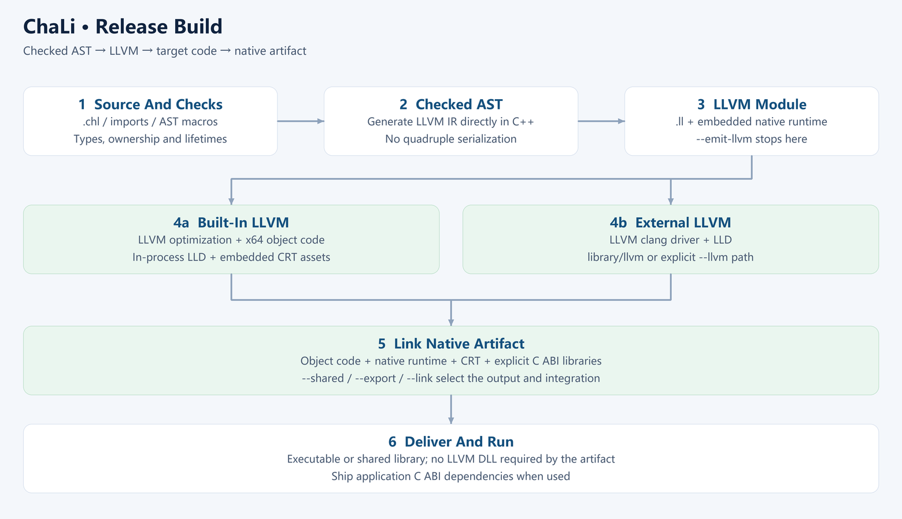

# Chapter 27 release build: delivering native artifacts

<!-- LANGUAGE NAVIGATION -->
**English** · [简体中文](../27-AOT导出.md)
<!-- END LANGUAGE NAVIGATION -->

Running a development example and delivering a deployable application require different evidence. LLVM generates target machine code, while target libraries, loaders, dynamic dependencies and resources still need to match. File creation alone is insufficient acceptance.

Begin with run/build defaults, follow the frontend and backend representations, then distinguish toolchain and application dependencies. Cross compilation, native debugging and staged deployment complete the workflow. State host, target and completed steps for each configuration.

## 27.1 Run and export settings

Distinguish immediate development execution from exporting a native artifact for a particular environment. `run` compiles a checked native program and executes it. `build` exports unchecked native artifacts with LLVM O3 by default.

The relevant unchecked defaults mainly affect runtime array and pointer checking; static types, ownership and borrowing remain. Include configuration when comparing executions rather than checking source identity alone.

Use chali help and the [LLVM build reference](../../en/38-build.md) for exact options.

Default run/build publishes final artifacts beside the source and uses the adjacent `.chali` directory for intermediates; Windows marks it hidden. Success or failure cleans the session workspace while preserving existing user files. Successful compilation and publication reports completion on standard error, then run launches the native program. `--quiet` or `CHALI_QUIET=1` suppresses only that notice. Explicit output, retention and incremental settings follow the [artifact reference](../../en/38-build.md).



### From source to native execution

Normal run and build execution generates LLVM IR directly from the semantically checked AST. The frontend parses declarations and expressions, expands macros and checks names, types, ownership and borrowing. The backend reads the checked tree and emits LLVM instructions and required runtime calls. LLVM performs optimization and target code generation. Linking combines objects with runtime components, system libraries and application dependencies.

Unqualified IR in this book means ChaLi quadruple IR; LLVM IR is named explicitly. Quadruple export and compatibility entry points for independent callers remain, but normal native compilation does not require generating quadruples, writing them to disk and reading them back. LLVM performs optimization through O3/LTO. Results depend on the program and configuration.

`run` compiles and executes programs through checked native compilation. A program validated with run still needs its export target, check settings and link configuration verified; the two commands have different defaults.

Checked execution helps detect the corresponding invalid accesses at runtime, while static checking rejects invalid programs before execution. Their coverage differs, and neither proves business inputs valid. Understand the actual switches before selecting unchecked and validate the release configuration itself rather than relying only on a development run.

### Persisting build settings in TOML

Extend the `[build]` table introduced in Chapter 11. This fragment targets Windows x64; other targets require matching runtime, SDK and linker inputs.

```toml
[build]
target = "windows-x64"
output = "executable"
lto = "full"
allocator = "malloc"
subsystem = "console"
build_option = ["A", "B"]
assembly_sources = []
assembly_includes = []
objects = []
libraries = []
search_paths = ["src"]
```

| Setting | Meaning and CLI precedence |
| --- | --- |
| target, cpu | Supported triple or alias and CPU tuning name; explicit --target and --cpu win |
| output | executable, llvm, object or assembly; explicit --emit-llvm, --emit-obj and --emit-asm win; run still compiles and executes |
| lto | true, false, full, thin or off; explicit LTO options win |
| allocator, subsystem | malloc/pool and Windows console/windows; explicit matching options win |
| sysroot, runtime_dir | Target SDK root and runtime directory; explicit matching options win |
| assembly_sources, assembly_includes | Assembly sources and include paths; an explicitly supplied CLI list replaces the corresponding manifest list |
| objects, libraries | Extra objects and libraries; an explicitly supplied CLI list replaces the corresponding manifest list |
| search_paths | Appends module and import lookup paths, resolved from the manifest directory |
| build_option | Boolean flag names, unioned with -B definitions and queried with $build[name] |

Bare library names without dots or path separators are resolved by the linker; other paths are relative to the manifest. CPU tuning does not change the target architecture reported by `$cpu`. `$system`, `$cpu` and `$build` become constants during macro expansion; see [Chapter 22](22-macros.md).

The static LLVM variant uses its embedded backend and rejects `--llvm` and `[build] llvm`. External toolchain paths are supported by the external variant. A manifest cannot switch a static compiler to an external backend. Consult the [LLVM build reference](../../en/38-build.md) for the complete interface and [Chapter 11](11-modules-projects.md) for entry and search rules.


## 27.2 Toolchain versus application dependencies

### Standard-library algorithms, C primitives and LLVM

Algorithms expressed in ChaLi are compiled with the importing program. For example, integer parsing in `std::parse` scans complete decimal input and checks range before accumulation; Boolean parsing compares `true` and `false`. These functions enter the LLVM backend with their caller and do not require interpreting their source at runtime.

<!-- verify-book -->
```chali
import std::parse;

void main() {
    match (Parse::parseInt64("-42")) {
        Ok(value) => { println("{}", value); }
        Err(error) => { println("{}", error.toString()); }
    }
}
```

```text
-42
```

The import makes the parsing module available. `parseInt64` returns `Result<int64, Error>`: the success branch prints its value, while the error branch obtains the reason through `Error`. This valid input prints -42. Empty, invalid and out-of-range input retain the corresponding `ParseError` under the same error protocol.

Floating-point text conversion keeps a thin C entry with the existing `strtod` format rules and combines its status into a language result. Public C boundaries use slots, byte lengths and opaque handles. An implementation file may use C++ internally without exposing those internal types as C ABI. Suitable scalar and memory operations can lower directly to LLVM instructions or intrinsics.

Files, networking and databases still require actual host services. LLVM optimizes and generates machine code; target operating systems and libraries perform IO. Primitive lowering preserves owned-value cleanup and the application's external library requirements.

### Deliver dependencies according to actual linkage

The embedded LLVM variant carries compilation components; the external variant uses an installed toolchain. Deliver applications according to their actual linkage. Compiler use of LLVM does not itself require an LLVM DLL beside the application.

C ABI libraries, database clients and runtime assets used by the application remain separate dependencies. Inspect the final artifact rather than inferring dependencies from the compiler variant.

### Build an application with a source module

Save the module as `modules/example/counter.chl`. The directory and file name follow the module name.

```chali
module example::counter;
struct Counter {
    int64 value;
    static Counter create(int64 initial) {
        self.value = initial;
        return self;
    }
    void add(int64 step) { self.value += step; }
    int64 read() { return self.value; }
}
void write(int64 mut& target, int64 value) { *target = value; }
```

Save the following program as `main.chl` in the directory that contains `modules`. Its mutable reference parameter updates the caller’s value.

```chali
import example::counter;
void main() {
    let counter = example::counter::Counter::create(40);
    counter.add(2);
    int64 result = 0;
    example::counter::write(&result, counter.read());
    println("{}", result);
}
```

```sh
mkdir -p build
chali run main.chl
chali build main.chl --lto-mode thin --checked --out build/counter
```

Running the source and launching the exported application give the same stdout.

```text
42
```

The exported program is `build/counter.exe` on Windows and `build/counter` on Linux. For existing native objects and archives, see the [toolchain reference](../../en/09-toolchain.md). The [library archive tools](../../en/44-library-packages.md) can package and inspect assets.

## 27.3 Required cross-compilation information

Cross compilation needs a target triple, CPU/features, ABI, sysroot, linker, runtime libraries and startup assets. Store supported settings in toml using the exact keys and override rules in the [LLVM build reference](../../en/38-build.md). Do not link host libraries into the target.

```toml
[build]
target = "aarch64-unknown-linux-gnu"
cpu = "generic"
sysroot = "build/cross-sdk/linux-arm64/sysroot"
runtime_dir = "build/cross-sdk/linux-arm64/lib"
output = "executable"
```

The [build] table groups export settings. Target selects ARM64 Linux GNU, and generic avoids tuning for a particular CPU. Sysroot identifies the target-system root, while runtime_dir identifies its runtime link assets; host Windows libraries cannot substitute for target libraries.

Output=executable records a desired artifact but does not download an SDK or supply missing libraries. Paths are relative to chali.toml, making that file's location part of reproducibility. An explicit object-output command overrides the corresponding setting, so inspect both configuration intent and actual invocation.


```sh
chali build app.chl --target linux-arm64 --emit-obj --out build/arm64/app
```

Aot reads app.chl, --target selects linux-arm64 and --out chooses the output location. Crucially, --emit-obj stops after object generation, before linking target runtime and startup assets into an executable.

This invocation can validate target code generation, but its ARM64 object cannot simply run on Windows and does not prove device execution. Follow it with matching target linking and target-system startup and business checks. Keep outputs separate from other architectures to avoid mixing objects.


Paths are relative to chali.toml. Explicit command-line options override matching settings. The --emit-obj example generates an object without target linking.

An object file does not establish a deployable application. Validate object generation, target linking and device execution separately. Building a cross-architecture compiler does not automatically enable every native target.

## 27.4 Deployment checks and diagnostics

In a clean directory verify configuration, web assets, dynamic libraries, data-directory permissions and working directory. Begin with a harmless operation before real workflows. Native debugging uses DWARF and GDB/MI; retain symbols and diagnostics to identify the failing stage.

### Collect evidence by failure stage

Parsing or type-checking failures occur before a target program exists; follow source diagnostics first. If objects exist but linking fails, inspect ABI, library architecture, symbols and search paths. If linking succeeds but startup fails, inspect the operating-system loader, dynamic libraries, resource paths and permissions. Incorrect business results after startup require inputs, logs and native debugging. A file's existence only establishes that a step wrote it, not that later stages passed.

Native debugging uses DWARF information and GDB/MI. Source mappings help explain machine instructions, but optimization may inline functions, combine operations or make locals difficult to inspect. Keep the tested binary, matching source, build settings and symbols together. Do not apply another build's line mappings to the current artifact. See [build debugging](../../en/43-native-debugging.md) for entry points and platform requirements.

Make acceptance reproducible: prepare dependencies on the target, enter the documented working directory, start the release artifact, perform a read, then an authorized write and verify its result. Database applications should also verify connection-failure and insufficient-permission diagnostics. Record host, target, compiler variant and completed steps. Generating a Linux object on Windows establishes object generation, not successful Linux deployment.

The shared runtime core requires C++17 and operating-system services. It targets desktop and supported embedded Linux hosts, without promising bare-metal support. A target triple does not replace system libraries, startup assets or real-device validation.

### Check an artifact with fixed input

Use a program with stable output to check behavior after native compilation and linking.

<!-- verify-book -->
```chali
int64 result() {
    return 6 * 7;
}
void main() {
    println("artifact={}", result());
}
```

```text
artifact=42
```

### Summary

Use run to observe checked native execution, then validate the actual build release configuration. Compiler LLVM components, application library dependencies and target startup are separate questions.

Retain commands, source/binary identities, target conditions and business outcomes. Report object generation, linking and execution with their respective evidence. Chapter 29 applies these requirements to a complete web/database application.

Next: [Chapter 28](28-http-file-server.md).
