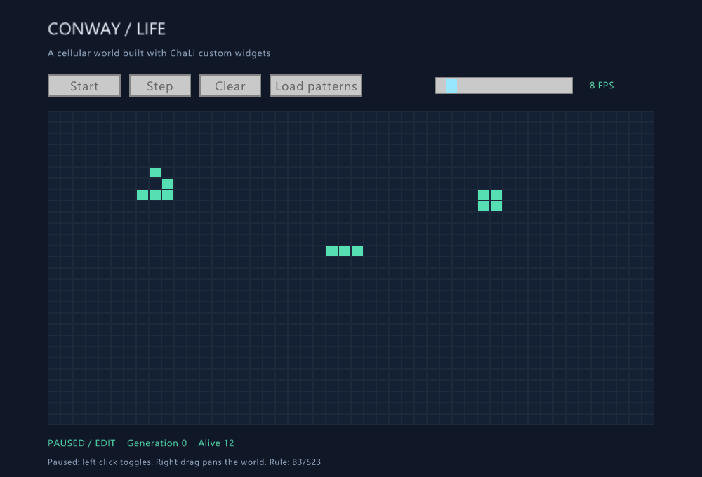
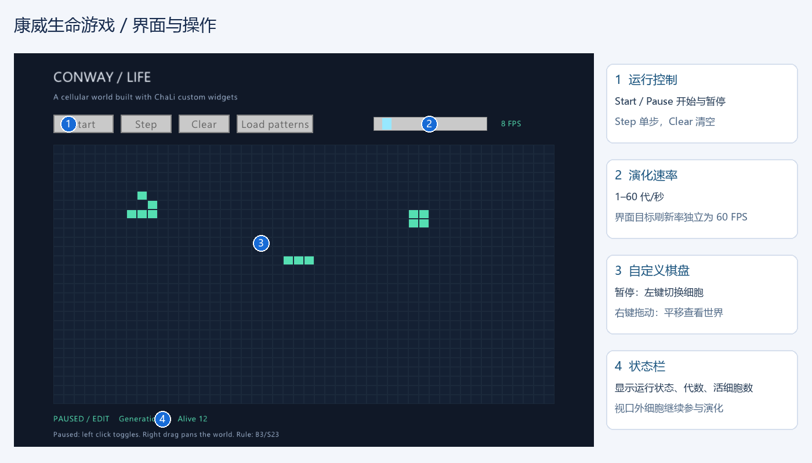
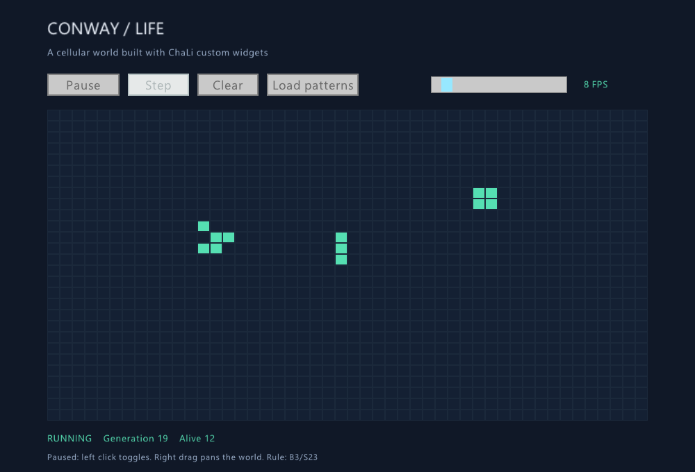
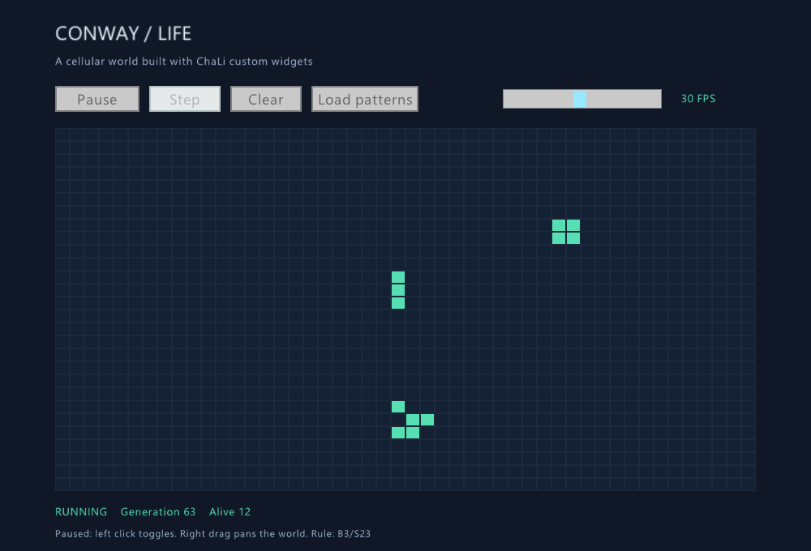
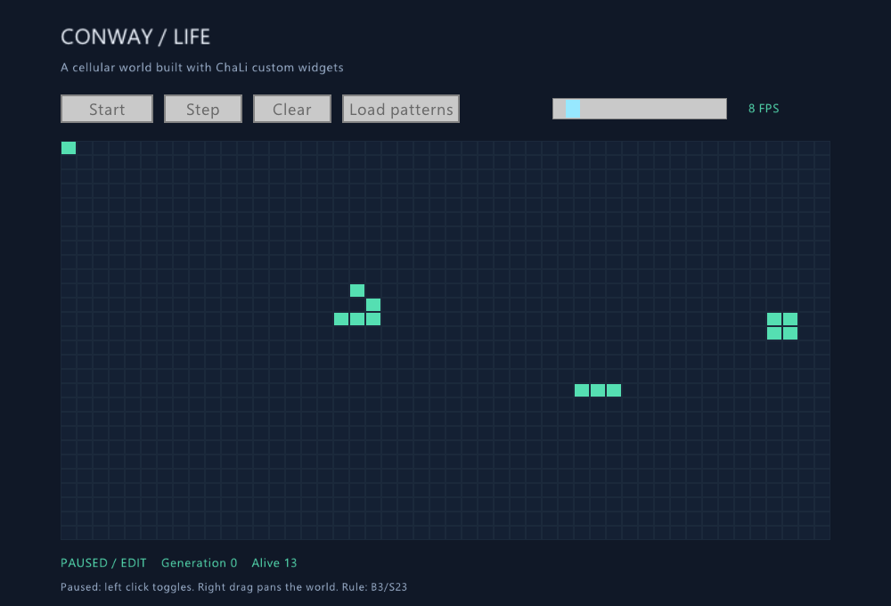

# Chapter 30 Project: Conway’s Game of Life

<!-- LANGUAGE NAVIGATION -->
**English** · [简体中文](../30-标准库初探.md)
<!-- END LANGUAGE NAVIGATION -->

Build a desktop application using `std::gui` buttons, a speed slider, and a custom board widget. The application starts paused. Green squares are live cells.

## 30.1 The finished application



| Action | Behavior |
| --- | --- |
| Start / Pause | Start or pause evolution |
| Left click while paused | Toggle a cell: place on an empty square, clear a live square |
| Hold right mouse button and drag | Pan the world while running or paused |
| Step | Advance one generation while paused |
| Clear | Pause and remove every cell |
| Load patterns | Pause and restore the example patterns |
| FPS slider | Choose 1–60 simulation generations per second |

The window targets 60 rendered frames per second independently of the simulation rate, keeping dragging and buttons responsive at slow simulation speeds. Actual performance depends on hardware and population.



## 30.2 Build and run

Use a compiler built with the `std::gui` native archive. See [Optional host libraries](../../45-optional-libraries.md) if building from source. Keep the two project files, `example/desktop-gui/life.chl` and `life_model.chl`, in the same directory. The program uses `import std::gui;` without a library search flag.

```sh
chali run example/desktop-gui/life.chl
chali aot example/desktop-gui/life.chl --out build/life
```

On Windows, `build/life.exe` includes the native GUI code it uses. Copy that file to another directory and run it. The application uses Win32 for its window and needs no accompanying GUI DLL.

## 30.3 Rules and a sparse world

A dead cell with exactly three live neighbors is born. A live cell survives with two or three live neighbors and dies otherwise: B3/S23. Every cell reads the previous generation, so updates must be simultaneous.

World coordinates use `int64`, including negative values. The world extends beyond the 48 by 28 cells visible in the initial viewport. A map keyed by the unambiguous string `x:y` stores membership, while two coordinate lists support iteration. Each update counts neighbors around live cells and builds new lists and a new map. Work depends on population and its neighborhood rather than the area visited by the camera. Coordinate range and available memory remain practical limits.

Deleting a cell must update both the membership map and coordinate lists to prevent ghost neighbor counts. The complete model follows.

```chali
module life_model;
/**
 * @brief 稀疏棋盘，仅保存活细胞，视口外仍参与演化；坐标使用 int64。
 */
struct Board {
    int64 generation;
    List<int64> xs;
    List<int64> ys;
    Map<String, int64> live;
    /**
     * @brief 生成无歧义坐标键。
     * @param x 世界列。
     * @param y 世界行。
     * @return 坐标字符串。
     */
    String key(int64 x, int64 y) { return x.toString() + ":" + y.toString(); }
    /**
     * @brief 清空所有细胞并重置代数。
     */
    void reset() { self.xs.clear(); self.ys.clear(); self.live.clear(); self.generation = 0; }
    /**
     * @brief 查询世界坐标上的细胞。
     * @param x 世界列。
     * @param y 世界行。
     * @return 0 或 1。
     */
    int64 at(int64 x, int64 y) { return self.live.getOption(self.key(x, y)).unwrapOr(0); }
    /**
     * @brief 放置活细胞，已有细胞保持不变。
     * @param x 世界列。
     * @param y 世界行。
     */
    void place(int64 x, int64 y) {
        if (self.at(x, y) == 0) { self.live.put(self.key(x, y), 1); self.xs.push(x); self.ys.push(y); }
    }
    /**
     * @brief 切换指定细胞；删除时同步维护坐标表，避免幽灵邻居。
     * @param x 世界列。
     * @param y 世界行。
     */
    void toggle(int64 x, int64 y) {
        if (self.at(x, y) == 0) { self.place(x, y); return; }
        self.live.remove(self.key(x, y));
        List<int64> nx; List<int64> ny;
        for (int64 i in range(0, self.xs.len())) {
            if (self.xs[i] != x || self.ys[i] != y) { nx.push(self.xs[i]); ny.push(self.ys[i]); }
        }
        self.xs = nx; self.ys = ny;
    }
    /**
     * @brief 累计活细胞邻居，以双缓冲同时应用 B3/S23 规则。
     */
    void step() {
        Map<String, int64> counts; List<int64> cx; List<int64> cy;
        for (int64 i in range(0, self.xs.len())) {
            for (int64 dy in range(-1, 2)) {
                for (int64 dx in range(-1, 2)) {
                    if (dx != 0 || dy != 0) {
                        int64 x = self.xs[i] + dx; int64 y = self.ys[i] + dy;
                        String k = self.key(x, y); int64 n = counts.getOption(k).unwrapOr(0);
                        if (n == 0) { cx.push(x); cy.push(y); }
                        counts.put(k, n + 1);
                    }
                }
            }
        }
        List<int64> nx; List<int64> ny; Map<String, int64> next;
        for (int64 i in range(0, cx.len())) {
            String k = self.key(cx[i], cy[i]); int64 n = counts[k];
            if (n == 3 || (n == 2 && self.at(cx[i], cy[i]) == 1)) {
                nx.push(cx[i]); ny.push(cy[i]); next.put(k, 1);
            }
        }
        self.xs = nx; self.ys = ny; self.live = next; self.generation += 1;
    }
    /**
     * @brief 获取活细胞数量。
     * @return 当前活细胞数。
     */
    int64 population() { return self.xs.len(); }
    /**
     * @brief 装入滑翔机、闪烁器和静物。
     */
    void seed() {
        self.reset();
        self.place(8, 5); self.place(9, 6); self.place(7, 7); self.place(8, 7); self.place(9, 7);
        self.place(22, 12); self.place(23, 12); self.place(24, 12);
        self.place(34, 7); self.place(35, 7); self.place(34, 8); self.place(35, 8);
    }
};
```

## 30.4 Custom drawing and input

Create the board with `customWidget()`. The drawing callback receives screen bounds. Add the viewport offset to world coordinates when drawing. Pointer callbacks receive widget-local coordinates: subtract the offset and divide by cell dimensions when selecting a cell.

Integer casts truncate toward zero. Correct negative fractional positions by subtracting one when the cast result is greater than the original value, producing floor behavior.

Right-button dragging accumulates pointer deltas. Pointer capture delivers releases even outside the board; losing focus also cancels dragging. Forward window events to `grid.handle(event)` in the event callback passed to `run`.

## 30.5 The complete window program

Mutable callbacks update the model and running state. Accumulate `frameTime()` and advance when a simulation interval has elapsed. Limit catch-up to four generations per frame, dropping excess accumulated time to preserve responsiveness. Pausing does not accumulate simulation debt.

```chali
import std::gui;
import life_model;

/**
 * @brief 康威生命游戏：暂停编辑，自定义棋盘绘制，独立演化速率。
 */
void main() {
    assert(std::gui::openWindow(1000, 680, "ChaLi | Conway's Game of Life", 1));
    std::gui::setTargetFps(60);
    std::gui::setBackground((uint32)0x101827ff);
    bool font = std::gui::loadFont("C:/Windows/Fonts/segoeui.ttf", (int32)24, "");
    if (!font) { std::gui::loadFont("/usr/share/fonts/truetype/dejavu/DejaVuSans.ttf", (int32)24, ""); }
    life_model::Board board; board.seed();
    bool running = false; float64 elapsed = 0;
    float64 pan_x = 0; float64 pan_y = 0; bool dragging = false;
    float64 drag_x = 0; float64 drag_y = 0;
    let toggle = std::gui::button("Start");
    let step = std::gui::button("Step");
    let clear = std::gui::button("Clear");
    let seed = std::gui::button("Load patterns");
    let speed = std::gui::slider(""); speed.setRange(1, 60); speed.setValue(8);
    let grid = std::gui::customWidget();
    toggle.onClick(void fn mut(std::gui::Event event) { running = !running; elapsed = 0; });
    step.onClick(void fn mut(std::gui::Event event) { if (!running) { board.step(); } });
    clear.onClick(void fn mut(std::gui::Event event) { running = false; elapsed = 0; board.reset(); });
    seed.onClick(void fn mut(std::gui::Event event) { running = false; elapsed = 0; board.seed(); });
    grid.on("pointer.down", void fn mut(std::gui::Event event) {
        if (event.code == 1) { dragging = true; drag_x = event.x; drag_y = event.y; }
        if (!running && event.code == 0) {
            float64 wx = (event.x - pan_x) / 18; float64 wy = (event.y - pan_y) / 16;
            int64 x = (int64)wx; int64 y = (int64)wy;
            if (wx < x) { x -= 1; } if (wy < y) { y -= 1; }
            board.toggle(x, y);
        }
    });
    grid.on("pointer.move", void fn mut(std::gui::Event event) {
        if (dragging) { pan_x += event.x - drag_x; pan_y += event.y - drag_y; drag_x = event.x; drag_y = event.y; }
    });
    grid.on("pointer.up", void fn mut(std::gui::Event event) { if (event.code == 1) { dragging = false; } });
    grid.on("focus.lost", void fn mut(std::gui::Event event) { dragging = false; });
    grid.onDraw(void fn(std::gui::Rect bounds) {
        std::gui::drawRectangle(bounds, (uint32)0x1b293bff);
        int64 left = (int64)(-pan_x / 18) - 1; int64 top = (int64)(-pan_y / 16) - 1;
        for (int64 y in range(top, top + 31)) {
            for (int64 x in range(left, left + 51)) {
                uint32 color = (uint32)0x142033ff; if (board.at(x, y) == 1) { color = (uint32)0x55dfb2ff; }
                std::gui::drawRectangle(std::gui::Rect::at(bounds.x + pan_x + x * 18 + 1, bounds.y + pan_y + y * 16 + 1, 16, 14), color);
            }
        }
    });
    std::gui::run(void fn mut() {
        int64 fps = (int64)speed.value();
        if (running) {
            elapsed += std::gui::frameTime();
            int64 updates = 0;
            while (elapsed >= 1.0 / fps && updates < 4) { board.step(); elapsed -= 1.0 / fps; updates += 1; }
            if (updates == 4) { elapsed = 0; }
        }
        std::gui::drawText("CONWAY / LIFE", std::gui::Point::at(68, 24), 32, (uint32)0xf0f6ffff);
        std::gui::drawText("A cellular world built with ChaLi custom widgets", std::gui::Point::at(68, 66), 18, (uint32)0x9fb3cfff);
        if (running) { toggle.setText("Pause"); } else { toggle.setText("Start"); }
        toggle.draw(std::gui::Rect::at(68, 106, 104, 32));
        step.setEnabled(!running); step.draw(std::gui::Rect::at(184, 106, 88, 32));
        clear.draw(std::gui::Rect::at(284, 106, 88, 32));
        seed.draw(std::gui::Rect::at(384, 106, 132, 32));
        speed.draw(std::gui::Rect::at(620, 110, 196, 24));
        std::gui::drawText(fps.toString() + " FPS", std::gui::Point::at(840, 112), 18, (uint32)0x55dfb2ff);
        grid.draw(std::gui::Rect::at(68, 158, 864, 448));
        String state = "PAUSED / EDIT"; if (running) { state = "RUNNING"; }
        std::gui::drawText(state + "    Generation " + board.generation.toString() + "    Alive " + board.population().toString(), std::gui::Point::at(68, 622), 18, (uint32)0x55dfb2ff);
        std::gui::drawText("Paused: left click toggles. Right drag pans the world. Rule: B3/S23", std::gui::Point::at(68, 650), 16, (uint32)0x9fb3cfff);
    }, void fn mut(std::gui::Event event) { grid.handle(event); });
    grid.close(); toggle.close(); step.close(); clear.close(); seed.close(); speed.close();
}
```

## 30.6 Observe evolution and speed



The blinker alternates between horizontal and vertical lines, the block stays stable, and the glider travels diagonally by one cell every four generations. Panning changes the viewport without changing world coordinates.



Left clicks edit only while paused. Use Step to inspect individual generations.



## 30.7 Verify the application

The headless model fixture checks negative coordinates, toggling, isolated-cell death, a stable block, a two-generation oscillator, and exact glider positions after four generations. The GUI test derives a hidden-window harness from the real example, injects process-local mouse events, and verifies placement, removal, panning, and negative-coordinate selection. It captures actual rendered frames without moving the system pointer.

```sh
python tests/chali_desktop_life.py --compiler path/to/chali.exe --library path/to/testing/chali_desktop.dll
```

Use a GUI library built with `CHALI_GUI_TESTING=ON` for this test. Normal applications do not require test hooks. The script checks both checked run and AOT and writes screenshots to `tmp/life-regression/`.

This headless program verifies the blinker period:

<!-- verify-book -->
```chali
import life_model;

void main() {
    life_model::Board board; board.reset();
    board.place(-1, 0); board.place(0, 0); board.place(1, 0);
    board.step();
    assert(board.at(0, -1) == 1 && board.at(0, 1) == 1);
    board.step();
    assert(board.at(-1, 0) == 1 && board.at(1, 0) == 1);
    println("{} / {}", board.population(), board.generation);
}
```

```text
3 / 2
```

## 30.8 Review and exercises

The model owns world coordinates and B3/S23 rules. The custom widget owns drawing and input. Basic controls manage application state.

1. Add a home-view button. Should it change cell coordinates?
2. Support continuous left-button painting without repeatedly toggling the same square.
3. Save and load the world, including cells outside the viewport.
4. Add zoom while preserving the world location beneath the pointer.

Suggested approaches: reset only the viewport offset; track visited cells during a drag or select one painting mode on press; serialize every live coordinate; compensate the viewport offset after changing scale.
